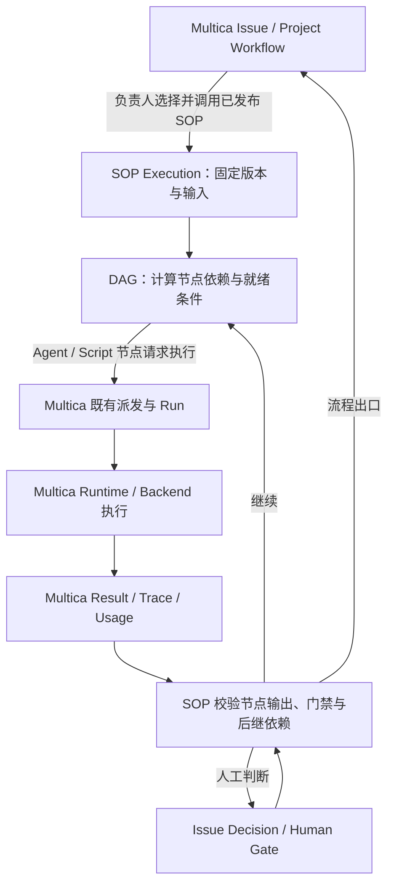

# 专题二：SOP 与研发工作流融合

版本：V1.0 · Multica 基座治理修订 · 2026-11-15

本专题以 [架构治理基线](governance-baseline.md) 为准。保留 LoopForge SOP / DAG 机制研究和既有实验，但将 SOP 明确定位为**附着在 Multica Issue 工作中的流程能力**，不再把它设计成第二套工作、派发和执行控制平台。

研究证据：[三库源码与测试](../research/02-source-evidence.md) · [状态模型原型](../research/topic-02/prototype-validation.md)。

## 1. 职责分工

| 需要回答的问题 | 唯一责任主体 | SOP 的作用 |
|---|---|---|
| 要做什么、谁负责、范围是否变化 | Multica Issue 的授权成员、当前负责人或主责 Squad | 读取工作约定，不自行决定业务范围 |
| Issue 当前处于什么状态、由谁接手 | Multica status / Project Workflow / 既有交接机制 | 提供流程建议或结构化出口，不另建状态机 |
| 专业工作有哪些步骤、依赖和验收条件 | 被调用的 SOP 定义 | 维护 DAG、节点输入输出、门禁、重试和返工逻辑 |
| 谁真正执行 Agent / Script | Multica 现有派发、Run、Runtime 和 Backend | 在节点就绪时请求既有执行入口 |
| 谁作人工放行或最终接受 | Multica Issue 上有权的成员 | 产生 Human Gate 请求并引用真实 Decision |
| 实际执行结果和费用在哪里 | Multica Run / Result / Task Usage | 将节点与已有 Run、制品和用量建立引用 |

核心原则：**SOP 可以决定“流程中的哪个节点已就绪”，但不能绕过 Multica 决定“谁有权派发、在哪个 Runtime 执行、Run 如何结束或 Issue 是否完成”。**

## 2. SOP 的定位与组成

SOP 是可复用、可版本化、可组合的研发工作方法。它可以覆盖完整交付，也可以只承担一个独立环节；是否调用由 Issue 当前负责人或明确主责 Squad 决定。

一个 SOP 定义可包含：

- 输入与前置条件；
- DAG 节点及依赖；
- Agent、Script、Human Gate 或 Sub-SOP 节点；
- 节点的输入、输出和 Artifact Contract；
- 质量门禁、重试边界、定向返工路径；
- 预算建议、超限处置和人工升级条件；
- 完成时应返回给 Issue / Project Workflow 的结构化结果。

SOP 定义和 SOP 执行进度属于流程域数据；Issue、Run、Runtime、权限和最终验收仍归 Multica。

## 3. 一次 SOP 如何运行

运行规则：

1. 调用时固定 SOP 发布版本、Issue 工作约定、必要输入和适用范围。
2. DAG 只计算流程内部依赖。节点就绪后，通过 Multica 现有 Run 创建 / 派发路径启动实际执行。
3. 每次实际执行都使用 Multica Run。SOP 只保存该 Run 与节点、尝试、输入和输出的关联。
4. 节点完成后，SOP 检查输出契约和后继条件；不直接修改 Issue 状态。
5. SOP 到达出口时，把结构化结果交回 Issue / Project Workflow 现有路径，由其检查当前状态、负责人和权限后推进。
6. 人工门禁引用 Issue 上的实际决定；没有明确答复就保持等待，不把模型推断当作批准。

## 4. 节点、尝试和 Run 的关系

这三个概念必须分开：

- **SOP Node**：流程定义中的一个步骤，不是独立业务工作对象。
- **Node Attempt（可选流程附属记录）**：某个节点在固定输入和 SOP 版本下的一次履行。仅当重试、返工、并行尝试或迟到结果确实需要区分时才引入。
- **Multica Run**：真实 Agent / Script 执行。一次 Node Attempt 可以关联多个 Run；一个 Run 不因被 SOP 引用而复制。

不为每个 SOP 节点机械创建 Issue / Sub-Issue。只有节点本身需要独立负责人、独立状态、跨人交付和长期跟踪时，才使用 Multica Sub-Issue。短暂步骤直接关联现有 Issue 与 Run。

## 5. 重试、返工和并行

| 场景 | SOP 负责 | Multica 负责 |
|---|---|---|
| 节点内修正 | 判断是否仍在本节点目标、输入和授权范围内；记录修正与复验结果 | 为重新启动的实际执行提供新的 Run 或既有受管执行延续 |
| 执行失败重试 | 判断是否允许重试、是否超预算、是否需人工介入 | Run 终态、派发重试、Runtime 选择、执行回执 |
| 上游缺陷导致返工 | 沿 DAG 找出受影响节点，声明返工目标与必需重验范围 | Issue 负责人和现有工作机制确认责任交接；新执行沿 Multica Run 发生 |
| 并行节点 | 根据 DAG 依赖计算可并行节点 | 使用 Multica 现有 Agent / Runtime 容量、队列和资源互斥 |
| 迟到结果 | 判断该结果属于哪个 SOP 版本、节点和输入轮次，是否仍可消费 | 依据原 Run / 派发身份接收回报，保留终态事实，不让迟到结果改写新 Run |
| 外部副作用不确定 | 暂停依赖该副作用的节点并要求对账 | 由 Issue 当前负责人和实际执行回执决定续跑、补偿或人工处置 |

## 6. Delegation Grant 与 Dispatch Control Binding 的治理结论

V0.3 曾设计 Delegation Grant 和 Dispatch Control Binding，目的是防止 Leader、Project Workflow、SOP 同时派发同一工作。但这两个概念目前**不作为既定架构对象进入实现**。

在新增它们之前，必须先验证：

1. Multica 当前 Issue 负责人、Squad 主责、Project Workflow、派发和 Runtime 授权是否已经提供所需控制。
2. 哪个真实并发场景无法由现有授权和幂等机制处理。
3. 是否能通过在既有 Issue / Run 上增加最少的 SOP 引用、调用来源或版本字段解决。
4. 是否确实需要新的授权对象或控制绑定；若需要，必须证明它不会形成第二个派发权威。

在完成上述验证前：
- 不创建独立 Grant 服务；
- 不创建平行 Dispatch Controller；
- 不允许 SOP 直接绕过 Multica 派发；
- 保留 V0.3 原型作为设计假设测试，不视为生产架构要求。

## 7. Script 与 Artifact Contract

Script 是 SOP 可调用的一类执行步骤，不是第二种 Run 系统。

- Script 通过 Multica 受管执行入口运行，复用其 Runtime、工作目录、授权和进程管理。
- SOP 固定预期脚本版本、输入和输出契约。
- Multica 回报实际退出、运行环境和具名制品；独立验证器检查内容正确性。
- 退出码 0 只说明进程成功结束，不等于业务验收通过。
- XLSX、报告等制品沿用 Multica 已有附件 / Artifact 通道；SOP 记录制品引用和校验结论，不再建立独立文件存储。

## 8. 版本、门禁与交接

SOP 发布后形成不可变版本。新实例选择新版本；在途实例继续引用原版本。若业务决定变化，Issue 先更新工作约定，流程负责人识别受影响节点，明确哪些输入、产物和验证结果仍有效。

SOP 出口只返回结构化结果，例如：
- 本 SOP / 版本 / 执行实例；
- 完成、失败、等待或需人工决定；
- 关键节点结果及其 Multica Run 引用；
- 必需制品与摘要；
- 未完成项、风险、预算消耗和建议下一步。

出口幂等应优先使用 Multica 现有交接请求、Run / Result 身份和写入机制。只有实测证明现有机制无法区分重复出口、旧版本回报或并发冲突时，才增加最小的 SOP Result ID 等附属标识。

## 9. 验证计划与保留的既有成果

既有 [17 项状态模型测试](../research/topic-02/prototype-validation.md)继续保留，用于验证 SOP 依赖、重试和出口语义；它们不证明必须建设独立 Grant / Binding 控制平面。

后续集成验收按以下顺序：

1. **最短调用链**：从一个 Multica Issue 调用一个两节点 SOP；两个节点分别通过现有 Multica Run 执行，确认没有第二套派发或 Run。
2. **并行与容量**：两个 DAG 节点同时就绪，由 Multica 既有队列和 Runtime 容量控制实际执行。
3. **失败与返工**：验证节点失败、节点内修正、上游返工和迟到结果，确认旧 Run 不被覆盖。
4. **人工门禁**：SOP 请求 Issue 上的明确决定；拒绝、批准和超时分别验证。
5. **撤权与恢复**：撤销成员或 Runtime 权限，确认 SOP 不绕过底座；Daemon 重启后沿 Multica Run 和 SOP 引用恢复。
6. **新增控制对象门槛**：只有前述测试出现 Multica 原生机制无法解决的具体失败，才设计最小扩展。

订单导出案例、LoopForge / TeamAI / Multica 源码研究及原型结果均保留在研究文档中。它们是融合设计的证据，不意味着复制上游完整内部架构。
