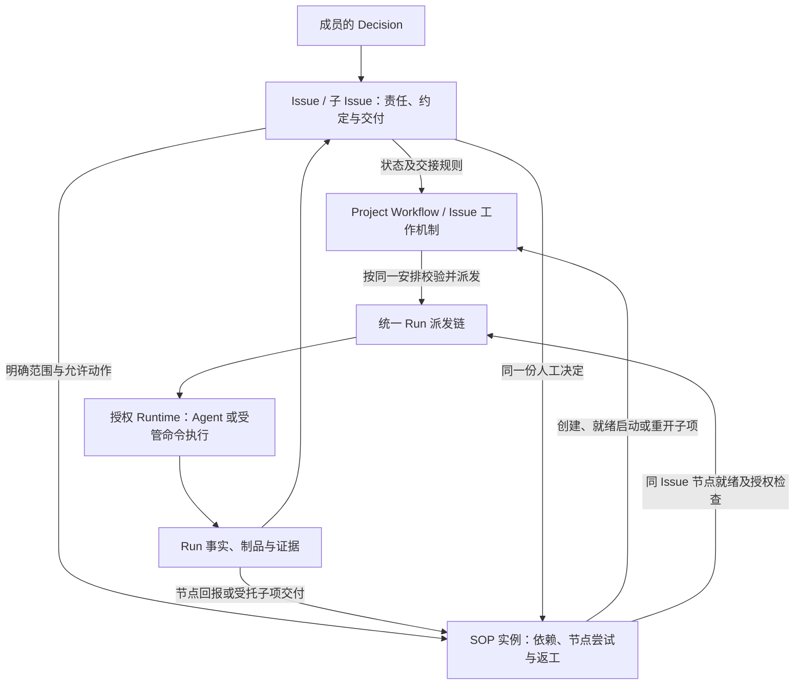
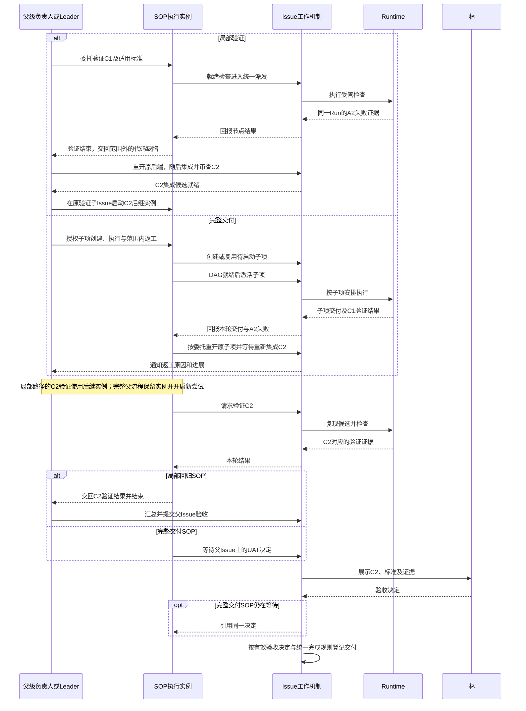

# 专题二 · SOP 与研发工作流融合

V0.2 设计评审稿 · 2026-11-14。沿用[专题一的工作对象和订单导出案例](01-unified-work-lifecycle.md)。本版补齐子项委托全周期、节点内自修正、执行与费用关联、Script 主体和代码交接。三个上游的版本、实现路径、测试和反例见[源码研究记录](../research/02-source-evidence.md)。

## 1. 谁决定下一步

一次交付可能有两种“下一步”。验证程序读完 XLSX 后，可以立刻检查行数。后端发现原定的权限规则遗漏一个用户类型，则要由工作负责人决定是否修改范围。前一个决定交给 SOP，后一个留在 Issue。混用两种决定，会让验证器分派后端工作，也会让 Leader 在脚本准备重试时再派一遍。

| 决定 | 作决定的人或机制 | 结果落点 |
|---|---|---|
| 要达成什么、谁负责、是否接收交付 | Issue 的授权成员、当前负责人及项目规定的验收人 | Issue 的约定、负责人、Decision 和交付记录 |
| 变更业务状态时如何交接 | Project Workflow 在现有 Issue 写入路径上校验交接。只有明确以 Squad 为主责的事项才启动自动协调 | 原 Issue 上的一次状态或负责人变化 |
| 陌生问题如何查、由谁分工 | Human、单个 Agent，或主责 Squad 的 Leader。Playbook 提供可选方法 | 同 Issue 委派；有独立负责人、跟踪和交付要求时建立子 Issue |
| 已交给某个 SOP 的工作，哪些步骤现在可以执行 | 一个 SOP 执行实例按已发布定义、已收到的输入和门禁结果推进 | 节点、尝试、结果及其关联的业务 Run |
| 哪台机器实际开工 | 沿用受管理的 Run 派发、授权和 Runtime 领取链。Human Gate 由成员直接在 Issue 上作决定 | Agent / Script 的实际执行记录，或人的 Decision |

采用**一种平台 SOP 执行语义**。LoopForge 提供图、制品、受控返工的主要参照。TeamAI 提供定义解析、driver 领取和回报、版本固定、能力协商和独立评价的参照。Multica 承担工作和执行主干。工程上的首选验证路径是将图推进与 LoopForge 原生节点启动分开，让就绪节点走现有 Runtime 派发链。选用哪个库、保留多少原实现，取决于第 9 节的集成验证。

**核心规则：一个工作范围只有一个有效派发控制者。** 自主协作由 Issue 当前负责人 / 主责 Squad Leader 组织；SOP 托管范围由对应 SOP Execution 按 DAG 决定节点就绪并提出派发；独立生产的外部结果由原生产方继续负责。三种关系在同一交付范围内互斥，切换必须显式交还并原子更新控制绑定。不同且无重叠的工作范围可以并行，由各自控制者推进。

SOP 对 Issue 的操作通过 **Delegation Grant（委托授权）** 获得范围受限的操作许可。授权由父 Issue 上有权的 Member（通常是总责人或当前负责人）作出，绑定父 Issue、SOP Execution、受托工作范围和适用版本，并声明可创建 / 绑定的子项范围、可选执行者、可使用 Runtime / 能力、允许的状态与返工动作、预算、交还对象及有效期。SOP 依据授权提出操作请求；Issue 工作机制仍以真实调用者身份、当前负责人权限、Grant 有效性和 Runtime 所有者授权逐项校验后执行。Grant 不授予业务决策权、最终验收权或超出声明范围的操作权。

## 2. 从自主工作到完整 SOP

| 工作形态 | 何时采用 | 一次实际运行 |
|---|---|---|
| 自主执行 | 目标清楚，路径未知、一次性，或者任务很小 | “修改导出按钮文案”用一个 Issue 和一次实际操作；两个 Agent 调查方案可以分别提交发现，负责人择优 |
| Playbook | 有成熟方法和检查清单，具体顺序依赖判断 | Leader 参考导出需求调查清单，自行决定先问权限还是先查数据量 |
| 局部 SOP | 输入可识别、输出可检查、失败有明确出口 | 独立验证者对一个指定候选执行导出回归，返回逐项证据 |
| 完整交付 SOP | 实施、交接、核验和验收规则已反复使用，职责与异常出口可以预先说明 | 父 Issue 调用已发布流程，流程可贯穿准备、实施、集成、验证、人工验收和交付登记 |

同一模板可由 Human 或 Agent 在有权的工作范围启动，也可由主责 Leader 选择。项目可把模板挂在一个 Project Workflow 步骤上。进入该步骤先确定此次采用哪种分派方式。若指定 SOP 已接单，该步骤原有的 Agent/Squad 自动开工与 SOP 启动必须归到同一份派工记录。保留原生交接入口，并在交接发生处合并两种请求；仅修改 Leader 的提示词覆盖不了成员操作、集成和重放。

完整交付指业务覆盖范围。模板作者可以把“人工验收”列为最后一个等待点，流程直接引用父 Issue 上的验收决定。执行者仍在所属 Issue 下工作，验收人仍在原工作台处理同一份候选；即使最后一个节点已完成，父 Issue 的完成操作仍走项目工作规则。

### SOP 结果如何推动 Project Workflow

SOP 到达声明的出口时，提交结构化流程结果：SOP 定义与实例版本、受托范围、完成 / 失败 / 阻塞结论、必需节点结果、候选及制品引用、证据覆盖、未解决事项、人工 Decision 引用和建议的下一步。结果回报只说明流程事实与出口条件。

Project Workflow 根据当前步骤的交接规则检查该结果：必需节点和制品契约是否满足、当前候选是否一致、强制门禁是否有有效决定、是否仍有在途执行，以及是否达到该步骤的退出条件。通过后，由 Issue 工作机制执行状态变更和负责人交接，并触发下一负责人或 Squad 的既有唤醒机制；未通过时保持当前步骤并呈现具体缺口，或按声明的返工边进入 SOP。SOP 不直接把父 Issue 标记为 `done`，也不自行替换 Issue 当前负责人。

人工验收节点引用父 Issue 上同一份 Decision。Decision 的决定者、问题、候选、标准版本和作用范围保持一致；完整交付 SOP 只订阅其结果。验收通过后仍由 Project Workflow / Issue 完成入口校验统一完成规则并登记交付。

### 三种接法的取舍

| 路径 | 会发生什么 | 取舍 |
|---|---|---|
| 把所有节点展开成子 Issue 和看板列 | 两条分支各自等待不同输入时，线性阶段引入人为等待；每次重试也会干扰项目进度 | 保留子 Issue 表达独立责任，stage 用于分组和唤醒 |
| 同时运行 TeamAI 与 LoopForge 的完整引擎，各自连接宿主 | 两者都可领取或启动步骤、等待人、重试和生成运行记录。一次取消或接管要同时解决两套在途执行 | 外部定义先做语义映射，再由同一个执行实例推进 |
| 工作交接沿用 Multica，已授权范围内使用一种图执行语义 | 现有 Issue、负责人和工作台可以继续使用。需补跨入口去重、Script 受管执行、门禁绑定和结果回写 | 采用此方案作为专题二工作假设 |

首期支持有向无环依赖图、明确的成功前置条件、并行分支、全部必需结果合流、有限返工及版本固定的 Sub-SOP。TeamAI 的动态生成子流程、for_each、条件表达式、finally 等逐项核对后导入。导入时列出无法保真映射的具体步骤及其原始语义，保留为草稿，作者改写或补充适配后再发布。例如，把“被跳过也开始清理”译成“上一步成功才清理”，会遗漏清理操作。TeamAI 还有可自动回答的可选门禁，导入时须区分可选提示、强制人工决定和业务验收。强制人工决定只接受项目指定成员对当前问题的明确回答；原模板的默认回答、机器自报和超时均保留各自来源。原始定义、导入版本和改写差异可回查；Git、平台原生编辑都可以成为来源。

## 3. 分工、依赖与一次派发

流程调用时记录所属 Issue、具体工作范围、候选或输入基准、约定版本、调用方及工作交还给谁。范围用团队能判断是否重叠的交付来描述，例如“验证 C1 的订单可见范围”，不同名称下的同一交付由负责人合并。若刻意让两人独立复核同一候选，分别指派两份审查并要求各自署名、各自产出判断；这两份结果都有业务用途。接管和重试沿用这次安排。平台按既有绑定阻止重复启动；成员新开的两项自由描述是否语义重叠，由工作负责人判断。

### 3.1 节点采用哪一种工作关系

| 一个节点要做什么 | 如何落地 | 谁发起实际执行 |
|---|---|---|
| 在现有 Issue 中实施 Agent 或 Script 工作 | 本轮节点尝试关联实际 Run；实施、后置检查及自修正按第 5 节记录，等待授权、容量或输入时说明原因 | SOP 决定就绪，统一派发链开工 |
| 将独立交付托管给子 Issue，例如“后端实现” | 按启动委托绑定既有子项或创建新子项；父图负责该轮开工条件，子 Issue 负责执行与交付 | 父节点就绪后提出一次待派安排，子 Issue 的既有入口校验该安排后开工 |
| 引用独立生产的子项或其他项目制品 | 标明生产方、所需版本、结果条件和负责解除阻塞的人，收到交付或显式替代决定再检查 | 生产方沿自己的工作路径执行，父图只检查并消费结果 |
| 复用另一段稳定流程 | 父节点调用已固定版本的 Sub-SOP，继承相同或更窄的授权，以输入和输出契约交接 | 子实例管理内部节点。父节点保存子实例引用，恢复时先重连 |
| 汇合、判定依赖或请求人工决定 | 汇合读取证据；人工节点建立一个待答问题，按规定身份收取决定 | 普通汇合不创建业务 Run；纯人工决定直接关联 Issue |

### 3.2 托管子 Issue 的委托全周期

**接单时确定允许动作。** 有权的父级负责人依已有授权或本次明确决定，将工作范围交给 SOP，同时明确可创建或绑定的子项、可选择的执行者、启动条件、允许回退的范围、预算及交还对象。已授权的模板分工自动执行；授权缺项时只等待对应决定，其他就绪工作继续。

1. **创建或绑定。** 允许自动创建时，首次激活建立所需子 Issue 并保留稳定绑定；重复请求、返工和标题修改都查回原绑定。标题用于展示，已有同名事项由负责人确认其工作范围后再绑定。新子项先采用项目的待启动安排，本案例为 `backlog`。
2. **就绪后开工。** 父图检查前置结果、当前候选和授权，产生该轮待派安排，再由子 Issue 的正常分配入口启动。对该托管范围，手动改为 `todo`、评论触发、Leader 唤醒和流程交接均检查同一就绪条件；条件未满足时保持待启动并说明所缺输入。既有去重处理重复派发，就绪检查处理首次提前派发。
3. **提交结果。** 子项按其工作约定交回制品、结果结论、核验来源和实际 Run 引用。父节点核对本轮候选与契约后结算本次尝试；子项的 `done` 仅提供工作状态，具体放行依结果条件判断。
4. **定向返工。** 委托已经允许回退时，SOP 向既有 Issue 工作机制提出重开请求，附失败证据、修复范围和新的交付要求。原子项回到实施安排，受影响下游回到待启动；本次返工形成新节点尝试与交付轮次，Leader 收到原因及进展。超出委托范围的修改交回有权负责人决定。
5. **交还或接管。** 按第 5 节收集在途执行和制品，记录新的范围负责人。显式交还后由接手方安排后续工作；原 SOP 保留已发生事实并结束该范围的继续派发权限。

已有子 Issue 正在自主执行或已由另一流程托管时，先选择“引用其独立结果”或明确交接该范围。新的托管轮次从确认的接续位置开始，先前执行保留原归属。SOP 发起创建、指派和重开请求，既有 Issue 工作机制始终负责权限、状态及负责人交接校验。

**子 Issue 交付轮次与 `child_done`。** 每次受托子 Issue 工作绑定唯一的委托轮次（Delegation Round），并关联父 SOP 实例、节点激活 ID、Node Attempt、Grant 版本、预期候选 / 输入基准和交付契约。子 Issue 的每次完成交付都形成该轮的 Delivery Record，引用实际 Run、制品摘要、核验结果及结论。父节点消费的是匹配当前激活与候选的 Delivery Record，而不是子 Issue 当前的 `done` 状态。

Multica 的 `child_done` 只作为“子项状态发生关闭变化”的唤醒信号；它包含取消等关闭事实，负责唤醒父负责人重新判断。它本身不代表交付成功，也不代表 DAG 前置条件通过。父 SOP 收到唤醒后，按子 Issue ID、委托轮次、节点激活 ID、候选版本和契约重新读取交付记录：只有当前轮次有效、结果满足声明条件且证据齐备时才放行。取消、失败、无证据关闭和旧轮次完成均只形成待判断事实。

子 Issue 被重开时，旧轮次关闭记录和 `child_done` 事件保留为历史；新开工创建新的 Delegation Round / 节点激活 ID。第一次交付 C1 的迟到回报只能归入 C1 原轮次，不能推进 C2。父级对同一子 Issue 的后继委托通过轮次区分，成本与 Run 按轮次归属并在汇总时按原始 Run 去重。

**委托授权的生命周期。** Grant 在 SOP 接单时创建或引用，授权范围在首次派发前固定；扩大工作范围、增加执行者 / Runtime、提高预算、改变交还对象或延长有效期，均由有权 Member 形成新的明确决定并更新授权版本。授权撤销后立即停止该范围的新建、重开和派发；在途 Run 按停止策略收敛并回报，已经产生的外部副作用先对账。SOP 完成、显式交还、父 Issue 取消或授权到期时，Grant 进入结束状态，原 SOP 不再持有派发权。历史 Run 和已交付证据继续保留原授权引用。

### 3.3 派发控制绑定与依赖推进

**同一份工作只派一次。** 阶段唤醒、评论提及、手动启动、重放和项目交接触及已绑定范围时，读取当前执行并附加新信息。合法重试则开启新尝试，保留前次结果。若父 SOP 已请求后端子 Issue 交付，父 SOP 的恢复动作和 Leader 的唤醒都回到同一个子项。Leader 可以推进其他范围、澄清问题或发起接管。

交接先保留“范围已委托、正在等待前置结果”的事实。该轮就绪时，一并记录启动决定和待派工作。两个入口同时首次到达时，胜出的安排可供另一方找回；中心重启后继续投递同一安排。

若实际 Run 已创建但回执丢失，重送同一次指派只取回原 Run。Sub-SOP 同理，父节点还没记到子实例编号就重启时，仍可凭原指派找到它。派发成功、Runtime 已领取、实际开工有各自的回执。

**派发控制绑定（Dispatch Control Binding）。** 每个受管理工作范围记录当前控制模式（自主协作 / SOP 托管 / 外部结果引用）、控制者、范围标识、对应 Grant（如适用）、当前 SOP 节点激活 ID、授权版本和控制代次。它是派发仲裁与幂等所需的控制记录，不是新的业务 Task。

- SOP 托管开始时，由父级负责人确认交接，工作机制将该范围的控制者从原负责人切换为指定 SOP Execution；切换与待派安排一并持久化。
- 绑定生效后，Project Workflow 自动派发、Leader 唤醒、评论提及和成员手动推进仍可记录状态、讨论或接管请求；同一范围的普通开工请求统一回到绑定，按 SOP 的 DAG 就绪条件检查。未就绪时保留待启动状态和缺失项。
- SOP 请求交还时，工作机制核对在途执行、Grant 和接手人，递增控制代次后切回自主协作或指定的新控制者。旧代次的派发与状态推进请求转为历史记录；迟到结果仍可作为证据归档。
- 入口幂等键按“范围 + 控制代次 + 节点激活 ID + 派发动作”生成。同一次请求重放取回原安排 / Run；合法返工使用新节点激活 ID 和新委托轮次。

工作范围以可判断的交付对象、候选和契约定义。父子 Issue 同时存在时，父级控制绑定只覆盖明确托管的子范围；未纳入托管的独立子项仍由原负责人推进。发现范围重叠时先由当前控制者合并、拆分或明确双重独立审查的业务目的，再创建新的绑定。

**stage 和 DAG 各自保存有用的信息。** 假设 A 是生成样例，B 是准备账号，C 只依赖 A，D 只依赖 B。A 成功后 C 可以先行，B 处于等待时只有 D 停留。最终核验等待 C 与 D 对同一候选给出合格结果。Issue 看板可以把 A、B 放进同一阶段；阶段计数用于提醒负责人查看。SOP 的就绪判断直接读取各自的边和证据。跨 Issue 的非标准依赖保留为结果引用；相互等待形成闭环时展示阻塞链，交父级或项目负责人解除。

两个 Issue 竞争同一 Runtime 时，各自保留已就绪的节点和优先级，按授权和现有容量领取。纯人工等待释放机器执行槽，后继节点就绪时再参与排队。已开工的写操作继续受其执行范围约束；项目优先级冲突由项目责任人处理。发现两项写入同一工作副本时，选择隔离副本后显式集成，或者串行写入。图上可并行只回答前置条件是否满足。

### 3.4 委托周期、证据与成本关联

节点尝试绑定子 Issue 的本轮委托与交付周期，记录这一轮交付使用的实际 Run、制品与核验结果。它是既有工作记录之间的关联，责任和状态继续保存在原 Issue 中。

| 来源 | 本次 SOP 的执行与费用如何归集 |
|---|---|
| 节点直接执行 | 关联当前节点尝试的实际 Run，包括独立启动的检查与自修正运行 |
| 托管子 Issue | 纳入该轮委托实际发生的分析、实施、自检和受托子流程 Run；子项按当前委托安排回传这些关联 |
| Sub-SOP | 保留子实例和原始生产者引用，汇总其实际执行集合 |
| 外部结果或历史制品 | 保留生产来源与已有成本，作为复用来源列示；本次新增成本仅计取得、检查或加工这些输入的实际执行 |

返工沿用原子 Issue，开启新的委托轮次，历史 Run 保留在原轮次。并行的独立审查分别记录自己的委托与结果。SOP、父 Issue、子 Issue 和项目汇总都按原始 Run 去重；父流程已含子流程时使用同一执行集合。一次执行的消耗只有一份事实，多处引用只形成不同观察视图。

既有进行中工作交接时，先明确已发生工作和接续位置；观测只能提供整段用量时，标明归集粒度及缺口。专题四比较局部验证与完整交付的效率时，先对齐委托范围，并分别报告本次新增消耗与复用的历史成果。

## 3.5 SOP 出口与 Project Workflow 交接

SOP 结果按以下顺序交回工作主干：

1. **流程结算：** 节点图按出口条件结束本次实例，生成包含版本、范围、节点结论、候选、制品、证据、人工决定和残留问题的结构化结果。
2. **步骤校验：** Project Workflow 对照当前步骤配置检查必需结果、门禁、候选一致性、在途执行及退出条件。
3. **工作状态交接：** 校验通过后，由 Issue 工作机制写入下一状态与下一负责人；状态和负责人变化触发既有通知 / 唤醒。SOP 结果本身不直接完成 Issue。
4. **后续推进：** 下一负责人可以启动下一 SOP、转为自主协作或交给人工验收。若验收要求绑定父 Issue Decision，下一步引用同一 Decision，不生成平行审批。
5. **未通过出口：** 缺失结果保持当前步骤并说明原因；质量失败进入声明的返工路径；超出 Grant 的范围、预算或权限则交还授权人决定。

Issue 的状态推进由 Project Workflow 决定，SOP 的内部节点由 DAG 决定。两者通过步骤出口契约衔接：一个控制“当前工作阶段和负责人”，一个控制“已委托范围内哪些节点具备执行条件”。

## 4. 定义、输入与证据如何传递

### 4.1 定义与制品版本

**发布时**检查节点引用、无环前向依赖、Sub-SOP 循环、必需产物的生产者与消费者、角色/脚本需求、人工决定者、返工目标与预算，以及各条路径的结束条件。首期返工只允许回到声明的上游或本节点。外部依赖应说明长期等待后由谁处理。模板发布者在分支可能同时修改资源时指定隔离或顺序。

**开始时**固定主图、子图、引用的规则与角色版本，记录当次可知的项目基准、工作约定和验收标准。节点开工时再记录实际输入、工具或角色实际加载的版本及环境。模板更新供新实例选择。首期设计中，在途工作需要换模板时，暂停原范围，列出新旧差异、可沿用制品和需重验的结果，由有权的人确认交给使用新版本的后继实例；原实例保留原定义和历史。旧版本材料或当前必需输入取不到时，实例等待补齐，并显示缺哪一项。

| 执行者 | Work Context / Execution Contract | 写回 Evidence & Feedback |
|---|---|---|
| Agent | 本次目标、允许动作、输入制品和版本、角色、结果要求 | Run、实际改动、结构化结论及依据。角色自报与独立核验分别标注 |
| Script | 固定的脚本版本、运行位置、输入摘要、输出契约、允许副作用及限额 | 实际退出结果、报告或制品、环境和候选。断言失败与执行环境失败分别记录 |
| Human Gate | 一个具体验收或放行问题、授权答复人、候选、标准、节点轮次及证据 | 答复人、时间、理由和作用范围。批准继续、接受例外、接受最终交付分别表达 |
| Sub-SOP | 固定的子定义、父实例/节点、声明输入与预算 | 交回子结果和约定的具名产物，同时保留原生产者、尝试与版本 |

Artifact Contract 写清**交什么、由谁产出、针对哪个候选、用什么检查通过**。例如导出脚本交出 XLSX 与逐项验证报告，文件可读和摘要一致只能证明拿到了指定文件；A2 权限要用不同身份与预期订单集合比对。跨成员机器以可访问的制品引用、内容摘要和版本交换；本机路径供原机器定位。输入缺失、内容不匹配或产物对接失败时，先恢复有效输入。汇合节点逐个核对必需结果；A2 失败即保留失败证据，阻止要求 A2 通过的后继动作。

### 4.2 Script 的执行主体与授权

Script 由选定 Runtime 的**受管命令执行器**执行，启动脚本本身直接运行命令。工作安排明确执行责任成员、可使用的 Runtime、脚本能力需求和允许动作；统一派发链选择同时满足授权、环境和容量的目标。Issue 的负责人提供责任关系，机器所有者的共享同意提供使用许可，两者分别核对。

随已发布 SOP 固定脚本版本与内容摘要，并声明工作目录、输入、允许读写和外部副作用、执行限额。Runtime 开工前核对实际取得的脚本与当次授权范围，记录命令结果和制品。已有持续授权按范围复用；新版本按第 4.1 节进入新实例并检查适用授权。

本节确定产品上的执行主体。专题 3A 验证原生以 Agent 为领取主体的队列怎样承载 Script、命令执行器怎样回传 Run，以及目录与操作范围如何落实；第 9 节的最短链先验证这项适配。Script 的运行事实进入同一 Run / Runtime 派发与观测体系。

### 4.3 连续代码工作与跨机交接

| 节点关系 | 交接安排 | 开工前确认 |
|---|---|---|
| 连续修改、构建和检查同一份代码 | 优先保留同一 Runtime 的同一工作副本，明确本轮使用范围及保留到哪个交接点；检查读取已指定的候选 | 仓库基准、未提交变更、工作副本当前内容和执行环境符合本次输入 |
| 不同成员或不同 Runtime 接续代码工作 | 交付可重建的代码候选：各仓库固定基准、未提交改动的补丁或等价快照、摘要及所需环境说明；使用 Git 时以明确 commit 定位基准，分支名作为辅助 | 接手方在自己的工作副本复现候选并核对内容，再继续构建、修改或验证 |
| 交换 XLSX、报告等普通制品 | 通过具名制品契约取得指定版本的内容、生产者和摘要 | 文件可获取、摘要与契约一致，后续业务检查针对该版本执行 |

代码可以通过 commit、可应用的补丁包或等价完整快照交接。依赖锁定信息和构建环境要求随候选说明；签名按项目规则选用。单机目录路径用于现场定位，可恢复候选负责跨机交接。

同工作区亲和是执行偏好；原 Runtime 离线时，先核清原执行和变更，再将可恢复候选交给另一获授权环境。并行修改采用独立副本并显式集成；验证节点使用已固定候选。专题 3A 还需验证原生 Run 结束时的 worktree 保留或清理行为，使后继节点获得约定的输入。

## 5. 重试、返工和人工介入

### 5.1 节点内自修正、执行重试与跨节点返工

节点尝试记录一次工作履行，Run 记录其中的实际执行。两者按发生的执行关联：一次节点尝试可以包含实施 Run、独立启动的后置检查 Run，以及随后修正产物的 Run。宿主内部的一条测试命令仍记入该 Run 的 Trace；同一次执行保留一份运行事实。

| 恢复类型 | 适用场景与处理 | Node Attempt / Run 关联 | 预算与退出 |
|---|---|---|---|
| 节点内自修正 | 当前节点自己的产物未通过检查，修复仍在本节点目标、固定定义和授权内；将检查反馈交回执行者，再验证修订产物 | 节点尝试保持进行中。活跃 Run 内修复记录轮次；原 Run 已结束后，由新 Run 继续同一节点尝试，各版产物和检查结果分别保留 | 使用本节点自修正次数、时长或消耗上限；达到上限后结算本次尝试，返回失败或待人工处置 |
| 执行错误重试 | 临时性工具或环境错误使本次尝试结束；确认输入有效、允许重放后重新执行 | 新节点尝试关联后继 Run，保留前次失败和来源；单纯重送原派发仍找回原尝试与 Run | 使用执行重试预算；结果未知的外部动作先对账 |
| 跨节点返工 | 缺陷来自声明的上游产物，或当前节点只负责检查；将反馈送回有权修复的生产节点 | 重置受影响下游时向其在途 Run 发送停止控制，记录回执，迟到输出归档到旧轮次；目标及受影响消费者各开启新尝试，托管子 Issue 复用原绑定并开启新交付轮次 | 使用返工预算及委托范围；超范围或预算用尽时交有权负责人决定 |

例如，后端节点内“实现 → 自测失败 → 修正 → 自测通过”可在一次节点尝试内完成，期间的每个实际 Run 分别记录。验证 C1 的只读节点发现权限缺陷时，将失败交回后端生产方，继续遵循原验证职责。

自修正可迭代本节点输出，并逐轮记录产物摘要、反馈和验证结果；更换输入候选基准时开启新的节点尝试，升级定义或角色绑定时按第 4.1 节交给后继实例。已终态的 Run 和节点尝试保留原结论。新获批准的尝试或预算记录相应决定。

三类恢复分别计数，并共同受本次委托的总预算约束。专题四据原始 Run 归集消耗，分别观察修正轮次、执行重试次数和跨节点返工次数；各轮次的费用视图引用同一运行事实。

### 5.2 等待、停止与接续

| 事件 | 接下来的动作 | 旧结果的处理 |
|---|---|---|
| 暂时性执行错误 | 按第 5.1 节，在同版本、同输入且允许重放时创建新尝试 | 原 Run 及消耗保留，重复回报不再次推进 |
| 质量门禁发现缺陷 | 本节点产物按授权自修正；上游缺陷按声明目标返工；托管子项按第 3.2 节请求重开，范围外问题交回负责人 | 从受影响输出追到下游消费者，原候选的结论和无关结果分别保留 |
| 门禁请求人工说明或例外 | 等待指定成员回答本轮问题。超时提醒、转交或终止由原约定决定 | 例外记录理由、批准人和适用范围。要求独立测试或业务验收的条目仍按对应规则取证 |
| 暂停、取消或人工接管 | 先停止新增派发，再收集在途 Run 的停止回执、已发生的外部动作和可恢复制品；有写冲突的范围在核清前等待 | 已有工作保留；接管者引用同一实例和最新决定，原 Leader 恢复后读取新归属 |
| 失联或进程重启 | 中心恢复实例、子实例及尝试关联；能重连则重连。确认原执行已结束且输入齐备，再交给有权限的 Runtime | 迟到的报告记入原尝试，只对仍有效的节点、轮次、候选与授权生效 |
| 已产生外部副作用，回报途中断线 | 先对账，例如按候选和目标查找已创建的交付请求，找到后关联回执；结果未知时交人处理 | 重投递和重新做工作分别记录，同一次外部动作只关联一次 |
| 自动修复预算用尽 | 返回已尝试方法、最后失败证据、剩余选项及负责接手的人。独立分支按自己的前置条件运行 | 人可缩小范围、转交或批准新尝试。新的范围或预算记录为决定 |

平台校验一次指派和本次进入步骤的标识。Issue 从“审查”回到实施再进“审查”时，旧审查 Run 的结论仍归第一轮。平行验证按各自当时的指派、输入和候选提交结果；一条分支先完成，另一条有效回报继续入账。

候选变化后，受影响的批准和测试针对新候选重新取得。接管更新该范围的派发权，原持有人随后送达的派工或推进请求归入历史。准备恢复材料结束时，再读取中心当前的接管人、取消决定和实际进展，保留此间已经完成的工作。

范围交接和某次 Run 换机器领取分别处理。运行、制品和费用继续沿第 3.4 节的委托关联回到原 Issue。

## 6. 把设计放进订单批量导出

以下沿用专题一的模拟人物、D1/D2 决定及 A1–A6 验收要求。C1、C2 是两次集成候选。

### 第一次做这项需求，用局部 SOP

1. 林把父 Issue 指派给交付 Squad。Leader 在父 Issue 上澄清目标，后端、前端、集成审查和独立验证各有子 Issue。前后端可并行，两项业务分派各走对应子项。林中途作出 D2，新增付款时间列；受影响的实现和验证引用 D2。当前负责人根据影响调整原安排。
2. 集成负责人交出 C1。丙在验证子 Issue 启动“订单导出回归”，使用已授权且符合脚本能力要求的 Runtime。读取 C1 和 D2 后，各组检查按依赖进入统一派发链，由受管命令执行器运行。A4 验证 5,000 成功、5,001 明确拒绝；A2 使用已授权测试身份比对实际导出与各自可见订单。检查分别记录环境、候选、Run 和报告，丙的独立验证职责决定核验方式。
3. C1 上 A2 失败。丙已完成这一轮验证工作，验证子 Issue 可以记为 done，并提交“验证已执行，A2 未通过”。SOP 将失败证据交回父级，因为修改后端代码超出了本次验证范围。即使此时所有子 Issue 都已关闭，父 Issue 仍等待整改。
4. Leader 重开后端原子项，原集成与验证子项先回到待启动安排。后端修复后，原集成子 Issue 更新并审查 C2，随后原验证子 Issue 开工。跨机集成按第 4.3 节重建代码候选，前端独立交付按实际有效性复用。C1 的局部验证已结束，因此在原验证子 Issue 上启动针对 C2 的后继实例，并链接前一轮；新证据绑定 C2，C1 报告保留。若完整流程仍停在等待返工，父流程保持原定义，相关节点开启新尝试并针对 C2 调用验证子流程。
5. 林在父 Issue 对 C2、D2 对应标准及 A1–A6 作出 UAT 接受决定。项目完成入口核对后记为交付。回顾时用同一份 A2 失败证据评估是否增加默认权限用例，形成提案、对照 Benchmark、审核后发布新模板。在途旧实例保留旧版本。

### 方法稳定后，使用完整交付 SOP

父 Issue 选择“标准导出交付”已发布版本。林确认业务范围，有权的父级负责人按既有职责将实施与交付范围委托给流程。委托明确允许创建或复用前端、后端、集成和验证子 Issue，选择已授权的执行者，并按声明目标发起返工。

首次运行自动创建尚缺的托管子项，或复用已确认的绑定，先保留为待启动。父图就绪后，前后端子项沿同一待派安排开工；两者的合格结果齐备后才激活集成子项。成员此时手动推进集成，也使用这项就绪检查。集成提供明确候选，再激活验证子项，由其调用固定版本的“订单导出回归”子流程。

进入验收列时，Project Workflow 将当前处理人交给林一次。Issue 工作机制创建或找回当前候选、标准及验收问题的待答决定，流程节点订阅同一记录。SOP 保留约定的等待和交付登记职责，业务接受由林作出。普通更新、批量状态、PR 集成及自定义完成列统一检查这份有效决定。

状态交接与工作回报携带本轮安排，原生通知继续发送。接收同一事实的 Leader、流程和手动入口查回既有安排，按当前范围授权行动。

C1 的 A2 失败时，父 SOP 在已授权回退范围内请求既有 Issue 工作机制重开原后端子项，并将受影响的集成、验证子项置回待启动。修复、重新集成与验证各有新尝试和交付轮次，实际执行继续归属原子 Issue。Leader 收到原因和进展；可见订单定义等范围外变化交给林及当前负责人决定，流程据此调整或交还范围。

完整交付 SOP 汇总本轮受托子项及验证子流程的实际 Run。已有前端结果作为来源复用时，历史费用与本轮新增验证费用分别列示。局部验证 SOP 只纳入其被委托的检查工作；专题四按相同范围比较效果和消耗。

### 两种路径的返工与交付

## 7. 与专题一、三、四、五的关系

专题一继续管理责任、工作状态和交付。节点、Run 与同 Issue 委派已覆盖本案例的短协作；独立子项覆盖前后端交付。关于独立 Task 的产品决定继续留在专题一，以实际多 Agent 调查的维护成本验证。项目级多 Issue 顺序、跨项依赖和 Runtime 容量也继续在专题一保留，专题二只规定一个实例如何消费外部结果和等待资源。

专题 3A 验证受管命令执行器、Runtime 授权、worktree 保留与隔离、停止回执及跨机代码复现。重点承接受影响在途分支的停止控制，以及结构化 Execution Contract 在 Daemon / 宿主回报链上的承载：Agent / Script 节点的 `pass / rework / fail / human` 结论、具名制品摘要和候选绑定如何关联本次尝试、封装上报并保留证据。

专题 3B 将 SOP 模板、受管 Script 与 Agent、Skill、Rule、Playbook 纳入统一的版本、作用域、审核、发布及分发模型，承接第 4.1 / 4.2 节的静态检查和版本摘要要求，并与 3A 的实际加载凭据对应。

专题四按节点尝试、子 Issue 本轮委托和原始 Run 追溯消耗，分别分析自修正、执行重试和跨节点返工；历史成果复用与本次新增费用分别呈现。专题五在 Issue 中显示“等谁、等什么、候选是哪一版、接下来谁行动”，支持进入具体尝试与证据；例外放行和独立测试通过各有明确展示值。

## 8. 交叉审查记录

| 用反例检查方案 | 必须观察到的结果 |
|---|---|
| 首次启动完整 SOP 时子项尚未创建，随后重送启动请求 | 在已授权范围创建并绑定一次；未就绪子项保留待启动；重送和标题变化查回同一绑定 |
| 后端仍在返工，成员将托管的集成子项改为 todo 或直接触发其 Agent | 对该范围使用父 DAG 的就绪检查，保持待启动并显示缺失结果；有权接管时先明确交还。外部独立生产的子项沿自己的路径运行 |
| Leader 唤醒、工作流交接和手动启动同时命中一个已绑定子项 | 只发生一次工作派发，其他入口指向同一工作。第二次合法返工有新尝试 |
| A→C、B→D，B 一直等人 | C 准时就绪，D 继续等，最后的必需合流等待双方 |
| 中心在保存交接后、实际派发前重启；另一轮在已建 Run 后丢失回执 | 前者补投，后者找回原 Run。两种情况都保有同一份安排与一次对应的受管 Run。外部操作的重复防护按第 5 节对账 |
| 同一状态 A→B→A，第一轮回报迟到 | 第一轮记录完整，只允许当前那轮推进。有效并行结果不被其他分支先返回所误伤 |
| 子流程已启动，父节点保存子实例编号前发生中断 | 凭父节点本轮指派重连同一子实例；旧尝试迟到报成功或失败都归原尝试 |
| 脚本已经产生外部动作，发送结果时掉线 | 先查回执或显式核实，记录外部事实后才选择重投或恢复 |
| 上游已修复并生成 C2，有人打开旧页面批准 C1 | 旧页面提交记录为过期操作，提示当前待验候选；历史已生效的 C1 决定照存。所有成功完成入口检查 C2 的有效验收 |
| 父流程中途发布了新版子 SOP，原 Runtime 离线 | 先找原子实例和已固定版本。拿到可访问输入、核对授权和旧进程后接续 |
| 慢接管正在取固定版本材料，另一接管者已领取、推进或取消 | 慢接管最后安装时复核归属和进展，已完成的步骤保留，取消的工作保持终止 |
| 两个入口同时首次请求同一托管范围（Leader 唤醒、Project Workflow、手动 todo） | 只创建一个控制绑定和一份待派安排；其余入口读取同一绑定，未满足 DAG 条件时不启动 |
| SOP Grant 到期或被撤销，仍有节点等待派发 | 阻止新派发和重开；在途 Run 按停止策略收敛，副作用对账，结果归档，范围交回授权人 |
| SOP 最后节点通过，但 Project Workflow 的出口条件或人工验收未满足 | SOP 提交流程结果；Issue 状态与负责人保持当前值，缺失项展示给当前负责人 |
| 子 Issue 首轮 C1 完成并触发 child_done，随后重开交付 C2，C1 迟到回报再次到达 | child_done 仅唤醒；父图只消费匹配当前委托轮次、节点激活和候选的 Delivery Record，C1 回报留在历史 |
| 实施 Run 已结束，后置检查失败；原执行者在权限内修正本节点产物 | 同一节点尝试关联后继修正与检查 Run，旧 Run 结论和各版产物保留；修正次数和实际消耗可分别追溯 |
| 技术异常重试与上游产物返工先后发生 | 两类原因分别记录；重试和受影响节点各用新尝试，预算按类型统计且共用委托总限额 |
| 父图绑定的子项已有历史 Run，本轮又实施、验证并调用子 SOP | 按本轮委托归集新增 Run；历史来源单列，父子流程按原始 Run 集合去重 |
| 编码完成后在另一台机器构建，原工作区含未提交变更 | 接手方取得固定代码基准、变更材料及环境说明，重建同一候选后构建；结果关联实际候选 |
| 原先单点的改字任务、单 Agent 临时调查 | 仍可直接完成 Issue；工作台只在实际使用流程时显示节点和门禁 |

上述为本平台的设计推演。上游运行验证与具体命令记录在[源码研究记录](../research/02-source-evidence.md)。

V0.2 已完成两项定向文档复核：一项检查托管子项的推进权限与案例，另一项检查节点尝试、Run、证据和费用关联。原先的首次开工条件缺口和版本升级措辞已收口；复核中发现的时序图 UAT 尾段问题也已修正，局部 SOP 在交回验证结果后结束，完整父 SOP 保持等待，图文复核通过。

## 9. 实现前的验证顺序

1. **先接一条最短链。** 在验证子 Issue 上启动两个并行 Script 和一次人工决定，明确 Runtime、受管命令执行器、固定脚本与允许动作。恢复后从同一 Issue 找回原实例、每个 Run 和报告，验证现有派发链的适配与执行能力。
2. **再验证委托授权与派发仲裁。** 分别由 Leader、Project Workflow 和成员手动入口同时触发同一托管范围，验证只形成一个 Dispatch Control Binding 和一份待派安排；撤销 / 到期 Grant 后检查新派发拦截与在途执行收敛。
3. **再验证节点轮次和状态交接。** 执行节点内自修正、技术错误重试、子 Issue C1 完成 / 重开 / C2 交付及旧回报注入；核对 child_done 仅唤醒、父图只消费当前轮次。让 SOP 结束后触发 Project Workflow 出口检查，分别覆盖自动推进、人工 Decision 等待和质量返工。\n4. **最后复现跨机返工与交还。** 两个成员 Runtime 分开执行，保留未提交代码变更，制造回执丢失、Leader 离线和模板升级。验证 worktree 保留及可恢复候选，明确交还范围，检查 C1 历史、C2 重验、后继实例及按 Run 去重的消耗。

以上三项是后续原型的验收条件。本次交付为产品机制设计、三库源码核验和案例推演。若最短链必须另启一条会自行派工或自行关闭 Issue 的引擎，重审这一引擎接法，优先保住一处工作责任和一次实际派发。
