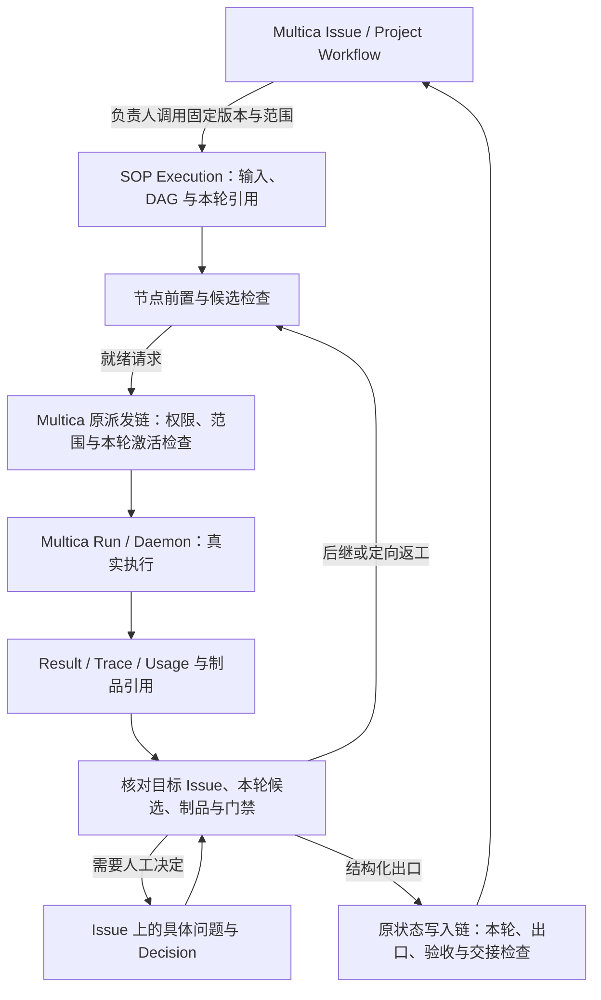

# 专题二：SOP 与研发工作流融合

版本：V1.1 · 交叉审查修订 · 2026-11-15

本专题以[架构治理基线](governance-baseline.md)为准，把 LoopForge SOP / DAG 作为附着在 Multica Issue 工作中的流程能力。工作状态、负责人、权限、Run、Runtime 和进程生命周期沿用 Multica；节点前置、工作激活和交付消费在既有链路补齐。撤回独立 Grant / Dispatch Controller 的预设，保留已证实的业务控制需求。

研究证据：[三库源码与测试](../research/02-source-evidence.md) · [Multica 交接与领取](../research/topic-02/multica.md) · [17 项状态模型原型](../research/topic-02/prototype-validation.md)。统一对象、Work Context、Execution Contract 和 Evidence & Feedback 见[共享业务契约](overview.md#共享业务契约)。

## 1. 职责分工

| 需要回答的问题 | 唯一责任主体 | SOP 的作用 |
|---|---|---|
| 要做什么、谁负责、范围是否变化 | Multica Issue 的有权成员、当前负责人或主责 Squad | 读取工作约定，超范围问题交回决定者 |
| Issue 当前处于什么状态、由谁接手 | Multica status / Project Workflow / 既有写入与交接机制 | 提交结构化出口及证据引用 |
| 专业步骤、依赖和节点验收条件是什么 | 被调用的 SOP 定义及其流程实例 | 计算 DAG 就绪、门禁、重试和返工范围 |
| 哪份工作已获安排，是否允许实际启动 | Multica 原派发链 | 提供节点前置、目标 Issue、托管范围和本轮激活供共享检查 |
| 谁执行 Agent / Script | Multica Run / Runtime / Daemon | Agent 使用现有 Backend；Script 在原链中补齐受管命令承载 |
| 谁作人工放行或最终接受 | 对应 Issue 上的有权成员 | 请求并引用对具体问题、候选和范围有效的 Decision |
| 结果、费用和候选在哪里 | Multica Run / Result / Task Usage 与获准制品通道 | 保存节点、本轮交付与实际结果之间的附属引用 |

SOP 决定专业节点就绪，Multica 决定工作写入和真实执行。节点完成、技术 Run 终态、Issue 验收各有自己的判断，互不覆盖。

## 2. 从自主工作到完整 SOP

SOP 可以只承担一个环节，也可以贯穿完整交付。是否调用由 Issue 当前负责人或明确主责 Squad 按已有权限决定，实际权限仍逐项检查。

| 工作方式 | 适用条件 | 订单导出中的用法 |
|---|---|---|
| 自主协作 | 目标尚需探索，执行方法会变化 | Squad 自主组织前后端、集成和验证，沿用 Issue / 子 Issue |
| 局部 SOP | 固定输入、输出和失败出口已清楚 | 验证子 Issue 对 C1 调用订单导出回归，返回 A1–A5 证据 |
| 完整交付 SOP | 实施、交接、验证和异常路径已可复用 | 父 Issue 调用标准导出交付，按 DAG 托管实施、集成、验证，再交回人工接受 |

SOP 定义包含输入、前置、Agent / Script / Human Gate / Sub-SOP 节点、制品契约、预算和重试边界、定向返工目标、结束及交还条件。发布前检查引用完整、前向依赖无环、Sub-SOP 无递归、必需产物有生产与消费关系；返工只回到声明的本节点或上游。并行分支修改同一资源时，定义须说明隔离或顺序。

一个局部检查无需展开成任务树。节点需要独立负责人、跨人交付和长期跟踪时使用子 Issue；流程内部条件、汇合和门禁使用 SOP 附属数据。正式版本按专题 3B 治理，候选改进先 Benchmark、审核再发布。

## 3. 一次 SOP 如何运行



1. **调用并固定。** 记录所属 Issue、调用者、SOP 发布版本、工作约定、具体范围、输入候选、允许动作、预算和交还对象；引用原 Issue 的有效安排与决定。目标 Issue 及权限按真实身份读取。
2. **检查就绪。** DAG 依据已消费的有效结果判断前置；节点需实际执行时，请求 Multica 原派发入口，附节点、目标 Issue 和本轮激活引用。未就绪保持待启动，缺哪份结果明确展示。
3. **创建与开工。** 原派发链核对当前安排、权限、前置和本轮激活；重送找回原 Run，合法新工作记录新激活。Run 继续由既有队列、领取、Runtime 容量和 Daemon Start 管理。
4. **接收与消费。** 原 Run 保存技术结果；SOP 再核对真实生产归属、候选、输入轮次、具名制品、门禁和当前消费资格。回调被接收与节点放行分别记录。
5. **继续、返工或交还。** 合格结果激活声明后继；失败按范围自修正、重试或返工；超范围及人工问题保持等待并交有权决定者。最终出口由原 Project Workflow / Issue 写入路径校验后推进。

## 4. 节点、工作激活与 Run

**工作激活（本轮）**表示同一范围进入某步骤或节点的一次履行资格。同一状态 A→B→A 是两轮，网络重送仍属同一轮，合法返工产生新一轮。它是原 Issue / Run 与流程的附属关联，具体字段形式留给实现设计，不建立新的授权服务。

| 概念 | 作用与关联 |
|---|---|
| SOP Node | 固定流程定义中的步骤，不是独立业务工作对象 |
| 本轮激活 / 必要的 Node Attempt | 本轮激活区分初次履行、输入换版与返工；必要的尝试记录进一步区分技术重试。关联固定输入、输出及所用 Run |
| 子 Issue 本轮交付 | 父节点托管子项时，标明该轮约定、候选和交付结果；重开复用原子 Issue，新轮引用原轮次 |
| Multica Run | 实际执行和技术生命周期的唯一记录；一个节点履行可包含实施、自修正、检查等多个真实 Run |

先盘点 Multica 的父执行、委托、重试、重跑与触发证据字段，只有语义一致时才映射。`RetryOfTaskID` 表达系统暂态重试，`RerunOfTaskID` 表达人工重跑；它们不直接证明业务返工或某次 SOP 前置已满足。`OriginatorSource / AccountableUserID` 是审计与成本线索，`RuleVersionID` 是原生 autopilot 规则快照，均不产生 SOP 授权或资产选版依据。字段事实见[固定模型](https://github.com/multica-ai/multica/blob/fdfbfcd5e5d30c135255e63ab9af4c52672b7bbc/server/pkg/db/generated/models.go#L124-L185)。

当前固定 Multica 的[步骤守卫](https://github.com/multica-ai/multica/blob/fdfbfcd5e5d30c135255e63ab9af4c52672b7bbc/server/internal/handler/issue_workflow_entry.go#L118-L123)仅比较步骤名。本轮设计要求在其原写入链补查当前工作激活与调用 Run 的有效关联，覆盖 A→B→A 的旧轮回报。并行节点各有自己的有效范围，不因另一分支先完成而失效；普通 Default 工作的原生适用范围保持原规则。

## 5. 同一工作范围的派发与托管

### 5.1 范围去重与 DAG 并行

范围以团队可判断的交付、目标 Issue、候选和契约描述，例如“验证 C1 的订单可见范围”。同一托管范围、本轮激活的 Leader、手动启动、评论提及、Workflow 和恢复请求，均读取原 Issue / Run 上的当前安排，在原派发链共享检查。针对同一次执行安排的重送复用既有 Run 引用；本节点合法新增的实施、修正和后置检查分别留有明确执行安排及来源，因此可关联多个 Run。既有事务和去重机制需覆盖检查与创建，避免各入口各自判断后分别开工。

不同节点可有不同工作范围，A→C、B→D 中 C 只等待 A，D 只等待 B；独立双人审查同一候选也可分别安排并各自署名。去重针对同一份履行的重复请求，容量、资源互斥与并行分支仍由 Multica 控制。同名自由描述的语义重叠由当前负责人合并或明确拆分，平台不另建语义调度器。

[Multica 研究 M2–M4、M7](../research/topic-02/multica.md)已证明交接重放、状态重入、普通 Agent pending 合并、事件观察和实际领取的语义不同；不能用领取互斥或单一 Run ID 代替跨入口的工作范围与前置检查。这些是既有证据，后续集成验证负责证明最小适配实际闭合。

### 5.2 三种工作关系

| 节点需要的工作 | 组织方式 | 结果与消费 |
|---|---|---|
| 同 Issue 中执行短步骤 | 本轮激活关联当前 Issue 的实际 Run | 消费该 Run 的当前候选、检查及制品 |
| 托管独立子 Issue | 在获准范围创建或绑定原子项；父 DAG 管本轮开工条件，子项保留负责人和状态 | 消费匹配本轮交付的 Run、候选、制品及核验结论 |
| 引用独立生产结果 | 保留生产方、所需版本和等待条件，不接管对方派发 | 生产方按原安排工作，消费时核对结果契约与读权 |

托管子项先保持待启动，本案例为 `backlog`。前置齐备后由正常分配入口开工；成员提前改 `todo`、直接触发 Agent 或收到 Leader 唤醒时，也核对同一托管安排。修改标题、恢复和启动重送查回原子项，避免重复创建。已有子项正在自主工作或已由另一流程托管时，先引用独立结果，或明确交接及在途处理，再开始新托管轮次。

子项关闭只触发重查。`child_done` 包含取消和阶段关闭，见[Multica 研究 M5](../research/topic-02/multica.md)；父节点须读取当前轮次实际交付，而非把 `done` 或唤醒当作通过。验证子 Issue 可以完成“检查工作”并给出失败结论，要求检查通过的后继仍等待。新候选 C2 对应新交付轮次，C1 迟到结果留在原轮。

### 5.3 授权、撤销和接管

SOP 的托管安排引用 Issue 上有权成员的决定和既有权限，声明允许的创建、指派、重开、返工范围、执行者 / Runtime、预算及交还对象。扩大范围、提高预算或改变责任交接时更新相应决定；流程不自行授予权限。Delegation Grant / Dispatch Control Binding 仅保留为历史设计名称，本设计采用原 Issue / Run 的最少附属关联与共享校验。

安排被撤销、失效、显式交还或父 Issue 取消后，阻止该范围新的节点派发、子项创建 / 重开和出口推进。创建待执行安排、领取和 Start 时分别核对当前资格，已排队而未开工的旧安排不再启动。在途 Run 按明确停止或隔离策略处理，记录请求、宿主终态与清理回执；外部副作用未知时先对账。工作安排失效与进程已停止分别呈现。

接管者使用自己的权限读取获准材料，先核对当前安排、候选、在途 Run 及实际副作用，再在原 Issue 更新接续位置与本轮引用。旧执行可留历史回报，新结果是否可消费按当前资格判断。Daemon 或流程恢复先找原 Run、子实例和已消费结果，不把恢复变成重复业务执行；慢恢复在最终准备开工前重查，避免覆盖已取消或已推进的工作。

## 6. 实际候选、制品与报告消费

节点输出契约说明交什么、由谁生产、针对哪个候选、满足什么检查。消费时由原执行关联核对以下信息：

1. 生产方真实 Run、目标 Issue 及其本轮激活 / 子项交付关联；报告正文自报的 Issue 和候选用于比对，不作为身份权威。
2. SOP 及节点版本、工作约定、当前输入和候选引用；代码采用可交换的固定提交与变更材料，文件采用具名引用和内容摘要。
3. 必需产物存在、可读取、摘要匹配，内容经对应检查；本地路径只供原机器定位，长期交付沿用获准附件 / 制品通道。
4. 门禁要求的核验主体、方法、结果及 Decision 有效；缺项继续等待或返工，退出码 0 只记录技术退出。

同一结果重放找回原消费结论，旧轮结果仅留历史。C1 报告的终态即使已成功接收，也不放行 C2 的节点；消费记录保留被采用的具体报告和制品版本。原生 Run CAS 保护 Run 终态，流程附属校验负责当前候选的消费，二者各沿原权威维护。

跨机接续取得固定代码基准、未提交变更、依赖环境和具名制品，重建候选后再运行检查。多仓库候选分别记录基准；源工作区变化不静默改变已交付候选。外部输入缺失或摘要不符时先恢复有效输入，再决定继续或形成新候选。依据见[真实候选与命令实验](../research/topic-03a/order-export-workspace.md)、[Daemon 结果接收与撤权实验](../research/topic-03a/result-handoff.md)。

## 7. Script 的执行主体

固定 Multica `fdfbfcd` 的[Backend 工厂](https://github.com/multica-ai/multica/blob/fdfbfcd5e5d30c135255e63ab9af4c52672b7bbc/server/pkg/agent/agent.go#L502-L564)提供 Agent 协议，尚未提供任意确定性 Script 的完整 Run 承载。已有订单实验使用 TeamAI 命令驱动，LoopForge 也有命令与产物检查；这些证明脚本与契约可执行，Multica 集成仍需适配。

设计在 Multica 原 Run / Daemon 链补受管命令能力，由专题 3A 确定最小扩展点，复用 Runtime、工作目录、授权、进程启动 / 取消、结果和附件通道。节点固定脚本不可变内容、输入、执行配置和输出契约；Daemon 回报实际执行版本、退出、具名报告和制品，内容核验按第 6 节执行。不得通过另起 TeamAI / LoopForge 队列形成第二套平台调度。

环境启动 / 日志等原生 Environment Command 与一次业务 Script Run 的目的和生命周期不同，先按真实含义盘点，再决定复用部分。脚本产生外部动作时保留动作凭据和实际结果；重试前核对已发生副作用，避免把回报失败当作动作未执行。

## 8. 节点自修正、重试、返工与人工门禁

| 情况 | 处理规则 | 原执行与新工作的关系 |
|---|---|---|
| 本节点产物检查失败，修复仍在目标与授权内 | 将具体反馈交回原执行职责，按已声明次数、时长或消耗上限修正并复验 | 同输入、同工作激活保留当前节点尝试；活跃 Run 内记录修正轮次，Run 已终态则签发后继修正 / 检查 Run，各版产物和结论保留 |
| 技术异常重试 | 先核对副作用与真实终态，再按既定预算重试 | 当前工作激活内开启新节点尝试和新 Run，采用语义匹配的原生重试关系，旧尝试与 Run 不改写 |
| 输入候选改变或缺陷来自上游 | 按声明返工目标交回生产节点，识别消费该输出的受影响后继 | 目标与受影响节点开启新工作激活和新尝试，托管子项形成新交付轮次；原子 Issue 复用，无关分支保留有效结果 |
| 返工涉及在途下游 | 停止或隔离旧执行并核对回执；未知副作用先对账 | 旧输出归原轮，新轮只消费新的有效候选 |
| 达到修正、重试或总预算上限 | 交还具体失败、已尝试方法和剩余工作，由有权负责人决定 | 保留失败事实，不以追加无限重试隐藏阻塞 |
| 人工判断未回答、超时或拒绝 | 未明确批准时保持门禁等待；拒绝按声明返工 / 交还路径处理，超时只提醒或转交 | Decision 关联指定决定者、问题、动作范围、候选及标准；通知已读不产生批准 |
| 人工选择例外放行 | 记录被接受的具体限制和适用范围 | 原失败仍为失败；允许动作来自有权决定，流程不把例外记成客观测试通过 |

Daemon 在同一 Run 内的原生恢复或宿主调用重试继续沿用原生命周期，并保留各次实际调用、结果和用量回执；只有重新签发真实执行才产生新 Run。节点级技术重试与这种 Run 内恢复分别记录。

更换 SOP / Role / 验收 Script 等资产版本走正式选版与后继实例规则，在途实例保持原固定版本。工作约定改变时由 Issue 先记录有效决定，再明确受影响节点、旧结果和是否需新候选。跨次能力改进走候选 Benchmark 与审核发布，和本次有限自修正分别管理。

Human Gate 复用 Issue 评论、成员权限和可定位决定，补齐结构化关联与默认等待。候选或标准已变更时旧页答复记录为过期操作，展示当前待决内容；历史已生效的决定保留原范围。拒绝、等待、例外放行和批准分别记录，流程通过仍须满足相应出口条件。

## 9. 版本与 Project Workflow 出口

SOP 发布版本不可变，在途实例固定该版本和实际输入。新版模板供新实例选择；计划换版时先记录 Issue 工作决定、在途处理及交还位置，后继实例保留来源。Sub-SOP 的实例与固定版本同样可查回，父节点恢复引用原子实例，避免再启动一份。

出口结果引用本 SOP / 版本 / 实例、目标 Issue 与工作范围、本轮激活、完成 / 失败 / 等待结论、必需节点结果、候选与制品、核验与人工 Decision、预算消耗、未完成项及建议下一步。

原 Project Workflow / Issue 写入链执行以下交接：

1. 根据当前 Issue、调用身份、有效托管安排和本轮激活判断是否有资格提交；检查目标 Issue 与结果引用一致。
2. 核对出口要求、当前候选、必需制品、核验结论及对应人工决定。步骤名匹配仍须核对本轮，A→B→A 的旧 Run 不取得当前推进资格。
3. 在原状态写入的同一原子判断中确认未被接管或变更、记录该出口的消费结论，再推进下一状态和负责人并交还托管范围。缺项保持当前状态；质量失败走声明返工；超范围交回负责人。
4. 重送依据原 Run / Result、实例与出口身份找回已生效交接及回执；已有身份不足时补最小出口引用。旧轮或不同候选冲突时重读当前工作，不再次改变状态或负责人。通知重投引用同一交接事实。

出口消费引用附着于原 Issue / Run 与 SOP 流程数据，不产生独立完成权威。人工验收事项由原完成入口统一检查指定成员对当前候选与标准的有效决定；SOP 最后节点通过只提供其所声明的结果。

## 10. 订单批量导出的两条路径

人物、D1 / D2、A1–A6 和数量均为[专题一的模拟约定](01-unified-work-lifecycle.md#121-模拟约定)，统一场景入口见[订单贯穿案例](overview.md#订单贯穿案例)。林承担人工总责及最终验收，交付 Squad 主导实施，丙承担独立验证职责；账号、Runtime 和外部操作按案例约定授权。以下是完整产品机制推演，已有脚本 / Daemon 实测覆盖的范围见第 12 节。

### 首次探索：自主分工加局部 SOP

1. Leader 在父 Issue 协调，前后端、集成和独立验证按责任建立子 Issue。前后端并行；集成与验证先待启动，Leader 依前置证据推进。林中途确认 D2，受影响实施和验证使用新约定。
2. 集成交 C1 后，丙在验证子 Issue 调用固定版本订单导出回归；本次范围仅检查候选。A2 比对各测试身份的可见订单，A3 回读 XLSX 金额、付款时间与未付款空值，A4 检查 5,000 / 5,001 边界；A1、A5 使用对应数据和页面证据。
3. C1 的 A2 失败，局部 SOP 交出失败证据并结束。验证子 Issue 可完成本轮“已执行验证”的工作，但结论是未通过。修后端超出局部检查范围，失败交回父负责人，`child_done` 只唤醒重查。
4. Leader 重开原后端，受影响集成和验证先待启动。修复、集成和审查形成 C2 后，在原验证子 Issue 启动针对 C2 的后继局部实例，关联前轮；C1 报告留历史，无关前端结果按实际有效性复用。
5. C2 的所需检查通过，Squad 汇总交还林。林针对最终候选完成 A1–A6 业务接受，原完成入口校验有效决定再结束父 Issue。

### 方法稳定：完整交付 SOP

父 Issue 选择已发布“标准导出交付”，林确认业务范围，有权负责人按既有职责记录托管安排，允许创建 / 复用前后端、集成和验证子项，以及范围内返工。流程在原 Issue 保存附属关联，子项先待启动。

```text
父 Issue / D2 / 标准导出交付固定版本
  ├─ 后端本轮交付 ─┐
  └─ 前端本轮交付 ─┴─ 集成候选 → 独立验证子流程
                                  ├─ 未通过 → 声明的生产节点返工
                                  └─ 通过 → 林的候选验收决定
                                            → Project Workflow 出口交接
```

父 DAG 的前后端节点分别就绪并行，合格结果齐备才启动集成，取得候选才启动验证。成员提前把集成改 todo 或直接触发其 Agent，也检查同一前置。节点下若有 A→C、B→D，C 不等待无关的 B；最终汇合只等待声明必需结果。

C1 的 A2 失败时，父流程保持本实例和版本，在已授权范围请求原工作机制重开后端，并使受影响集成、验证进入新履行 / 交付轮次。局部验证子流程已结束，C2 用后继子实例；父流程仍等待返工。旧 C1 回报与取消子项只留历史，不放行 C2。范围外的可见订单规则变化交林决定。

所需 C2 检查通过后，流程引用林对 C2 / D2 / A1–A6 的真实决定，再提交出口。林未回答时保持等待，拒绝时定向返工；审批期间 Runtime 槽位沿既有机制释放，等待不持续调用模型。最后由 Project Workflow 检查本轮及人工验收，更新状态、交还责任；完整 SOP 与局部 SOP 均无独立关闭父 Issue 的权限。

两条路径的前后端与验证 Run 成本归各自目标 Issue，父流程、子流程、Squad 与项目从同一原始计量集合去重汇总。历史候选复用保留来源，本次修正、检查和返工新增消耗分别可查。

## 11. 交叉审查反例

| 反例 | 必须成立的规则 |
|---|---|
| 启动重送、标题变化、恢复再次请求创建托管子项 | 查回原子项与本轮安排；未就绪仍待启动 |
| 后端未交付，成员提前 todo、评论触发或 Leader 派发集成 | 原入口采用同一托管前置检查，拒绝提前开工并显示缺项 |
| Leader、Workflow 和手动入口同时命中同一范围的同次执行安排 | 一次实际派发，重送查原 Run；合法修正 / 检查分别关联其执行安排，业务返工形成新轮 |
| A→C、B→D，B 等待人工决定 | C 可在 A 合格后执行；D 等 B，最终合流检查必需结果 |
| 状态 A→B→A，第一轮 Run 后到 | 原状态写入链检查本轮激活，第一轮仅留证据，第二轮的有效并行分支可正常消费 |
| C1 交付后子项重开交 C2，旧 child_done 或 C1 成功回报到达 | 只唤醒重查，消费必须匹配 C2 本轮交付、候选与制品；取消子项也不自动通过 |
| 报告正文自称正确 Issue，但 Run 实际属于另一工作 | 按原派发 / Run 关联核对目标；外部结果显式引用，不能冒充本轮托管结果 |
| 进程退出 0，但报告缺失、XLSX 截断或 A2 失败 | 保留技术退出，按输出契约等待或返工，不宣告质量通过 |
| 实施 Run 已结束，后置检查失败并在范围内修正 | 同输入节点履行关联后继修正与检查 Run，各版产物和失败保留；达预算上限交还 |
| 保存待派安排后中断，或实际 Run 已创建但回执丢失 | 恢复找回原安排与 Run，再补未完成投递；不重复业务执行 |
| 子流程已启动，父节点保存引用期间中断 | 用原激活引用找回子实例及固定版本，不新开另一份 |
| 撤销托管安排时节点已排队或准备 Start | 创建、领取、Start 均复核当前资格；停止新开工，在途执行按明确策略处理并核对副作用 |
| 脚本已产生外部动作但结果投递失败 | 先查原动作回执和真实结果，再决定恢复或重投 |
| 林打开旧页面批准 C1，但待验候选已为 C2 | 新答复标明过期，保持 C2 等待；C1 原决定保留历史范围 |
| 最后节点通过但人工拒绝、未答复或出口缺证据 | 原状态与负责人保持当前值，按声明返工或等待，不绕过完成校验 |
| 慢接管取材料期间另一个接管者推进或取消 | 最终开工前重查当前安排与本轮，不覆盖已发生推进 |
| 跨机接续时原目录含未提交修改、模板又发布新版 | 交换获准代码候选和变更；在途固定原定义，确认原进程与副作用后接续 |

上述为当前设计验收规则。固定源码、代表测试和原型已提供部分事实依据，完整 Multica 融合集成须按下一节逐项验证。

## 12. 验证计划与已有证据

| 已有证据 | 当前能支持的结论 |
|---|---|
| [Multica 固定研究与 37 个顶层测试](../research/topic-02/multica.md) | 交接重放与重入、领取容量和代次、事件观察、stage / child_done 的真实语义；保留各自固定提交 |
| [17 项确定性状态模型](../research/topic-02/prototype-validation.md) | 前置、托管、门禁、轮次、重放等规则的模型推演；原 Grant / Binding 名称是历史载体 |
| [C1 / C2 真实工作副本与命令](../research/topic-03a/order-export-workspace.md) | XLSX、A2 / A3 内容检查和 TeamAI 命令驱动结果；任意 Script 的 Multica Run 承载尚需适配 |
| [真实 Daemon 结果与撤权回执](../research/topic-03a/result-handoff.md) | 原 Run 终态重放、取消结果及回执与进程退出的区别；当前 SOP 消费规则仍需集成 |
| [治理基线固定源码盘点](governance-baseline.md#固定版本的底座盘点) | `fdfbfcd` 步骤名守卫、原谱系与受管 Script 缺口，作为本轮最小扩展依据 |

集成验收顺序：

1. **最短调用链。** 一个验证 Issue 调用两个可并行 Script 节点和一项人工决定。命令适配进入原 Run / Daemon 链，核对固定脚本、候选、报告、Run 归属和实际容量；恢复查回原实例。
2. **多入口与前置。** Leader、Workflow、评论和手动入口同时请求同一托管范围的同次执行安排；首次提前请求不得开工，重送复用原 Run，合法新增的修正 / 检查各留来源，不同独立范围可并行。
3. **本轮与消费。** A→B→A、节点自修正、暂态重试、C1→C2 返工、子项取消和旧成功 / 失败报告注入，核对原写入检查及真实候选 / 制品消费。
4. **授权与出口。** 创建、领取、Start 前撤权或取消；人工批准、拒绝、超时和旧页答复；出口重放与被接管后迟到，确认 Issue 状态只按当前有效决定推进。
5. **完整交付与接续。** 按订单局部及完整两路径验证返工、Sub-SOP 恢复、回执丢失、跨机候选与未提交变更，按原 Run / Usage 去重核对成本。

验收观察的是一个原生工作主干和实际结果，不要求新增特定名称的服务或存储对象。实现点与字段映射须以固定源码和真实集成结果确定；既有已证明缺口直接纳入适配，不再退回未知。

## 13. 本专题六问审查表

| 问题 | 本专题结论与证据 |
|---|---|
| Multica 已有什么？ | Issue / Workflow / Squad / Run、队列、权限、Runtime、交接重放、终态与附件通道；原谱系含父执行、委托、重试与重跑，见第 4、12 节 |
| 我们缺什么？ | 托管范围多入口前置、A→B→A 本轮识别、子项当前交付与实际候选消费、默认等待的 Human Gate、任意 Script 经 Run 托管；已有研究分别证明，非全部未知 |
| 选择哪种扩展方式？ | 在原 Issue / Run 附最少流程引用，原写入 / 派发入口共享检查；Script 在原 Daemon 链适配受管命令。谱系仅复用语义相同字段，不把成本或 autopilot 快照当作授权 |
| 谁拥有事实？ | Issue 拥有目标、责任、状态和验收；Run / Usage 拥有实际执行与计量；SOP 拥有 DAG 及附属节点 / 本轮交付引用；制品沿原通道 |
| 是否形成第二权威？ | 无独立 Grant 服务、Dispatch Controller、执行队列或完成权威；SOP 提供就绪与结果，Multica 原入口校验权限、派发与交接 |
| 如何验证？ | 第 11 节反例、第 12 节顺序及订单双路径；已有源码 / 测试 / 命令 / Daemon 证据与待完成真实集成分别列示 |
