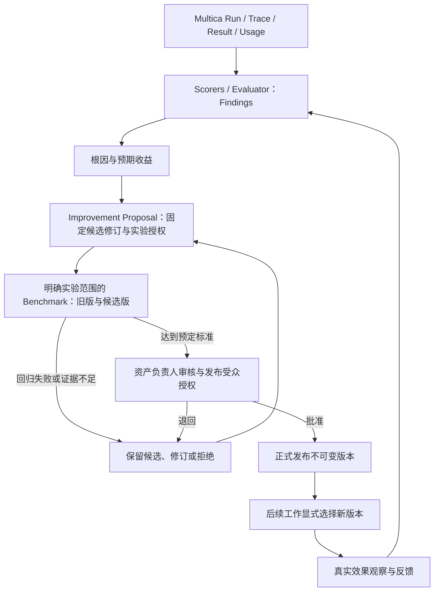

# 专题四：成本、质量评价与工程级 RSI

版本：V1.1 · 交叉审查修订 · 2026-11-15

本专题沿用 Multica 的 Run、Trace、Result 和 Task Usage 作为执行与计量事实底座，融合 TeamAI Scorers 和 LoopForge Evaluator、Benchmark、Findings 与工程级 RSI。成本归集、评价与改进共同引用既有工作记录，治理规则见[架构治理基线](governance-baseline.md)。

## 1. 目标与共同输入

平台要回答四个问题：一次工作消耗了什么、归到哪里；结果质量如何且依据是什么；问题应改知识、能力、流程还是环境；候选改进在相同条件下是否改善了后续交付。

沿用[共享业务契约](overview.md#共享业务契约)：

| 共同输入 | 本专题如何使用 |
|---|---|
| Work Context | 引用 Issue 的目标、有效决定、分工、父子结果和当前交付要求，确定评价对象与成本汇总范围 |
| Execution Contract | 引用每次执行的授权范围、输入、候选、资产版本、预期制品和验证要求，解释消耗和失败原因 |
| Evidence & Feedback | 引用实际 Run、宿主调用、服务回执、制品摘要、核验与验收决定；计量结论、质量判断和改进效果各自留据 |

工作完成仍由专题一的验收规则判断；节点修正和返工仍走[专题二](02-sop-workflow.md)；改进资产发布与来源授权仍走[专题三 B](03b-capability-governance.md)。

## 2. Multica 复用盘点与明确缺口

本轮固定源码为 Multica [`fdfbfcd5e5d30c135255e63ab9af4c52672b7bbc`](https://github.com/multica-ai/multica/tree/fdfbfcd5e5d30c135255e63ab9af4c52672b7bbc)。下表区分原生事实、扩展需求与宿主待测项，原始研究保留各自提交版本，见[研究记录](../research/04-source-evidence.md)。

| 已有事实 | 本专题复用方式 | 已明确的增量 |
|---|---|---|
| Run / Task、Provider / Model、Session、Trace / Result | 保持实际执行身份、终态和宿主连续性 | 补充执行用途及 SOP 节点、评价对象、观察来源的关联 |
| [Task Usage 写入](https://github.com/multica-ai/multica/blob/fdfbfcd5e5d30c135255e63ab9af4c52672b7bbc/server/pkg/db/queries/task_usage.sql#L1-L20)按 task / provider / model 覆盖累计值 | 作为唯一计量写入与汇总链，复用原生快照覆盖语义 | 原生请求 / Stage 身份、单位、覆盖区间、多源冲突和更正来源尚需补齐 |
| [服务端用量载荷](https://github.com/multica-ai/multica/blob/fdfbfcd5e5d30c135255e63ab9af4c52672b7bbc/server/internal/handler/daemon.go#L5490-L5507)已有 `credits_micros`，[云端 Qoder 写入](https://github.com/multica-ai/multica/blob/fdfbfcd5e5d30c135255e63ab9af4c52672b7bbc/server/internal/qoderruntime/usage.go#L68-L96)已使用此字段 | 复用 Credits 与 Token 分列、未知与真实零值分开的能力 | 本地 [TokenUsage](https://github.com/multica-ai/multica/blob/fdfbfcd5e5d30c135255e63ab9af4c52672b7bbc/server/pkg/agent/agent.go#L273-L293)及 [Daemon TaskUsageEntry](https://github.com/multica-ai/multica/blob/fdfbfcd5e5d30c135255e63ab9af4c52672b7bbc/server/internal/daemon/types.go#L309-L322)尚无 Credits；本地 Backend → Daemon → Usage 链需要扩展 |
| Codex / Claude 已处理部分重复消息、累计基线和终态后用量 | 保留各适配器已验证的身份与区间处理 | 增加跨采集源匹配与来源冲突规则，原始观察保留在同一执行事实链上 |
| ContextReceipt 提供准备和投递证据 | 关联资产选择、投递版本及缺项 | 按调用核对实际输入；恢复会话还含[列表之外的历史](https://github.com/multica-ai/multica/blob/fdfbfcd5e5d30c135255e63ab9af4c52672b7bbc/server/internal/daemon/context_receipt.go#L61-L77)，以宿主证据说明覆盖 |
| [Issue 用量汇总](https://github.com/multica-ai/multica/blob/fdfbfcd5e5d30c135255e63ab9af4c52672b7bbc/server/pkg/db/queries/task_usage.sql#L84-L122)覆盖该 Issue 的 Run | 复用原生查询及汇总关系 | 增加业务执行、评价、Benchmark、知识活动分类，分别展示费用和覆盖 |
| Skill / Plugin 等资产设施 | 由 3B 承载候选、审核与发布 | 验收资产固定版本、候选实验授权和历史留存由 3B 补齐，见[原生资产研究](../research/topic-03b/native-assets.md) |

现有 [AgentTaskQueue 谱系](https://github.com/multica-ai/multica/blob/fdfbfcd5e5d30c135255e63ab9af4c52672b7bbc/server/pkg/db/generated/models.go#L124-L185)优先复用，并保留字段原义：`RetryOfTaskID` 表示系统暂态失败重试，`RerunOfTaskID` 表示成员人工重跑；`DelegatedFromTaskID` 记录归因继承来源，`ParentTaskID` 记录已有执行关系，`TriggerEvidenceKind / RefID` 定位直接触发证据。SOP 激活、候选轮次、改进实验组与被评 Run 的关系逐项核对已有写入和读取路径，再补最少附属引用。`RuleVersionID` 是原生自动化规则快照，通用 SOP / Skill 版本另按资产引用表达；`AccountableUserID`、`OriginatorSource` 用于归因和审计，授权沿现有权限路径检查。

以上缺口沿 Multica Backend、Daemon、Usage 与资产扩展点补齐。Observation 保存来源证据，计量结论统一写回 Usage；各层报表从同一事实派生。

## 3. 成本采集、归属与汇总

### 3.1 原始观察到计量结论

原始观察可来自 Backend、ACP、Stream-JSON、Hook、OTel、转录或成员补录，记录宿主与账号命名空间、原生事件身份、发生与接收时间、观察范围及摘要。成员选定的共享范围与当前来源读权继续适用，评价和计量只取得本次获准的材料。

处理顺序如下：

1. 先确定事件表示请求增量、Stage、Turn 快照、Session 累计还是来源更正。
2. 以启动绑定和原生 Request / Stage / API Call 等身份定位 Run。无充分映射时保留 Session 级或未归属观察，等待补证。
3. 对同一原生计量单元归并多份观察。CodeBuddy 以 Session / requestId / stage.id 定位 Stage，投递帧 UUID 仅用于识别该份观察；跨账号或宿主身份分别处理。
4. 对累计快照确认基线、区间连续性与独占归属，再计算派生差额。计数重置、混合 Issue、缺基线或乱序缺口保留原快照及缺项；已知差额标为派生结果。
5. 明确进入 Usage 的指标、单位、数值、覆盖范围与证据。请求合计、Turn snapshot 和 Session total 的覆盖重叠时选择同一范围的计量依据，其他值作为核对证据。
6. 更正保留原观察及前后结论的来源。较晚到达与较高可信度分别判断；同等可信来源冲突时记录待核对，受影响范围暂缓确定计量，已证实的其他范围照常汇总。

同一事件重放仅增加接收记录。Run 结束后到达的有效用量可以更正该 Run 的计量，原执行终态与验收决定保持其事实含义。

### 3.2 原生单位与宿主覆盖

| 宿主 | 原生计量与身份 | 当前证据及扩展要求 |
|---|---|---|
| Codex | Input / Output / Cached Tokens，Thread / Turn 与累计区间 | 复用现有适配器基线处理；历史重放按已覆盖区间核对 |
| Claude Code | Token、请求级 Usage、部分 OTel request_id / message UUID | 复用现有消息去重；Hook、SDK、OTel、转录的重叠按原生请求关联 |
| Qoder | Qoder Credits；Assistant 请求用量与 Session total_credits | Mac CLI 1.1.88 / SDK 1.0.59 未取得请求 Credits。Multica [ACP 当前解析](https://github.com/multica-ai/multica/blob/fdfbfcd5e5d30c135255e63ab9af4c52672b7bbc/server/pkg/agent/acp_usage.go#L167-L216)与本地上报链尚缺 Credits，目标 ACP 协议是否暴露请求字段另行实测 |
| CodeBuddy Code | Credits Stage、requestId、stage.id、Turn / Result snapshot | CLI 2.181.0 实测一个 Stage 为 0.69 Credits；[现有 Backend](https://github.com/multica-ai/multica/blob/fdfbfcd5e5d30c135255e63ab9af4c52672b7bbc/server/pkg/agent/codebuddy.go#L655-L724)尚缺对应 Stage 解析与本地上报，见[协议研究](../research/04-source-evidence.md) |
| GitHub Copilot CLI | nano-AIU、Premium Request cost、Tokens | Session checkpoint 为累计值；CLI 1.0.107 两次 invocation 的差额仅作派生观察，逐请求 nano-AIU 保持 unknown |

各宿主 Credits、nano-AIU、Premium Request cost、Token、USD 估价分别汇总。Runtime 未上报的 Credits 保持 unknown；Token、时长和订阅余额均不补作 Credits。当前采集范围为获准的本地 Runtime 消息流，企业 API、账户 Usage 页面、账单接口和余额抓取均不在本专题采集路径中。

### 3.3 Run / Session / Turn 与结果归属

Run 是实际执行的归属单位；Session 是连续性资源，可由多个 Run 先后使用。Thread / Turn / Request / Stage / API Call 的唯一范围按宿主版本声明，恢复后的相同 turnId 单独不足以判定同一次调用。

每个计量结论关联生产 Run；Run 通过原生 Issue 归属、执行者、Runtime、资产选择及 SOP 附属引用提供汇总维度。接收报告时核对生产 Run、目标 Issue、当前输入 / 候选和消费资格。跨项目制品引用沿原生产归属展示来源与成本，本次下载、复核或重新执行另记新增消耗。

仍在运行的回合内自修正记入原 Run。宿主已返回且退出后再次执行签发新 Run，并关联原失败或拒收证据；同一节点尝试可引用这些 Run，各次消耗均保留。派发前尚未开工的会话切换按原有效派发处理。[Hook 复验的已验证归属](../research/topic-03b/existing-session.md#hook-复验的-run-归属修订)

### 3.4 四类费用状态与覆盖

费用状态按“指标、单位、执行范围”表达。同一 Run 可同时有已上报 Token、已上报 Credits 和未知 USD，界面保留这些并列结果。

| 状态 | 采用条件 | 展示与汇总 |
|---|---|---|
| 真实上报费用 / 原生计费量 | Runtime 提供明确费用或 Credits，且归属、单位和覆盖已确认 | 标来源与原生口径。供应商上报的执行费用与账单实付分别命名；后者当前无采集来源 |
| 估算费用 | 已知用量可按明确的模型、计价单位和固定费率版本计算 | 同时保留原始用量、费率版本、时间及假设，标估算。原生费用后到时按相同范围替代该估算的展示依据 |
| 仅有 Token | 已取得 Token，但模型 / 费率不明或当前范围不进行估价 | 只汇总 Token 与覆盖；其他计费指标继续标 unknown |
| 未知费用 | 未上报费用或缺少可证明归属、计费量、单位、基线 | 记录缺失原因与范围，展示未计量执行数量或未覆盖区间 |

实际费用、估算、仅 Token 和未知在同一周期分别列示。总计同时带已覆盖执行数与应覆盖执行数；已知部分的合计标为部分总量。真实零值须由明确上报与覆盖证明，字段缺失保留 unknown。原生服务端已支持 Credits 的零值与缺失区分；USD 的现有零值处理及展示沿固定源码核对，新增指标按其语义补齐。

### 3.5 十维归集与重复引用

输入中的十维统计按既有工作对象表达：

| 维度 | 归集规则 |
|---|---|
| Team | 汇总本团队实际承担的业务与后台活动，按唯一计量单元去重 |
| Project | 使用 Run 的实际项目 / 工作归属；共享后台活动保留团队公共部分，分摊须有明确规则与依据 |
| Member | 保留实际执行 / Runtime 提供者、发起人和成本总责人的不同关系，分别筛选；所属角色不直接改变授权 |
| Issue / 子 Issue | 直属执行与子树执行分别展示；父级整体成本按 Run 集合并集汇总，保留取消和失败子项消耗 |
| Task | 沿统一术语作为具体工作的普通称呼，映射到既有 Issue 或 SOP 步骤引用，统计沿其 Run 集合计算 |
| Run | 原始执行归属；重试、返工、拒收后的重跑各保留实际 Run |
| Agent | 以实际执行 Agent 汇总；一次 Run 的多角色选择另作说明，保持同一消耗身份 |
| Squad | 汇总本轮协调与成员 Run 的并集；成员的子项成本与父项协调成本各可展开 |
| Model | 按实际 Provider / Model、指标及单位汇总，未知模型单列 |
| SOP | 引用实例、节点、尝试和子 SOP 的 Run，按唯一计量单元去重；外部历史结果另列来源成本 |

这些是可交叉筛选的视图。父子 Issue、Squad、SOP 和项目总量采用底层计量集合并集；把已有上层小计相加会重复覆盖时，改为重新汇总底层集合。若同一执行段关联多个受益工作，保存共同来源与未精确分摊部分；分摊展示仍保留总量核对关系。

### 3.6 业务与后台活动

每次独立 Agent / Script 活动的执行归属沿 Multica Run，Script 承载按 3A 已识别缺口补齐；记录用途与来源：业务分析 / 开发 / 核验 / 返工、事后评价、Benchmark、知识抽取 / 索引或改进候选生成。无需实际执行的纯人工决定直接留在 Issue。

独立 Scorer 引用被评 Run，但自己的费用归评价活动；Benchmark 的实验和评分 Run 归该实验；知识抽取关联来源 Issue 及实际服务的项目 / 团队。源业务与后台活动之间保留可追踪关系，业务交付小计和后台治理小计分别展示。若后台 Run 已按原生机制关联业务 Issue，原生 Issue 全量汇总仍保留，再按活动用途派生交付小计，避免把全量直接标为业务交付成本。

跨项目索引等公共活动归团队或明确项目，尚无分摊依据时留作公共消耗。未知用途或归属待核对的执行单列；费用更正影响当前汇总，并保留原周期与更正记录。

### 3.7 指标定义与预算使用

| 指标 | 工作口径 |
|---|---|
| 总消耗 / 单 Issue 消耗 | 指定周期与范围的唯一计量集合，分单位、活动用途及四类费用状态列示；同时给出覆盖 |
| 单位有效交付成本 | 同一业务范围、本统计周期的全部业务执行消耗（含失败、取消与返工）/ 本期正式验收交付数。事先选择父级整体交付或独立子项交付作为计数粒度，集合重叠时只计一次；标明周期、跨期交付影响及未知部分。无有效交付时展示全部消耗与零交付数 |
| 已验收交付平均成本 | 可另按验收群组追踪每项交付的全部生命周期业务消耗（含跨期失败与返工）/ 该群组交付数量，标明统计截止时点。最终未交付工作的消耗在单位有效交付口径及失败 / 取消分析中保留 |
| 失败和返工成本 | 分别标记执行故障、候选质量失败、证据拒收及业务变更后的重做，再按 Run 集合并集汇总；一个 Run 可有多种原因标签，合计只计一次 |
| Agent / Model 对比 | 预先声明所比较的 Agent / Model 等实验变量，其余输入、标准、版本、执行配置和覆盖保持可比，比较质量与分单位消耗；其他样本按分组事实展示 |
| 人工介入次数与时间 | 用具名审批、澄清、接管等决定去重计数；主动投入时长取明确记录，等待时长从请求到决定计算并单列 |
| 趋势与异常增长 | 使用相同单位、用途、时间口径与覆盖对照，分别说明工作量变化、单次消耗变化、返工变化和新增采集覆盖 |

每个指标保留纳入对象、标准版本、周期和费用覆盖。治理活动若纳入某个“完全成本”指标，显式说明纳入规则，并与业务交付口径并列。

SOP 修正 / 重试预算沿专题二执行，真实已发生的各 Run 消耗都占用其声明范围。阈值只对已知单位判断；关键计量缺失时按执行契约预先约定暂停、人工决定或有限继续条件，保留实际缺项。费用分析生成异常与建议，实际停止或新增执行仍走现有工作责任、授权和 Run 控制。

### 3.8 Qoder 当前研究结论

Qoder CLI 1.1.88 / Agent SDK 1.0.59 的 Mac 实测保持 PARTIAL：Query 与共享 Daemon 的关闭已验证，Node 主进程自然退出，本轮派生进程另行定向清理；Assistant 消息为 0，原生 request_id 为 null，请求 Credits 为 unknown。Result 的 total_credits=0 按 Session 累计快照保留。

本地 Multica Credits 解析和上报链的缺项已由固定源码确认。下一步沿原有 Qoder ACP Backend 核对目标协议是否暴露实际请求 Credits，再选择最小采集扩展。SDK 探针用于协议对照，其生命周期结论随该入口记录。[Runtime 真实验证记录](../research/topic-04/runtime-validation-1.1.88-2.181.0.md)

## 4. 质量评价机制

### 4.1 评价器、对象与可用证据

| 评价器类型 | 主要职责 | 证据来源 |
|---|---|---|
| Deterministic Scorer | 测试、退出、制品完整性、权限事实与契约检查 | Result、Script 输出、测试报告、服务回执 |
| Trace Scorer | 步骤、工具、重试、恢复、上下文投递与执行效率 | Trace、Tool Activity、ContextReceipt 与原生调用证据 |
| Model-based Evaluator | 目标覆盖、代码 / 文档质量及有证据支持的问题归因 | 获准的 Trace、制品、工作约定和固定评价提示版本 |
| Human Review | 业务、架构、体验与其他需人工判断的质量 | Issue Decision、Review 和具名证据 |

对象可为 Run、Issue 交付、Agent / Role、Squad、SOP 或资产，评价须固定具体对象和版本。终态业务 Run 可发起事后评价，等待中的门禁检查按 SOP 预先声明的核验契约运行。评价器取得证据时复核当前读权及允许共享范围，来源撤回时按受影响证据标记待复核。

缺少必需证据时给出“待核验 / 证据不足”及具体缺项。执行过程能观察到的消息、动作和产物是评价依据，未采集的宿主内部过程保持未知。评价器独立版本化；重新评分产生新结论，旧评价及其输入范围继续可追溯。

### 4.2 Evaluation、门禁与验收

Evaluation 记录被评对象和 Run / Issue / Asset 引用、工作约定及候选、评价器类型和版本、输入证据及摘要、覆盖和缺项、维度分与权重、结构化 Findings、结论时间及需复核事项。Findings 包括问题、严重度、位置、证据、归因假设和置信度。

执行终态、评价结论、SOP 门禁结果和业务验收各有职责：事后评分提供建议；预先声明为质量门禁的 Scorer 按当前候选、规则版本和节点轮次产生核验结果，由专题二消费；最终验收由专题一的指定主体决定。执行者自行调用模型或 SOP 评分按其实际核验职责标明来源，独立核验另记承担主体。

独立评价 Agent / Script 使用自己的 Multica Run 和 Usage，引用被评 Run，记录评价用途。更新评价提示、证据或标准后再次执行的费用保留在新的评价执行中。

## 5. 单次修正与跨次 RSI

### 5.1 两个闭环

**单次执行内环：** 当前目标与输入 → 执行 → 契约 / 门禁核验 → 缺陷反馈 → 授权范围内修正与复验 → 当前候选交付。SOP 管理重试、返工和预算，新的实际执行遵循 Run 生命周期。改动完成标准或扩大权限由有权成员明确决定。

**跨次执行外环：** 终态执行与真实反馈 → Findings → 根因归类 → 改进提案与候选变更 → 固定 Benchmark → 审核发布 → 后续真实工作观察。

### 5.2 根因与三层改进

先区分输入缺失、SOP 依赖 / 门禁、资产缺失 / 冲突、模型配置、工具权限 / 环境、验证器错误与外部故障，再选择修改对象。

| 改进层 | 典型变更 | 发布与有效性要求 |
|---|---|---|
| Knowledge Improvement | 项目文档、来源章节、可共享经验 | 固定检索问题、来源与正确性标准验证候选，再核对实际投递；实验前确认当前读取 / 使用许可，正式发布时复核精确派生文案与受众授权 |
| Capability Improvement | Role、Skill、Rule、Playbook、Harness / 执行配置 | 固定候选内容与依赖版本，核对职责、工具、投递及实际产物；验收规则变更同步工作约定 |
| Process Improvement | SOP 依赖、Gate、检查次序、重试与返工路径 | 检查流程可执行性、拒绝 / 超时 / 恢复和其他任务回归，再形成新 SOP 版本 |

一份提案可涉及多个资产，但逐项记录采用、拒绝或部分采用的修订和依赖，说明组合是否仍满足原成功标准。对正式知识来源的单个许可撤回、源修订及同字节恢复，沿 3B 的来源授权与重新审核规则处理。

### 5.3 提案与候选轮次

提案引用源 Run / Issue / Findings、根因假设、拟修改资产及原版、候选修订和摘要、预期改善、潜在退化、Benchmark 样本与成功标准、来源授权及审核记录。重复投递同一候选沿原提案；内容修改形成新修订，绑定对应的实验与评价结果。

候选仅在明确授权的 Benchmark 范围内使用。每次实验绑定候选实物、依赖资产与配置，走现有 Multica 执行路径并标记实验用途；普通业务继续选择已发布版本。候选改动、样本或标准发生变化时重新确定可比范围，旧通过记录继续指向旧修订。

### 5.4 Benchmark 对照

对照前固定任务输入与代码 / 文件基准、工作约定、样本集摘要、评价器 / rubric、权重、聚合方式、统计重复次数、成功标准和质量 / 成本退化阈值。模型、Runtime、工具链与 effort 等非实验因素尽量固定，记录环境和实际差异。被研究的变更作为显式实验变量，例如同一输入下比较旧 Skill 与候选 Skill；若实验变量是模型，模型作为两组差异，其余条件和解释范围固定。

观察目标达成率、客观测试、Findings 严重度、返工 / 重试 / 人工介入、执行耗时、工具调用、分单位用量、覆盖及恢复和制品完整性。未知费用单列；仅在覆盖与计量可比范围内比较成本。只在相同实验定义的可比组给出改善结论，其余结果附差异说明。回归集既包含提案所针对的失败，也包含其他代表工作，分别保留每项结果和总体聚合。

达到预先声明的标准后进入审核。资产负责人核对候选实物、Benchmark、权限、兼容和适用范围，再按 3B 发布不可变版本。验证不通过或证据不足的修订保留候选及拒绝理由；基于模型自评分的单一改善仅作评价证据。

### 5.5 发布后观察

发布记录关联最终候选摘要、通过的 Benchmark、审核与生效范围。后续新工作显式选择该版本，在途工作继续使用实际固定版本；有权负责人决定迁移时，先识别受影响节点和重验要求。

新版本按同类工作与实际覆盖观察质量、返工、消耗和人工介入，区分离线实验结论与真实工作结果。样本不足时保持待观察；出现退化时暂停默认选用或选择先前获准版本，并形成新提案，已发生执行、失败证据和已发布内容均保留。

## 6. 统一事实边界

| 数据 | 权威来源 | 专题四的职责 |
|---|---|---|
| Issue / Run / Session | Multica | 引用原身份、责任与生命周期 |
| Trace / Tool Activity / Result | Multica Backend / Daemon 及有来源的附属观察 | 提取事实、记录覆盖与证据缺项 |
| Token / Credits / Cost | Multica Task Usage | 扩展原生计量身份、单位、更正与来源；派生汇总保持可回查 |
| Evaluation / Findings | 专题四评价机制 | 固定对象与证据，产出独立评价 |
| Improvement Proposal / Benchmark | 专题四 | 保存候选、对照及审核依据，实际执行仍归 Multica Run |
| SOP / Role / Skill / Rule / Knowledge 版本 | 专题三 B 资产治理 | 引用发布、来源许可、选择及实际生效版本 |
| 人工决定与验收 | 既有 Issue 工作记录 | 引用决定者、当前候选与标准 |

## 7. 订单批量导出贯穿案例

### 7.1 输入、已验证事实与本节推演

沿用订单 Issue 的 D2 决定：按当前可见订单导出，新增付款时间，未付款留空。C1 的区域隔离检查失败、付款时间检查通过；C2 按同一标准修复后再次核验。具体角色、候选和规则来自[项目知识实验](../research/topic-03b/project-knowledge.md)，案例环境使用合成订单。Hook 改写结果、后继 Run 与报告消费来自[成员会话实验](../research/topic-03b/existing-session.md)。

下表给出将这些事实接入专题四的产品机制推演。`U(r)` 表示 Run r 在某一明确单位下已确认的用量集合，各单位分别计算；订单实验未取得的费用为 unknown。CodeBuddy 的 0.69 Credits 属于独立协议探针，保留其原探针归属。

| 环节 | Run、候选与证据 | 成本和质量如何处理 |
|---|---|---|
| C1 开发与核验 | 业务执行 r1，核验 v1，固定 D2 与核验规则；报告指出普通区域账号越界 | 分别保留 U(r1)、U(v1)；标记候选质量失败，按原报告保留通过和失败检查 |
| C2 返工与核验 | 返工执行 r2，核验 v2，仍引用 D2；新报告验证区域账号与跨区账号 | 新增 U(r2)、U(v2)；C1 的失败历史继续可追溯；返工集合与业务集合引用相同 Run |
| C2 的 Hook 结果拒收 | 实际原 Run `post-hook-order` 完成宿主调用，模型所得摘要被 Hook 改写，节点未消费报告 | 原执行成本保留，记录证据拒收原因；宿主终态与可接受的核验结论分别展示 |
| C2 后继复验 | `post-hook-reverification` 新 Run、新任务身份，仍为原节点尝试、D2 与 C2；有效报告消费一次 | 后继费用另记；重复报告只增加投递证据。节点尝试汇总两次实际执行，项目和父 Issue 同样按并集去重 |
| 独立事后评价 | 产品接入后由评价 Run e1 引用上述业务事实，形成权限检查和 Hook 来源 Findings | U(e1) 归评价小计；订单业务交付小计继续保留业务 Run 集合 |
| 生成候选改进 | 基于失败提取“分角色导出检查”经验，并提出核验 Rule / SOP 候选修订 | 知识候选按源证据和受众审核；Rule / SOP 另外固定修订，候选生成 Run 归改进活动 |
| 固定 Benchmark | 产品接入后比较旧版与候选版，输入含 C1 越权反例、C2 正常样例及其他代表任务 | 实验 Run 和评分 Run 归 Benchmark；任何必需回归失败则保留候选；通过结果进入资产审核 |
| 正式发布与新工作 | 审核通过后发布新版，下一项订单工作显式选择并记录实际输入 | 原订单与在途工作保留原版本；新工作质量和分单位成本供发布后观察 |

业务 Run 集合记为 `B`，返工 / 拒收关联集合为 `W`，评价与改进 / Benchmark 活动为 `G`。订单业务消耗取 `B` 中唯一计量单元；返工分析取 `W` 的集合并集，且其已属于 `B` 的消耗保留同一身份；含治理活动的完全消耗取 `B ∪ G`。父 Issue 同时引用子 Issue 和核验节点时，仍从这些底层集合汇总。

### 7.2 失败、撤权与部分采用

已验证的知识提案首版包含项目订单号而被退回，修订版只公开测试方法；单个来源许可撤回会暂停组合经验新投递，恢复时重新授权及复审，详见[贡献记录](../research/topic-03b/project-knowledge.md#一次返工成为团队经验)。专题四保留被拒提案与审核成本，候选修订引用原始 Findings；已撤回内容从后续评价输入和实验上下文移除，缺必需依据时相应评价待复核。

若团队仅采用知识经验而拒绝 Rule / SOP 改动，记录部分采用及各自决定。业务验收标准继续依据 Issue 的有效决定。新 Rule 候选若在 Benchmark 误拒合法跨区账号，保留该失败并修订候选；若通过离线实验但新工作仍反复返工，记录真实观察并重开改进。上述评分与 Benchmark 接入分支属于验收方案，原始宿主与贡献实验的已执行结果各按其记录引用。

## 8. 交叉审查反例与验收

本表是当前设计需要满足的判定规则。原型与宿主实测覆盖见[研究记录](../research/04-source-evidence.md)；未标为实测的 Multica 融合路径按第 10 节执行集成验收。

| 反例 | 设计处理与核对结果 |
|---|---|
| Hook、Backend、OTel 三路观察同一请求，重放三次 | 保留多份观察；确认同一原生计量范围后 Usage 只计一次 |
| 两个账号出现相同 requestId，或按值相同推断同请求 | 使用宿主 / 账号命名空间及原生映射；值相同只作核对线索 |
| Stage、Turn snapshot、Result snapshot 同时到达 | 覆盖范围核对后归并计量，Stage 更正替换该范围当前结论并留原依据 |
| Session 首快照缺基线、计数重置或混入另一 Issue | 原快照与缺口保留，受影响区间标未归属 / 未覆盖 |
| Session 恢复后 turnId 重用，或同 Session 服务两个 Run | 以启动绑定及原生 event / request / API call 等范围定位，保持 Run 分开 |
| Run 终态后用量晚到或更可信来源纠正 | 更正原计量及派生汇总，原执行与验收事实继续留存 |
| Credits 0、Credits 缺失、Token-only 和估价同时出现 | 按指标与覆盖分别标状态；同范围实际费用与估算采用明确优先依据 |
| 一个 Run 同时出现在父 Issue、子 Issue、SOP、Squad | 从唯一计量集合求并集；可展开来源关系 |
| 本期多项工作失败或取消，只有一项正式交付 | 单位有效交付成本计入同范围本期全部业务消耗；无交付时展示消耗及零交付数 |
| 复用历史工作簿、Hook 拒收后同节点尝试重跑 | 历史生产成本另列；本次重跑是新 Run，原失败与后继消耗都保留 |
| 评价 Run 挂在业务 Issue，或公共索引没有业务 Issue | 按用途分业务 / 治理小计；公共活动保留项目 / 团队归属 |
| 过程缺项、模型分数低或评价器换版 | 缺证据给待核验；评分与真实终态、门禁和验收分别记录；换版生成新评价 |
| 旧候选或失效规则的评价被重投到当前门禁 | 消费前核对候选、标准、节点轮次和当前授权，旧结论留在原对象 |
| 生成提案直接更新团队默认资产 | 候选进入实验范围，Benchmark 和审核通过后正式发布 |
| 修改候选正文后沿用旧通过报告 | 旧实验固定旧摘要，新修订重新确定验证要求与实验组 |
| 只改模型却要求全部模型字段相同，或同时改变多项未声明因素 | 模型可作为明确实验变量；其余差异写入实验定义并限定比较结论 |
| Benchmark 目标样例改善但其他合法角色退化 | 按预定质量与退化标准拒绝本轮发布，保留逐项结果 |
| 源许可撤回、正文恢复原字节，或发布后样本不足 | 按 3B 新授权 / 复审规则处理；真实改进效果保留待观察 |

## 9. 六问审查表

| 问题 | 本专题答案 |
|---|---|
| Multica 已有什么？ | 第 2 节固定源码：Run 谱系、Session、Trace / Result、ContextReceipt、Task Usage 服务端 Credits 与 task / provider / model 覆盖写入、Issue 汇总 |
| 我们缺什么？ | 本地 Backend / Daemon Credits 与 Stage 解析、多源请求身份和更正、调用级输入证据、活动用途分类和跨视图去重；质量 / 候选 / Benchmark 与资产发布的关联 |
| 选择哪种扩展方式？ | 复用现有 Backend、Daemon、ReportTaskUsage、查询和资产扩展点；评价与实验用原 Run，必要来源与业务轮次保存附属引用。Script 承载由 3A 补齐 |
| 谁拥有事实？ | Multica 拥有执行与 Usage；SOP 拥有节点依赖和结果引用；专题四产出评价、候选与实验结论；3B 拥有正式资产发布；Issue 保有最终验收 |
| 是否形成第二权威？ | 只有原 Run 生命周期与 Usage 计量写入；Observation 只作证据，报表按原计量派生；Scorer 回报由既有门禁按契约消费，正式发布沿 3B |
| 如何验证？ | 第 8 节反例覆盖计量、归集、评价与发布；第 10 节区分已有协议 / 原型证据和真实 Multica 集成待验路径 |

## 10. 实施顺序与证据

1. **Usage 最短链**：沿固定 CodeBuddy Backend 补齐一条真实 Stage → Daemon → 原 Usage 的来源、单位和 Run 绑定；回放重复及修订事件，核对现有任务汇总与终态处理。
2. **Qoder 与其他宿主**：复用既有 Backend，实测目标入口实际可得字段，记录缺项；补本地上报链后验证原生单位、unknown、Session 基线和恢复归属。
3. **归集与分类**：以订单多 Run 验证父子 / SOP / Squad / 项目并集，以及业务、评价和公共知识活动小计，保留覆盖和更正。
4. **最小评价**：对终态订单 Run 运行固定确定性与 Trace Scorer，实际执行走 Multica；核对来源读权、证据不足、旧候选拒收和评价费用。
5. **候选到发布**：用一项真实 Findings 提取候选，在明确实验范围跑旧版对照、回归失败、修订、人工审核和 3B 正式发布；新工作选择新版本，在途保留旧版。
6. **后续观察**：按相同定义展示真实样本、质量、返工与分单位消耗，证据不足保持待观察，退化沿原资产和工作机制处理。

现有确定性原型、真实 CLI 协议回执及贡献实验分别见[专题四研究](../research/04-source-evidence.md)、[Mac Runtime 记录](../research/topic-04/runtime-validation-1.1.88-2.181.0.md)、[Hook 复验](../research/topic-03b/existing-session.md#hook-复验的-run-归属修订)与[知识贡献](../research/topic-03b/project-knowledge.md)。这些记录支持各自版本与场景的结论；上述完整 Multica 融合、订单费用覆盖和发布后收益按本节验收取得新证据。
