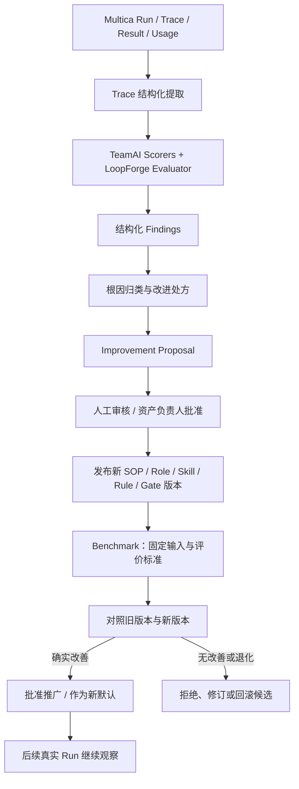

# 专题四：成本、质量评价与工程级 RSI

版本：V1.0 · Multica Usage 融合与 TeamAI / LoopForge 进化机制 · 2026-11-15

本专题沿用 Multica 的 Run、Trace、Result 和 Task Usage 作为事实来源与基础计量链路。融合 TeamAI Scorers 和 LoopForge Evaluator、Benchmark、Findings 与工程级 RSI，形成从真实执行到可验证改进的闭环。

本专题不建立第二套 Run、执行事实库或 Cost Service。治理边界见[架构治理基线](governance-baseline.md)。

## 1. 目标

平台最终要回答四个问题：

1. 一次真实工作消耗了什么，哪些用量有宿主证据，哪些仍未知？
2. 执行质量如何，评价依据是什么，哪些失败来自产品、流程、Agent 或环境？
3. 哪些问题值得改进，应该修改 SOP、Role、Skill、Rule、Gate 还是执行配置？
4. 改进是否真的让后续执行更好，而不是只生成了一份看起来合理的建议？

## 2. 复用 Multica 的成本与执行事实

Multica 已有 Run / Task、Provider / Model、Trace / Result、Task Usage 与用量上报链路。专题四沿用它们作为事实底座。

| 已有能力 | 专题四使用方式 | 允许的增量 |
|---|---|---|
| Run / Task 身份 | 成本、质量和改进的原始执行归属 | 仅补充与 SOP 节点、评测对象和观察来源的关联 |
| Task Usage | 计量结果和汇总入口 | 扩展 Qoder / CodeBuddy 等 Credits、单位、来源身份、覆盖和未知状态 |
| Trace / Message / Tool Activity | 评价执行过程、控制流和工具行为 | 增加必要的结构化提取和原生事件身份 |
| Result / Terminal | 执行终态事实 | 不由评价器或成本采集改写 |
| ContextReceipt | 评价本轮实际获得的能力和知识输入 | 关联资产版本、投递证据和缺项 |
| Asset 发布机制 | 接收改进后的 Skill / Rule / Role / SOP 版本 | 增加候选改进和 Benchmark 的关联 |

不创建平行 Cost Ledger。若 Task Usage 现有字段无法表达某类原生计量，先扩展既有 Usage 模型和上报链路；Observation 可作为来源证据，但不成为另一份可独立结算的账本。

## 3. 成本计量规则

### 3.1 原始观察与计量结果

可保留多路原始观察，例如 Multica Backend、ACP、Stream-JSON、Hook、OTel、宿主转录和成员补录。它们用于证明事件来源、覆盖范围和身份关系。

真正进入 Task Usage 的计量必须：
- 归属于真实 Multica Run / Task，或明确标记暂时无法归属；
- 携带 Provider、Model（若有）、Metric、Unit、Value 和原生身份；
- 区分单次增量、阶段快照、Turn 快照、Session 累计和账单结算；
- 使用原生请求 / Stage / API Call / Event 身份去重；
- 对更正采用覆盖或版本化更正，不把同一快照重复累加。

### 3.2 计量单位不能混算

| 宿主 | 已观察或官方定义的计量 | 当前边界 |
|---|---|---|
| Codex | Input / Output / Cached Tokens | 按 Thread / Turn / 原生用量区间识别累计基线 |
| Claude Code | Token、请求级 Usage、部分 OTel request_id | Hook、SDK、OTel 和转录多源重叠时按原生请求归并 |
| Qoder | Qoder Credits；Assistant 消息请求用量与 Session total_credits 累计快照 | 当前 Mac CLI 1.1.88 / SDK 1.0.59 测试未取得 Assistant 消息、原生 request_id 和请求 Credits；Session total_credits=0 不是单次消耗 |
| CodeBuddy Code | Credits Stage、requestId、stage.id、Turn / Result snapshot | 实测单 Stage 0.69 Credits；snapshot 是同一事实的副本，不能重复相加 |
| GitHub Copilot CLI | nano-AIU、Premium Request cost、Tokens | Session checkpoint 是累计快照；两次 Run 的差值只是派生观察，不冒充原生单次用量 |

Qoder / CodeBuddy Credits、Copilot nano-AIU、Premium Request cost、Token、USD 估价和账单实付均为不同指标。缺少原生字段时记录 unknown，不根据 Token、时长、订阅余额或累计快照推算。

### 3.3 Run / Session / Turn 归属

- Run 是 Multica 的执行归属单位。
- Session 是宿主连续性资源，可被多个 Run 先后引用。
- Turn / Request / Stage / API Call 是宿主内部更细粒度身份。
- 一个 Session 不等于一个 Run；不能按 Session ID 直接归集所有费用。
- 只有启动绑定、原生事件身份或可验证的映射足以证明归属时，才将 Usage 计入 Run。
- 无法证明时保留 Session 级或未归属观察，不伪分配到 Issue / Run。

### 3.4 Qoder 当前研究结论

Qoder CLI 1.1.88 / Agent SDK 1.0.59 的 Mac 实测保持 PARTIAL：

- SDK Query 与共享 Daemon 的关闭已验证；Node 主进程自然退出，但本轮观察到的派生进程仍需定向清理。
- Assistant 消息为 0，原生 request_id 为 null，请求 Credits 为 unknown。
- Result 的 total_credits=0 是 Session 累计快照，不代表单次请求消耗为 0。
- SDK 探针实验不是 Multica Qoder ACP Backend 的生产架构依据。下一步应优先核对 Multica ACP Backend 在目标 Qoder 版本中是否能取得真实 Credits；若 ACP 不暴露，再评估官方 CLI 其他原生入口。
- 不使用企业 API、账户 Usage 页面或账单接口补数。

详细回执见[Runtime 真实验证记录](../research/topic-04/runtime-validation-1.1.88-2.181.0.md)。

## 4. 质量评价：融合 TeamAI Scorers 与 LoopForge Evaluator

评价的对象可以是 Run、Issue 交付、Agent / Role、Squad、SOP、Skill / Rule 或 Workflow，但每份评价必须说明评价对象、证据范围、评价器版本和评价时间。

### 4.1 评价器分层

| 评价器类型 | 主要职责 | 证据来源 |
|---|---|---|
| Deterministic Scorer | 测试结果、退出码、制品完整性、门禁、工具调用和权限事实 | Multica Result、Script 输出、测试报告、服务回执 |
| Trace Scorer | 控制流、步骤遵循、工具使用、重试、恢复、上下文和执行效率 | Multica Trace、Message、Tool Activity、ContextReceipt |
| Model-based Evaluator | 目标达成度、推理过程质量、代码 / 文档质量、需求覆盖和风险 | 固定范围的 Trace、制品、工作约定和评价提示版本 |
| Human Review | 业务判断、架构判断、用户体验和无法自动判定的质量 | Issue Decision、Review 记录和具名证据 |

模型评价不能替代客观测试或人工验收。评价器本身也必须版本化，并记录输入证据范围，防止评价器版本变化导致历史分数不可解释。

### 4.2 评价结果

Evaluation 至少包括：
- 被评价对象及其 Multica Run / Issue / Asset 引用；
- 评价器类型、名称和版本；
- 输入证据范围与缺失项；
- 维度评分及权重（若有）；
- 结构化 Findings：问题、严重度、位置、证据和置信度；
- 建议动作及其适用范围；
- 是否需要人工复核。

Evaluation 是独立结论，不修改 Run 成功 / 失败、SOP 门禁或 Issue 最终验收状态。

## 5. LoopForge 工程级 RSI 改进闭环

LoopForge 的关键价值不仅是 SOP 执行，而是从真实 Trace 中发现问题，形成改进处方，再通过 Benchmark 验证改进效果。

### 5.1 从 Findings 到改进处方

Findings 需要归因，而不是直接把“Agent 表现不好”转成修改 Prompt。

根因类别至少区分：
- 需求或输入不完整；
- SOP 步骤、依赖或门禁设计不合理；
- Role / Skill / Rule / Playbook 缺失或冲突；
- Agent / Model 能力或配置不适合；
- 工具、权限或 Runtime 环境问题；
- 验证器自身错误或覆盖不足；
- 外部服务、网络和资源故障。

处方必须指出准备修改的资产、预期改善的指标、可能副作用和验证方法。

### 5.2 Benchmark 对照

Benchmark 固定：
- 任务输入、代码 / 文件基准和工作约定；
- SOP / Role / Skill / Rule / Gate 版本；
- Agent / Model / Runtime 配置（在可固定范围内）；
- 测试、Scorer、Evaluator 和评分权重；
- 成功标准、失败标准和统计口径。

比较候选版本时，至少观察：
- 目标达成率与客观测试通过率；
- 质量 Findings 数量和严重度；
- 返工次数、重试次数和人工介入次数；
- 执行耗时和工具调用；
- Token / Credits / USD 等分单位消耗；
- 失败、恢复和交付完整性。

新版本只有在预先声明的成功标准下取得改善，且没有不可接受的质量或成本退化，才可推广。不能只用模型自评分数证明自身改进。

### 5.3 改进发布边界

- Improvement Proposal 是候选，不是自动发布。
- 资产负责人审核影响范围、证据、兼容性和潜在回归。
- 发布走专题三 B 的统一资产版本治理。
- 新版本只对后续选择它的新 SOP 实例 / Run 生效。
- 在途工作保留原版本，除非有权负责人明确决定迁移并完成影响分析。
- 改进失败时保留 Benchmark 结果、拒绝理由和后续修订，不删除失败证据。

## 6. 统一数据边界

| 数据 | 权威来源 | 专题四的职责 |
|---|---|---|
| Issue / Run / Session | Multica | 只引用，不复制身份和生命周期 |
| Trace / Tool Activity / Result | Multica Backend / Daemon | 结构化提取、补充观察来源和覆盖 |
| Token / Credits / Cost | Multica Task Usage | 扩展指标与身份，提供去重和缺项证据 |
| Evaluation / Findings | 专题四评价机制 | 新增评价结果，但不修改执行事实 |
| Improvement Proposal | 专题四 | 形成候选和审核依据 |
| SOP / Role / Skill / Rule 版本 | 专题三 B 资产治理 | 发布和分发仍归统一资产治理 |
| Benchmark | 专题四 | 固定对照输入、版本和评价器，验证效果 |

## 7. 实施顺序与验收

1. **Usage 融合**：盘点 Multica Task Usage 对 Token、Credits、成本和来源身份的支持；优先扩展现有模型与 ReportTaskUsage 链路。
2. **多源去重**：将 ACP、Stream-JSON、Hook、OTel、转录与 Multica Trace 对齐，验证重复上报不重复结算。
3. **Qoder / CodeBuddy 覆盖**：先验证 Multica 现有 Backend 的真实字段，再决定是否需要补充采集入口。
4. **最小评价闭环**：选一类真实 Run，组合确定性 Scorer 和 Trace Scorer，产出结构化 Findings。
5. **改进处方**：从真实 Findings 生成一项 SOP / Skill / Rule 改进提案。
6. **Benchmark 对照**：固定旧版和候选版，在相同输入和评价器下对比，形成推广或拒绝结论。
7. **发布后观察**：只对新版本生效，持续比较真实 Run 的质量、返工和成本指标。

验收要求：无第二成本账本；无第二 Run；原始用量单位不混算；评价不覆盖执行事实；改进必须经过审核和 Benchmark；所有未知值和证据缺口可见。
