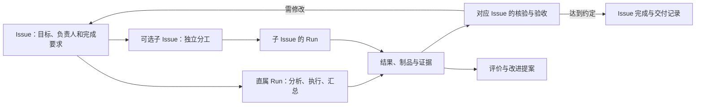

# 统一架构总览

版本：专题一 V0.3 / 专题二 V0.3 / 专题三 A V0.6 设计评审稿 · 架构总览

日期：2026-11-15  
范围：工作机制、产品边界与核心模型；不包含数据库、接口、部署方案。  
依据：[产品架构设计输入 V1](../../Team%20Agent%20Collaboration%20Platform.md)、[专题一研究](../research/01-source-evidence.md)、[专题二三库源码与测试](../research/02-source-evidence.md)、[专题三 A 研究](../research/03a-source-evidence.md)。

## 1. 项目目标、底座决策与设计基线

本项目维护面向研发团队的人机协作工作台产品架构设计，采用中心协作、本地分布式执行的方向。

### 1.1 底座工作假设决策

本方案明确确立一条设计前提决策：**以 Multica 作为平台工作平面与控制平面的主干**（复用其 Issue/子 Issue 共模模型、status 状态目录、Project Workflow 步骤指令与负责人交接、受管理 Run 执行记录、Runtime 共享授权以及 child_done 阶段唤醒机制），作为后续专题展开的设计前提。

- **采用理由：** Multica 已提供较为完整的人机协作与本地执行链路，直接复用其骨架能最大程度减少重复建设，避免重造任务管理、执行派发与本地 Daemon 轮子。
- **适用范围：** 作为工作平面与控制平面的主干；TeamAI（团队能力体系、上下文检索与自改进）与 LoopForge（SOP 流程图与工程评测）的能力按需以增量方式接入，不独立建立平行工作平面。
- **推翻条件：** 若后续专题出现以下情况之一，该工作假设即被推翻：
  1. 专题二研究发现 Project Workflow 无法容纳完整交付 SOP 而不产生双重状态或双重分配权威；
  2. 专题三研究发现 Multica Runtime/Daemon 无法适配目标宿主工具（如 Codex、Claude Code、CodeBuddy、Qoder、OpenCode 等）或本地交互接入需求；
  3. 关键平台强制规则（见专题一第 6.4 节，如全部完成入口校验有效人工验收决定、人工门禁等待明确答复等）在 Multica 上的扩展代价不可接受。
- **推翻后果：** 若推翻此假设，需重审专题一的工作对象模型（是否退回业务 Task 或双层模型）、负责人流转机制（是否重建独立状态机）以及执行记录与会话接入方式。
- **决策效力：** 最终技术选型仍由用户在五个专题贯通后最终确认，但在专题探索阶段，该假设作为后续专题设计的前提。

### 1.2 设计基线表

全文对技术状态的约束集中由此表界定，不再在正文中对每句话冗余附加“候选/探索/草案”等限定词：

| 维度 | 【用户已确认】 | 【当前工作假设】 | 【待定】 |
|---|---|---|---|
| **架构方向** | • 中心协作管理 + 分布式本地执行架构 • 不以 Git 为平台运行的底层必要前提（Git 仅为外部来源/协作方式） | • 以 Multica 为工作平面主干（见 1.1 决策） • TeamAI 与 LoopForge 能力增量接入 | 最终生产级技术选型与多服务整合部署方案 |
| **工作对象** | • Issue First：Issue 作为团队工作和协作的中心 • SOP 是工作过程中可调用的标准化执行机制，不取代 Issue 协作系统 • Issue 设计参考 Multica，减少重复建设 | • 以父子 Issue 承担分工，不设立独立业务 Task 层（偏离 V1 初始概念） • Run 统一作为受管理执行记录 • 区分稳定的“总责人（人工）”与随步骤交接的“当前负责人” | 跨系统对象持久化映射与接口数据协议；轻量工作单元是否需要独立表达 |
| **协作组织** | • Human / Agent / Squad 三种工作负责人模式 • Squad 仅在明确指定为主责时才启动自动协调 | • 子 Issue 允许指派给 Squad，但限一层嵌套 • 子项阶段使用 stage + child_done 提示负责人；交给 SOP 的工作按各自的前置结果就绪 | 复杂跨小队级联协作调度与额度分摊细节；一层 Squad 嵌套策略的长期适用范围 |
| **流程与依赖** | • 将稳定研发流程固化为可执行、可验证、可复用的 SOP | • Project Workflow 承担 Issue 状态推进与步骤交接主干 • SOP 以 Delegation Grant 获得范围化操作许可；托管范围由 Dispatch Control Binding 指定唯一派发控制者，按 DAG 就绪条件激活子 Issue；结构化出口结果经 Project Workflow 幂等校验后推进 Issue；外部独立生产的结果另行引用 | 完整 SOP 在真实项目上的并发交付、外部副作用核对及指定验收人决策；分项证据见[第五阶段](../research/03a-source-evidence.md#14-第五阶段跨主机接续与设计收口) |
| **规则与执行** | • 支持人工讨论、决策、审批、介入和接管 • 真实执行由本地 Runtime 承担；本地 Runtime 离线时，中心协作数据仍可由在线成员访问 | • 设立平台强制规则清单（全部完成入口校验有效人工验收决定、人工门禁等待明确答复、机器所有者共享授权等） | 各成员独立 IDE 的实际覆盖、真实部署的外部副作用核对与 Leader 角色接管；受管 Codex、Claude 与其他适配器的已测能力见[能力矩阵](execution-capabilities.md) |

### 1.3 与设计输入 V1 的对应与偏离

- **Task 对象的承载方式：** 设计输入 V1 中将 Task 定义为“可分配的具体工作”，并设想了 Issue、Task、Run 三层模型。本方案中，具体分工由**子 Issue**（需要独立负责人、状态与交付的分工）或**同 Issue 委派**（短协作/同事项内多次 Run）承担，**不建立与 Issue 并列的独立业务 Task 层**。
- **偏离原因：** Multica 的 Issue 模型天然具备父子树状关系、独立负责人、状态推进、评论通知与 Run 挂接；若在 Issue 之下平行建立一套业务 Task 层，会导致两套对象的状态双重同步、分配权限冲突、交付判断冗余以及用户心智负担，且缺乏实际场景收益。“Task”在本文档中仅作为具体任务的普通称呼。
- **状态提示：** **【需用户确认此偏离】**。

## 2. 设计进度与入口

| 专题 | 当前范围 | 后续工作与首要问题 |
|---|---|---|
| 一：统一工作生命周期 | V0.3 阶段方案、订单导出推演与用户评审修订 | 保留六项待验证事项，涵盖轻量工作单元 / Task、总责人、验收决定、Squad 嵌套、Leader 离线和项目级多 Issue 组织；结合后续专题持续验证 |
| [二：SOP 与研发工作流融合](02-sop-workflow.md) | V0.3 设计：委托授权、派发控制绑定、工作流出口幂等交接、子项委托轮次；配套 17 项状态模型测试与三库研究 | 验证委托授权与撤销、三入口派发仲裁、子 Issue 委托轮次、SOP 出口幂等交接，以及人工门禁和跨机返工 |
| [三 A：执行平面与宿主适配](03a-execution-plane.md) | V0.6 设计评审稿。已验证双机候选交接、双成员访问、原机重连和迟到回报。[实验记录](../research/03a-source-evidence.md#14-第五阶段跨主机接续与设计收口) | [宿主能力与版本回执](execution-capabilities.md)交 3B 使用；成员日常 IDE、实际订单服务及人工接受由现场验证 |
| 三 B：能力与知识治理 | 下一阶段：资源来源、作用域、版本、审核发布及知识贡献 | 先贯穿一条 Rule 与受管 Script 换版，验证发布、选择、在途节点处理及宿主回执追溯 |
| 四：成本、质量与自改进 | 约定共享证据、执行事实和归集边界 | 统一成本口径、评价覆盖、后台活动、Benchmark 与改进效果验证 |
| 五：统一工作台产品 | 约定围绕现有工作对象组织入口 | 复用既有产品路径，补齐交互视图，不创造平行状态权威 |

阅读[专题一](01-unified-work-lifecycle.md)了解具体工作规则，阅读[专题三 A](03a-execution-plane.md)了解执行平面探索范围，[术语表](../../CONTEXT.md)用于核对概念，[源码研究依据](../research/01-source-evidence.md)区分上游事实、配置和设计扩展。专题二的工作选择及实现验证条件见[专题二设计](02-sop-workflow.md)，状态模型结果见[原型验证记录](../research/topic-02/prototype-validation.md)。

## 3. 专题一提出的工作主线

子 Issue 与父 Issue 使用同一模型；父子关系用于工作组织，父级完成按整体目标和验收要求判断。七项能力——输入、分析、组织、执行、验证、交付、改进——按场景组合，不强制成为七个步骤或七个 Issue。

## 4. 专题一的复用与扩展方案

| 事项 | 处理方式 | 需要保留的边界 |
|---|---|---|
| Issue、父子关系、负责人和 Run | 原生复用 | 同一工作不再同时维护业务 Task 与子 Issue |
| 评论、提及、Leader 协调与工作变化唤醒 | 原生复用，明确参与和主责 | 同一工作选择一种派发路径；受邀参与不自动取得主责 |
| 状态目录与 Project Workflow | 原生复用，按项目配置 | 不另建一套固定业务状态机；步骤交接可改变当前负责人 |
| 工作范围、验收、决策和证据 | 优先组织现有 Issue 内容、评论、活动与 Run 引用；缺口才扩展 | 约定版本、候选版本和判断来源要对应；上游提示词约定不是强制保证 |
| Runtime 与权限 | 先复用现有成员访问、资源共享、派发及执行限制 | 业务分配、机器使用和实际操作授权各有范围，不互相替代 |
| 本地交互式会话接入 | 先核对已有会话 / Run 关联，再补适配 | 共享范围可选择，过程与成本分别记录实际采集覆盖 |
| 团队能力、SOP、评价与改进 | 在既有工作链路上增量接入 | 不复制项目、Issue、负责人、通知或运行事实权威 |

此分类用于当前方案推演与后续比较。项目源码中的内部 Task、Workflow Run 等名称按原项目解释；各专题结合实际需求评估复用和适配代价。

## 5. 跨专题职责草案

| 事项 | 主责 | 协作与限制 |
|---|---|---|
| Issue 工作目标、父子分工、当前负责人与总责人、完成与验收 | 专题一，依托 Multica 工作机制 | SOP / 评价提供依据，由现有工作机制确认业务完成 |
| 工作分配、接管和验收的授权语义 | 专题一 | 复用成员与项目权限；专题 3A 处理 Runtime 资源授权，专题五呈现操作入口 |
| Project Workflow 与 SOP 的衔接、分工组织双轨矛盾消解 | 专题二 | Project Workflow 管状态与交接；SOP 通过 Delegation Grant 获得范围化操作许可，以 Dispatch Control Binding 成为托管范围唯一派发控制者；SOP 提交带稳定 Result ID 的结构化出口结果，Project Workflow 幂等校验并原子推进 Issue 与控制绑定；stage 提醒与 DAG 就绪分别处理 |
| 执行平面、宿主适配与资源授权（3A 先行线） | 专题 3A | 研究中心派发与本地交互、受管命令、任务身份、按 Provider 协商的停止确认、代码接续和加载回执，验证结构化节点结果与制品回报的职责分配 |
| 能力知识治理、上下文选择与版本发布（3B 顺延线） | 专题 3B | 统一治理 SOP、受管 Script、Agent、Skill、Rule、Playbook 的版本、作用域、审核与分发；工作事实由 Issue 提供，实际加载由 3A 确认 |
| 成本、评价、后台活动、提案及 Benchmark | 专题四 | 复用执行事实；正式资产发布走专题 3B 的治理，流程可执行性由专题二验证 |
| 工作台、资源与权限管理交互 | 专题五 | 优先复用已有 Issue / 会话 / Run 入口，不在视图中创造新状态权威 |

这份分工把授权和 Runtime 纳入已有五个专题，不新增第六个专题。专题三内部拆分为 3A（执行平面与宿主适配）和 3B（能力与知识治理）两条先后依赖子线。权限细节、适配协议与实现方案不在专题一提前展开。

## 6. 共享业务契约

### 6.1 Work Context

围绕当前 Issue，引用父级目标、子级结果、有效决定、项目知识、代码基准、流程进展与已有证据。子 Issue 获得完成自身工作所需的父级约束，不默认复制全部父子聊天。

专题一负责工作事实和工作约定版本；专题三按角色和范围组装知识与能力，记录来源、版本及实际加载证据。专题二补充 SOP 节点要求，专题四读取实际使用的上下文进行归因。私有会话接续时采用共享记录中的最新有效决定。

### 6.2 Execution Contract

业务执行直接引用 Issue 的当前约定、目标范围、允许动作、代码基准、必要输入、结果要求和验证方式；执行结束提供实际结果、变更、证据、制品、缺口与下一步。

这是一组复用现有工作信息的语义要求，不是额外的 Task、任务单或接口格式。纯人工决定与验收直接记录在 Issue；实际人工操作可附验证记录，无须伪造 Agent Run。

### 6.3 Evidence & Feedback

证据关联具体要求、制品 / 代码版本、环境、观察者、方法和结论，供工作追溯、验收、评价及改进共同引用。测试事实、人工放行、模型评价和业务接受分别表达。

业务 Run 的成本归直接关联的 Issue。SOP 通过节点尝试、Delegation Round 及子 Issue 本轮交付关联实际 Run，纳入本次直接执行、受托子项和 Sub-SOP 的消耗；历史制品引用保留来源成本，与本次新增成本分别列示。父 Issue、Squad、项目和 SOP 按实际 Run 去重汇总。后台评价、索引和知识抽取记录来源与项目 / 团队归属，真实上报、估算、只有 Token 和未知费用分别保留。

## 7. 跨专题协作约定草案

| 工作动作 | 已有工作主干提供 | 扩展能力返回 | 权威边界 |
|---|---|---|---|
| 选择能力与知识 | 当前 Issue、父级约束、角色、基准和要求 | 资源版本、来源、实际提供 / 加载情况和缺失项 | 专题三组装，不覆盖 Issue 工作事实 |
| 开始业务执行 | Issue、执行范围、参与者、允许动作 | 原生运行关联、真实状态、结果和证据 | 沿用 Runtime 派发执行链，不旁建一套 Run |
| 调用 SOP | Issue、明确委托范围、Delegation Grant、所选版本和输入 | 节点尝试、子项委托轮次、Delivery Record、门禁结果、制品与结构化出口结果 | Dispatch Control Binding 唯一确定该范围的派发控制者；Issue 工作机制校验 Grant、派发请求与状态交接 |
| 请求人工判断 | 具体问题、候选、影响和决定者 | 对应 Issue 上可追溯的 Decision | 批准采用指定决定者对具体事项的明确答复 |
| 评价与归因 | Issue / Run、结果、资源版本与反馈 | Evaluation、证据缺口、改进建议 | 评价不替代验收，不回改历史事实 |
| 发布改进 | 提案、候选变更、回归结果和审核结论 | 正式资源版本和适用范围 | 资源发布统一归专题三；效果证明归专题四 |

后续专题结合实际需求检验以上约定。出现新的对象或执行机制需求时，说明现有方案的缺口及取舍依据，并同步更新本总览、术语、相关专题和案例。

## 8. 贯穿案例

“为现有系统增加订单批量导出功能”是父 Issue，由 Squad 协调。前后端等需独立交付的工作形成子 Issue，各自承载 Run；Leader 分析和汇总留在父 Issue，最终业务验收也记录在父 Issue。

案例继续使用模拟决定：导出当前筛选下可见订单、XLSX、最多 5,000 条、超过上限明确拒绝；中途增加付款时间列。经历成员离线交接、权限测试失败和定向返工，再对最终候选验收。数字、角色和业务取舍用于设计推演，不是用户已批准的真实需求。

简单文案修改则只需一个 Issue 和必要执行，不创建子 Issue、协调 Task 或验收 Task。详细正常、失败和轻量路径见专题一。

## 9. 后续验证与专题输入

| 专题 | 尚需解决 | 专题一提供的阶段性输入 |
|---|---|---|
| 二 | 验证托管子项的首次就绪检查、稳定绑定复用、自修正与重试记录、委托费用归集及跨机接续 | 按[专题二第 9 节](02-sop-workflow.md#9-原型验证顺序与验收标准)先接通局部验证，再覆盖完整交付的创建、返工和交还 |
| 三 A | 在成员独立 IDE、真实项目与长期断线条件下复核 V0.6 的能力与恢复契约 | 核对节点结论、具名制品、候选与尝试；按宿主和版本记录终态观察、清理确认及恢复证据；真实集成沿用专题二的授权和控制关系 |
| 三 B | 以订单导出 Rule / Script 换版贯穿版本、作用域、审核发布、分发与上下文组装 | SOP 模板和受管 Script 与 Agent、Skill、Rule、Playbook 同属资产治理；承接专题二发布静态检查与版本摘要要求，加载由 3A 确认 |
| 四 | 成本覆盖、后台活动归属、可信评价、Benchmark 与发布后观察 | 来源明确、无重复统计，后台活动不强制业务化，评价与事实分离 |
| 五 | 轻量入口、父子工作视图、待决与交付判断、资源管理交互 | 围绕工作，复用现有产品路径，减少重复维护 |

## 10. 底座工作假设与整体决策

V0.3 确立以“Multica 作为平台工作平面与控制平面主干”作为明确的工作假设决策（详见第 1.1 节），指导后续专题的设计展开，避免在初期反复摇摆。

若后续专题在研究中触发推翻条件（SOP 分工双轨不可调和、Daemon 无法适配宿主、或平台强制规则扩展代价不可承受），将重审专题一的工作对象模型（如退回 Task 层）与状态机设计。

最终架构、技术底座与代码落地选型在五个专题贯通后由用户综合评审确认。各专题在推演与比较中发现新需求时，依设计基线表同步更新总览、术语和案例。
