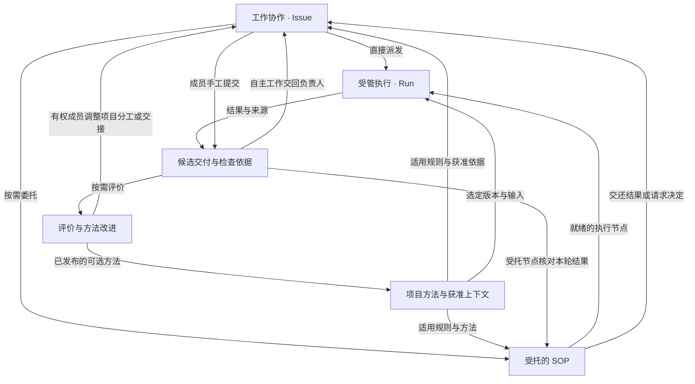

# AgentPlatform 核心架构

AgentPlatform 是面向研发团队的 AI 研发能力平台。它以团队知识为基础、以产研工作为主线、以 Engineering Harness 为质量保障，通过真实执行证据、Evaluation 和持续改进，让团队经验进入研发、研发结果反哺知识与工程方法。

产品目标、核心能力域、团队知识飞轮与 Harness 进化飞轮，以及产品范围边界，以[产品定位与总体设计基线](product-foundation.md)为准。本页说明现有工作协作、执行和交付架构；其中对象与模块边界将在整体融合设计中按产品基线统一收敛。

## 产品能力如何落到现有架构

| 产品能力 | 现有架构承载 | 融合设计重点 |
|---|---|---|
| 团队知识管理 | [团队知识管理与研发知识闭环](knowledge-management-lifecycle.md)、团队 Wiki、项目资料、能力与上下文中的知识引用 | 统一来源接入、证据处理、知识提炼、发布治理、检索复用、更新失效和使用反馈 |
| 产研工作与流程 | Project、Issue、Project Workflow、SOP Execution | 保留 Issue 作为工作与责任主线，区分项目责任交接和受托 SOP |
| Engineering Harness | Team / Project 方法、Rules、Skills、Playbooks、Workflow、Scripts、Evaluation | 从知识中取得依据，将团队方法带入执行，并以可验证的质量门槛约束结果 |
| Agent 执行、观测与改进 | Multica Run / Runtime、Daemon、宿主适配、Observation、D5 / D6 / D7 | 让真实执行证据同时支持交付、知识贡献、评价和持续改进 |

跨知识、Harness、工作、执行和证据的对象关系见[核心业务对象与统一关系模型](core-business-object-model.md)。

知识资产、Harness 资产、Issue 工作上下文和执行资源分别维护，不合并成一个通用资产仓库。两个飞轮共享可追溯证据，但各自的知识发布、Harness 发布、项目采用和业务验收保持独立权责。

## 1. 系统边界

本页说明产品核心职责与工作主线。完整的逻辑模块划分、五层职责映射、中心与本地 Runtime 边界、组织资源关系及模块依赖见[整体系统架构与模块边界](system-architecture.md)。

| 边界 | 在哪里产生和维护事实 | 跨越边界时交接什么 |
|---|---|---|
| 中心协作 | 项目配置、Issue 及其讨论和决定、指派、受管执行的安排与收到的回执、选定的交付、流程与方法版本 | 向有资格的执行者派发授权范围内的工作。接收实际回报，保留生产方、版本、工作归属与观察范围。 |
| 成员本机 | 宿主 Session、实际输入与工具调用、工作副本、未共享的修改，以及 Runtime 的可用资源 | 受管执行经 Daemon 和宿主适配器回报。本地自主工作按成员选区和来源权限交回。共享材料、读取历史和控制后续输入分别核对授权。 |
| 工程仓与资料来源 | 代码修订、资料正文及其读权由各自来源维护；平台自有资料由其维护者修订 | 工作引用仓库修订、资料版本或已共享的具体附件。接手者按自己的权限取用。团队资料 Wiki 与代码 Wiki 都可按需接入。 |

工作台是上述能力的共同入口。项目列表、Issue、Inbox 和执行视图读取同一份共享记录。改变负责人、批准某项要求、调整资源授权，各自回到拥有该决定权的入口写入。成员本机离线时，其他成员仍可讨论、决定和取用已经共享的版本。[工作台职责](05-unified-workbench.md) · [本地执行](03a-execution-plane.md) · [资料来源](team-project-wiki.md) · [代码来源](code-wiki.md)

## 2. 核心对象模型

系统对象按组织与范围、工作与责任、方法与能力、流程实例、执行资源与记录、交付与证据、评价与演进划分。**Issue 是业务工作与责任的权威归属；SOP Execution 管明确受托的流程范围；Run 记录真实受管执行；Session 只提供宿主连续性。** Artifact、Candidate、Evidence、Delivery Record、Evaluation 和 Decision 分别表达交付内容、交付组合、事实依据、交付汇总、评价结论和业务决定，不能互相替代。完整定义、对象关系、事实归属和不变量见[核心对象模型](core-object-model.md)。对象各自的生命周期、状态转换、事件因果和跨层联动见[统一生命周期、状态机与事件模型](lifecycle-state-event-model.md)。多主体并发、跨层动作恢复、版本消费和旧执行隔离见[核心协作一致性与并发控制模型](core-consistency-concurrency.md)。各层交换的工作、上下文、能力、委托、执行、交付和反馈约定见[跨层业务契约与协作协议](cross-layer-contracts.md)。

## 3. 核心职责分层

五项职责按决定权和事实来源划分。中心侧可以合并部署相应职责，受管执行跨越中心派发与成员本地宿主。工作台贯穿各层，将成员的动作交给有权变更该事实的入口。

| 职责 | 负责决定或记录什么 | 其他层怎样与它协作 |
|---|---|---|
| 工作协作 | Project 与 Issue 维护工作约定、当前负责人、父子分工、业务决定及完成状态。Project Workflow 按项目步骤移交责任。 | 给执行者或 SOP 明确受托范围和完成条件。收回交付、问题与决定，按当前约定推进。成员与 Agent 的分工方式见[工作生命周期](01-unified-work-lifecycle.md)。 |
| 能力与上下文 | 团队维护可发布的方法与适用范围，项目维护者决定采用的规则、Skill、角色、工具和资料来源。一次工作的有效选择绑定到所用版本。 | 从 Issue、父项和项目已有信息出发，按这次分工和接收者权限准备输入。交给实际执行者，依据回报区分已选择、已投递、已使用。[能力与工作上下文](03b-capability-governance.md) |
| 流程编排 | 负责人可以自主规划。对明确委托给 SOP 的部分，流程实例维护前置条件、就绪节点、采用的交付、返工范围和出口。 | Agent 或受管脚本就绪时请求原执行入口派发，人工节点在 Issue 等待决定，子流程接续自己的实例。局部 SOP 将结果交回委托人，完整 SOP 在授权内协调相关分工。[SOP 与项目工作流](02-sop-workflow.md) |
| 执行与回报 | Multica 管理受管执行的派发与 Run，成员端 Daemon、Runtime 和宿主适配器负责领取、准备、执行、取消与回报。Session 提供宿主会话连续性。 | 按当次授权取得输入，向原 Issue 或流程节点交回结果与可核对的制品。手工提交保留成员署名和真实来源，可在有依据时关联原 Run。[执行平面](03a-execution-plane.md) |
| 度量、评价与改进 | 按原生产执行归集已知用量。评价对具体候选、标准及证据给出结论。维护者用可比结果判断改进是否适合推广。 | 本次检查供节点或负责人决定是否修正。团队方法由资产维护者发布，项目配置由有权成员调整，效果从后续实际使用的交付中核对。[成本、质量与改进](04-cost-quality-improvement.md) |

### 三个上游如何共同服务于一次工作

**工作和派发沿 Multica 的原链路。** 业务分工使用 Issue 与子 Issue，受管执行使用 Run。成员可在原讨论邀请一次性协助，也可将 Issue 指派给 Agent 并明确委托它担任 Main Bot。Main Bot 可直接执行，也可把具体工作交给获准的 Worker。Project Workflow 管项目阶段与负责人，SOP 管本次受托范围内的步骤和结果，二者通过 Issue 的原有交接入口衔接。

**同一份执行安排贯通方法与流程。** 采用 TeamAI 的项目作用域、能力选版和步骤驱动机制，让成员或 Agent 取得这次有权使用的输入。采用 LoopForge 的依赖判断、检查与定向返工机制，让 SOP 决定哪一步已就绪。若节点使用步骤驱动，宿主在已获授权的执行中领取、确认和回报步骤。实际启动与用量沿同一个生产 Run 记录。

**同一份交付证据支持修正和后续改进。** LoopForge 从运行事实及返工中提取发现，TeamAI 提供独立评分、可比样本与回归检查的机制。平台让当前负责人先用证据处理本项交付，再由有权维护者决定是否形成候选。团队方法经审核发布后，可由项目设为默认，也可由负责人在授权范围内为某项工作选用。涉及项目分工或工作流的调整，由有权成员在原配置或 Issue 决定中注明适用范围。上游原生覆盖、需要适配的部分和研究证据分别见[底座边界](governance-baseline.md)、[流程研究](../research/02-source-evidence.md)与[评价研究](../research/04-source-evidence.md)。

## 4. 一项工作的核心流程

从团队已有的项目开始，成员在原 Issue 接下目标，使用适用的项目要求和资料，在本地完成工作后把选定的成果交回。下表列出负责人在推进中可以作出的选择。

| 何时 | 谁采取什么动作 | 工作以什么为准 |
|---|---|---|
| 发起或接回工作 | 从中心开始时，提出人与负责人在 Issue 明确目标、责任和完成要求。先在本地开工的成员，可在受支持的入口关联后续工作，或事后把选择共享的成果交回已有 Issue。 | Issue 保存共享目标与约定；先前的本机过程按实际可核对范围记录。 |
| 确定工作方法与分工 | 当前负责人使用项目已有配置。需要协助时在原项邀请；能独立负责并交付时拆子 Issue；重复环节有明确输入、产出及失败处置时可托付给 SOP。 | 项目采用的必需规则按适用范围进入工作约定，建议方法由负责人选用。需要例外或出现规则冲突时，由有权变更相应规则的成员决定，受影响的工作再继续。 |
| 实施与交回 | 成员自行完成并提交可取回的材料；受管 Agent 经获准 Runtime 执行；SOP 在受托范围内经原派发链启动就绪的 Agent 或受管脚本。 | 交付指向实际版本、工程基准、已知检查及缺项。有可追溯执行时引用原 Run。 |
| 检查与修正 | 检查者针对当前候选和要求出具结果。负责人自主分工时，由负责人安排修正；已托管的工作，由 SOP 在授权内返工。 | 旧报告保留在原候选。新候选只重新取得受影响的证据。结束一次检查可以交出失败报告，接收方据报告决定后续。 |
| 交接与完成 | 受托工作将结果交还原 Issue。需要具名验收时，将当前候选及待决事项交给约定的验收人。项目步骤要求转交 Assignee 时同步办理交接。普通事项由有完成权的主体按既定条件完成。 | 待验收事项可直接转交。写入成功完成状态时，须核对本项完成条件要求的决定及证据。各完成入口遵循同一条件。 |
| 跨工作改进 | 负责人或维护者可在资源和读取授权内对终态 Run 发起独立评价。有证据表明同类问题反复出现或可能影响其他工作时，成员可提出改进，由相应维护者决定是否投入版本对照，再按权限发布或调整项目配置。 | 发布、项目采用、后续工作实际使用各有相应记录。新版本的实际效果从后续可比交付判断，评测消耗单独归集。 |

同一份交付供多项 Issue 使用时，各使用方按自己的条件接手。项目成员能从列表找到仍缺什么、该由谁处理，打开承载该事项的原 Issue 后作决定或补交。项目据此显示哪些分工可继续，实际开工看各项进展。[项目与个人工作入口](05-unified-workbench.md#从项目和个人工作找到下一步) · [跨 Issue 接续](01-unified-work-lifecycle.md#101-优先级和依赖)

### 首期协作范围

**共同要求是下一位成员能接手。** 普通调查可以直接在 Issue 留下署名结论。有代码或文件时，接手者能用自己的权限打开对应提交或附件版本，看见这版已经检查了什么、还缺什么，以及下一步由谁处理。若工作已满足项目的完成条件，有完成权限的负责人或项目流程可直接收尾。需要别人作决定时，当前负责人可在原讨论提及对方，移交整项工作时才变更指派。

**Agent 按本次分工加入。** 一次 `@Agent` 以结果回到原请求为交接点。持续协调时，成员把 Issue 指派给已有 Agent，明确其作为 Main Bot 的授权，自己保留业务总责。两种方式都复用 Multica 的受管执行与回报。无论谁负责，项目都可以沿用 TeamAI 的方法选版机制，把适用规则和获准资料带给实际执行者。需要把有明确输入、检查和返工条件的一段工作委托给 SOP 时，由流程接收该段结果，再向 Issue 交还交付或待决问题。

**首批详细设计聚焦交付与接手。** 从原 Issue 查到交的是哪一版、谁有权取用、哪项决定仍然有效，三种协作方式都能用这份记录继续。项目要求具名验收时，再核对验收人对当前候选和标准的决定。团队可直接引用已有资料，随 Run 保留已有用量，有值得复用的发现时再发起跨工作评价与改进。[首期动作与底座覆盖](governance-baseline.md#原生入口与项目配置) · [专题与工程推进状态](system-architecture.md#11-架构专题与工程推进状态)

### 三种状态各由谁推进

一个 Issue 可有多个子 Issue、多次受管 Run，也可按需调用 SOP。每个子 Issue 有自己的负责人和交付条件。节点按实例和本轮尝试关联结果；一次宿主 Session 可被多次 Run 接续。引用同一制品或运行时沿用其原身份。

- **Issue 状态**由有权成员、Agent 或项目工作流按工作约定推进。评论、通知已读和资源恢复各自只说明相应动作已经发生。
- **SOP 实例及节点状态**由本次流程根据有效输入、当前尝试、核验或人工决定推进。局部检查失败时，只有受托范围内的工作等待或返工。
- **Run 状态**由实际派发、领取、启动和终态回执推进。同一个 Issue 可以引用多次 Run；一次 SOP 节点履行也可能引用多个 Run。成员亲自完成并提交材料时，可只有交付记录。

Main Bot 登记等待条件后可结束本轮 Run。回唤时，它从 Issue 重读当前委托、Worker Run 和尚待核对的交付，再决定继续、返工或交还。

工作重入同一步骤时要区分进入的轮次。重复回报归回原次执行；迟到结果保留原归属。接手时先核对当前责任、授权、可读取的制品与仍可能写入的执行，再继续受影响的工作。成本按可信的原生计量单元归集；未取得的指标保留未知。[流程交接与恢复](02-sop-workflow.md) · [执行回执与资源释放](03a-execution-plane.md) · [计量口径](04-cost-quality-improvement.md)

## 5. 跨层约定

### 共享业务契约

| 约定 | 谁提供，谁使用 | 变化时如何处理 |
|---|---|---|
| Work Context（工作上下文） | Issue 提供目标、责任及共享决定，项目和来源维护者提供方法、代码与资料引用。接手者按当前分工和权限取用所需版本。 | 范围、来源或权限变化后，重新取得受影响的输入；历史工作仍能定位当时所用的版本。 |
| Execution Contract（执行契约） | 负责人或已授权的 SOP 定义本轮工作范围、身份、允许动作、输入、产出与检查条件。执行者按资源和当次权限领取。 | 撤销后停止新的受影响派发；在途动作核对实际终态与副作用。需用新身份接手时以接手者的授权继续。 |
| Evidence & Feedback（证据与反馈） | 生产者交回制品和来源，检查者给出针对候选的结论，业务决定者记录接受、退回或例外的作用范围。评价者按读权使用这些事实。 | 候选或标准变化后重新判断哪些检查仍适用。发布新方法与接受当次交付分别由各自有权主体决定。 |

[统一术语](../../CONTEXT.md)定义各对象的含义。专题正文维护各自的行为规则；[宿主能力矩阵](execution-capabilities.md)给出按入口和版本区分的可观察范围。
