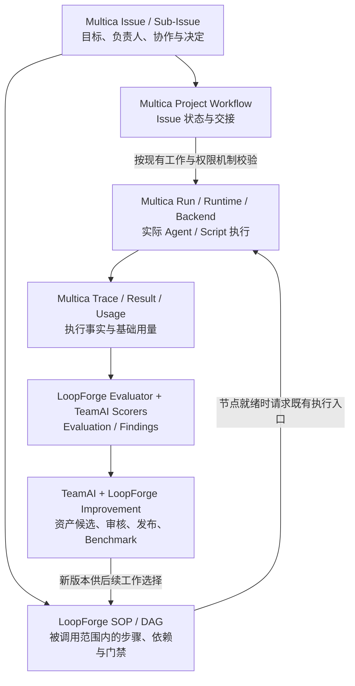

# 统一架构总览

版本：V1.0 · Multica 基座融合架构 · 2026-11-15

范围：产品边界、能力归属、跨专题职责与核心工作机制。数据库、接口和部署细节由后续实现设计确定。

架构治理规则见[架构治理基线](governance-baseline.md)。专题设计与本文件冲突时，以治理基线和本总览为准。

## 1. 产品定位与架构方向

本项目建设面向研发团队的人机协作产品，**以 Multica 为协作与执行基座，融合 TeamAI 的团队能力治理，以及 LoopForge 的 SOP、工程评测和 RSI 自改进机制**。

这是一项明确的架构方向，不是等待各专题重新选择的工作假设。

- Multica 提供工作平面、控制平面和本地执行底座。
- TeamAI 提供团队能力、知识、上下文治理与能力改进机制。
- LoopForge 提供可组合 SOP、执行评测、结构化 Findings 和工程级 RSI。
- 本项目负责把这些能力融合成一套产品，不另建与 Multica 平行的协作和执行平台。

最终仍需验证具体版本、扩展点和实现成本；验证的是“如何基于 Multica 落地”，不是每个专题重新讨论是否采用 Multica。

## 2. 能力所有权与复用边界

| 领域 | 基座与事实权威 | 融合内容 | 不建设的平行能力 |
|---|---|---|---|
| 工作组织 | Multica Issue / Sub-Issue、Assignee、Comment、Squad | 研发工作约定、验收引用 | 第二套 Issue / Task / 负责人系统 |
| 状态与协作 | Multica status、Project Workflow、现有权限和交接 | 研发强制规则的最小扩展 | 第二套状态机、派发权威 |
| 执行 | Multica Run、Daemon、Runtime、Provider Backend、Session、Process 管理 | Skill Driver、执行观察和宿主能力补缺 | 第二套 Run / Runtime / Daemon / Supervisor |
| 执行证据 | Multica Trace、Result、ContextReceipt、Task Usage | AgentObservation、额外事件身份和来源覆盖 | 第二套执行事实库与成本账本 |
| 团队能力 | Multica Agent / Skill / Plugin / Context 基础设施 | TeamAI Role / Rule / Playbook / Knowledge 治理 | 未经盘点的新资产平台 |
| SOP | Multica Issue / Project Workflow / Run 是承载面 | LoopForge SOP / DAG / Sub-SOP / Gate / Retry | 第二套 Issue、Run、Runtime、权限和完成状态 |
| 质量与改进 | Multica 的 Run / Trace / Usage 是事实输入 | LoopForge Evaluator、TeamAI Scorers、Benchmark、RSI | 评价结果覆盖真实执行或自动改写已发布资产 |

详细的“已有能力—扩展缺口—实现方式”审查要求见[架构治理基线](governance-baseline.md)。

## 3. 工作主线

Issue 是工作与责任的中心；Run 是 Multica 管理的一次真实执行；Session 是宿主会话连续性资源；SOP 是可附着在 Issue 工作中的标准化流程；Evaluation 是对执行结果的独立评价。

SOP 负责流程内部依赖，不取得 Issue 状态和实际 Run 的所有权。节点需要 Agent / Script 执行时，通过 Multica 既有执行入口；人工门禁引用 Issue 的真实决定。评价和改进不会反向篡改原 Run。

## 4. 跨专题职责

| 专题 | 责任 | 必须复用的 Multica 能力 |
|---|---|---|
| 一：统一工作生命周期 | 明确 Issue First、Human / Agent / Squad 责任、轻重工作分工、验收和工作事实 | Issue、Sub-Issue、Assignee、Squad、Project Workflow、Comment、Run |
| 二：SOP 与研发工作流融合 | 把 LoopForge SOP / DAG 接入 Issue 工作；确定节点如何调用既有 Run、门禁和返工 | Issue、Project Workflow、Run、Runtime、权限、通知和结果回报 |
| 三 A：Multica 执行底座审计与扩展 | 盘点现有 Daemon / Runtime / Backend / Session / Process / Workspace / Trace；只设计真实缺口 | Multica 全部执行链和 Provider Adapter |
| 三 B：团队能力与知识治理 | 将 TeamAI 的资源治理、检索、版本、分发和加载核验接入 Multica | Agent、Skill、Plugin、ContextReceipt、Runtime 派发 |
| 四：成本、质量与 RSI | 扩展 Task Usage，融合 TeamAI Scorers 与 LoopForge Evaluator / RSI | Run、Trace、Task Usage、Result、Asset 发布 |
| 五：统一工作台 | 整合工作、执行、能力资产、SOP、评价与改进入口 | Multica 既有工作对象和产品路径 |

## 5. 统一工作对象

- **Issue / Sub-Issue**：团队工作、目标、责任和交付判断的权威对象。按独立责任与交付需要拆分，不为 SOP 节点机械创建子 Issue。
- **Run**：Multica 管理的实际执行记录。所有 Agent / Script 执行沿用现有 Run 及其生命周期。
- **Session**：宿主会话连续性对象，可以被多个 Run 先后引用，不与 Run 一对一。
- **SOP Execution**：某个 SOP 版本在 Issue 工作范围内的一次调用。只保存流程定义、节点依赖、节点结果引用和必要的尝试信息，不拥有 Issue / Run / Runtime。
- **Evaluation**：对 Run、交付、Agent / Role、SOP 或资产的评价，必须关联实际证据和评价器版本。
- **Improvement Proposal**：基于 Findings 的候选改进，发布仍走统一资产治理流程。
- **Benchmark**：固定输入、评价器和成功标准，用于比较改进前后效果。

新增对象必须证明 Multica 现有对象无法承载；否则只使用引用或附属元数据。

## 6. 统一事实与授权边界

1. Issue 的目标、负责人、状态和业务决定由 Multica 工作机制维护。
2. 实际执行状态、宿主 Session、进程与结果由 Multica Run / Runtime / Backend 链路维护。
3. 能力资产的发布和适用范围由 TeamAI 融合治理能力管理，执行实际加载由 Multica 现有上下文投递链提供证据。
4. SOP 内部节点依赖由 SOP 引擎管理，但所有真实执行仍归 Multica Run；SOP 不自行授予项目权限。
5. 质量评价是独立结论，不替代脚本退出、客观测试或人工验收。
6. 用量来源可以多路观察，结算回到 Multica Usage 与原始 Run；未知值保持 unknown。
7. 任何资产改进经审核发布后才影响新工作；在途执行固定其实际采用的版本。

## 7. 已有研究如何使用

- 专题一至四的源码研究、原始回执、测试和订单案例全部保留，作为事实证据。
- 专题三 A 的宿主适配和进程实验用于验证 Multica 底座，不构成另建执行平面的要求。
- Qoder / CodeBuddy / Copilot 真实用量研究用于发现 Multica Usage 的扩展缺口，不构成另建账本的要求。
- 专题二状态模型原型用于验证 SOP 与 Issue 的交接语义；不自动证明必须新增 Grant、Binding 或独立调度服务。
- TeamAI / LoopForge 研究用于选择可复用机制和明确融合边界，不要求逐个复制其内部架构。

## 8. 后续设计评审标准

任何新增机制都必须先说明 Multica 对应实现、实际缺口、最小扩展点、事实权威、恢复策略和可验证验收。出现第二套工作状态、Run、权限、派发或成本账本时，必须停止并重新设计。
