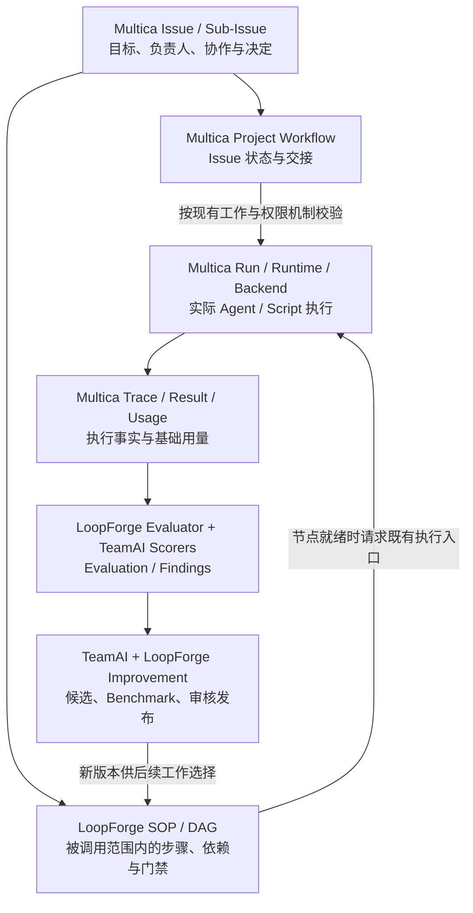

# 统一架构总览

版本：V1.1 · Multica 基座融合架构 · 2026-11-15

范围：产品边界、能力归属、跨专题职责与核心工作机制。数据库、接口和部署细节由后续实现设计确定。

架构治理规则见[架构治理基线](governance-baseline.md)。专题设计与本文件冲突时，以治理基线和本总览为准。

## 1. 产品定位与架构方向

本项目建设面向研发团队的人机协作产品，**以 Multica 为协作与执行基座，融合 TeamAI 的团队能力治理，以及 LoopForge 的 SOP、工程评测和 RSI 自改进机制**。

这是一项明确的架构方向，不是等待各专题重新选择的工作假设。

- Multica 提供工作平面、控制平面和本地执行底座。
- TeamAI 提供团队能力、知识、上下文治理与能力改进机制。
- LoopForge 提供可组合 SOP、执行评测、结构化 Findings 和工程级 RSI。
- 本项目负责把这些能力融合成一套产品，不另建与 Multica 平行的协作和执行平台。

最终仍需验证具体版本、扩展点和实现成本；验证的是“如何基于 Multica 落地”，不是每个专题重新讨论是否采用 Multica。

### 设计基线与决策效力

本次修订继续采用 V1.0 的 Multica 底座方向。以下区分用户方向输入、当前设计决策和待确认事项；设计文档发布及测试通过分别记录其效力，不代替用户业务决定。

| 事项 | 用户方向输入 | 当前架构基线与待决点 |
|---|---|---|
| 产品形态 | 中心协作、成员本地执行；Human / Agent / Squad 协作；SOP 是可调用的方法 | Multica 为单一协作与执行基座，TeamAI / LoopForge 增量融合；各专题围绕此方向补齐实际缺口 |
| 工作对象 | V1 将 Issue、Task、Run 列为初始概念，要求进一步研究模型 | 当前以父子 Issue 和同 Issue 的 Run 承担分工，省去独立业务 Task 层。对 V1 的这项偏离沿用原待确认记录；本轮交叉修订不将其标为用户已确认 |
| 责任与验收 | 支持讨论、决策、审批、介入和接管 | 稳定人工总责人与当前负责人分开；人工验收绑定候选和标准。轻量工作适用范围、Squad 嵌套等产品取舍继续按专题一验证 |
| SOP 承载 | 稳定流程可执行、可验证、可复用，允许并行、返工和人工门禁 | 用现有 Issue / Run 承载流程；保留前置、激活与结果消费约束，Grant / Binding 的独立对象方案撤回；必要关联由现有语义和缺口决定 |
| 能力与知识 | 作用域、版本、检索、分发和改进；Git 为可选外部来源 | 优先扩展原生 Agent / Skill / Plugin / Context；验收资产锁版和来源授权是产品要求，普通 Skill 原生更新行为另行适配 |
| 成本与进化 | 区分真实费用、估算、Token-only 和未知；Benchmark 通过后发布 | 统一 Usage 计量权威，业务与后台活动分项归集；内环修正、外环候选验证和发布分别处理 |
| 工程选型 | 先确定机制与核心模型 | 此阶段确定扩展职责和可验证契约；数据库、接口、部署及具体实现成本在后续实现设计中确认 |

共同工作对象的变更由用户确认后更新本表及相关专题。需要改变底座方向的证据应提交用户决策，各专题继续遵循当前基线。

## 2. 能力所有权与复用边界

| 领域 | 基座与事实权威 | 融合内容 | 不建设的平行能力 |
|---|---|---|---|
| 工作组织 | Multica Issue / Sub-Issue、Assignee、Comment、Squad | 研发工作约定、验收引用 | 第二套 Issue / Task / 负责人系统 |
| 状态与协作 | Multica status、Project Workflow、现有权限和交接 | 研发强制规则的最小扩展 | 第二套状态机、派发权威 |
| 执行 | Multica Run、Daemon、Runtime、Provider Backend、Session、Process 管理 | Skill Driver、执行观察和宿主能力补缺 | 第二套 Run / Runtime / Daemon / Supervisor |
| 执行证据 | Multica Trace、Result、ContextReceipt、Task Usage | 调用级输入证据、AgentObservation、计量身份与覆盖扩展 | 第二套执行事实库与成本账本 |
| 团队能力 | Multica Agent / Skill / Plugin / Context 基础设施 | TeamAI Role / Rule / Playbook / Knowledge 治理 | 未经盘点的新资产平台 |
| SOP | Multica Issue / Project Workflow / Run 是承载面 | LoopForge SOP / DAG / Sub-SOP / Gate / Retry | 第二套 Issue、Run、Runtime、权限和完成状态 |
| 质量与改进 | Multica 的 Run / Trace / Usage 是事实输入 | LoopForge Evaluator、TeamAI Scorers、Benchmark、RSI | 评价结果覆盖真实执行或自动改写已发布资产 |

详细的“已有能力—扩展缺口—实现方式”审查要求见[架构治理基线](governance-baseline.md)。

## 3. 工作主线

Issue 是工作与责任的中心；Run 是 Multica 管理的一次真实执行；Session 是宿主会话连续性资源；SOP 是可附着在 Issue 工作中的标准化流程；Evaluation 是对执行结果的独立评价。

SOP 负责流程内部依赖，不取得 Issue 状态和实际 Run 的所有权。节点需要 Agent / Script 执行时，通过 Multica 既有执行入口；人工门禁引用 Issue 的真实决定。评价和改进不会反向篡改原 Run。

## 4. 跨专题职责

| 专题 | 责任 | 必须复用的 Multica 能力 |
|---|---|---|
| 一：统一工作生命周期 | 明确 Issue First、Human / Agent / Squad 责任、轻重工作分工、验收和工作事实 | Issue、Sub-Issue、Assignee、Squad、Project Workflow、Comment、Run |
| 二：SOP 与研发工作流融合 | 把 LoopForge SOP / DAG 接入 Issue 工作；确定节点如何调用既有 Run、门禁和返工 | Issue、Project Workflow、Run、Runtime、权限、通知和结果回报 |
| 三 A：Multica 执行底座审计与扩展 | 盘点 Daemon / Runtime / Backend / Session / Workspace / Trace；补齐 Script、调用证据和已识别的采集缺口 | 原生执行链、Provider Adapter 与上下文准备机制 |
| 三 B：团队能力与知识治理 | 将 TeamAI 的资源治理、检索、版本、分发和加载核验接入 Multica | Agent、Skill、Plugin、ContextReceipt、Runtime 派发 |
| 四：成本、质量与 RSI | 扩展 Task Usage，融合 Scorers / Evaluator；定义分项成本、Benchmark 和改进效果 | Run、Trace、Task Usage、Result；资产发布引用专题三 B 治理 |
| [五：统一工作台](05-unified-workbench.md) | 首轮将十二类工作映射到产品入口，围绕订单候选、人工决定、轻量工作和资源等待设计交互 | Multica 既有工作对象和产品路径 |

## 5. 统一工作对象

- **Issue / Sub-Issue**：团队工作、目标、责任和交付判断的权威对象。按独立责任与交付需要拆分，不为 SOP 节点机械创建子 Issue。
- **Run**：Multica 管理的实际执行记录。所有 Agent / Script 执行沿用现有 Run 及其生命周期。
- **Session**：宿主会话连续性对象，可以被多个 Run 先后引用，不与 Run 一对一。
- **SOP Execution**：某个 SOP 版本在 Issue 工作范围内的一次调用。只保存流程定义、节点依赖、节点结果引用和必要的尝试信息，不拥有 Issue / Run / Runtime。
- **Evaluation**：对 Run、交付、Agent / Role、SOP 或资产的评价，必须关联实际证据和评价器版本。
- **Improvement Proposal**：基于 Findings 的候选改进，发布仍走统一资产治理流程。
- **Benchmark**：固定输入、评价器和成功标准，用于比较改进前后效果。

新增对象必须证明 Multica 现有对象无法承载；否则只使用引用或附属元数据。

## 6. 统一事实与授权边界

1. Issue 的目标、负责人、状态和业务决定由 Multica 工作机制维护。
2. 实际执行状态、宿主 Session、进程与结果由 Multica Run / Runtime / Backend 链路维护。
3. 能力资产的发布和适用范围由 TeamAI 融合治理能力管理。Multica 原生回执提供准备和投递证据，逐次调用的实际输入、工具结果和加载观察按已识别缺口补齐。
4. SOP 内部节点依赖由 SOP 引擎管理，但所有真实执行仍归 Multica Run；SOP 不自行授予项目权限。
5. 质量评价是独立结论，不替代脚本退出、客观测试或人工验收。
6. 用量来源可以多路观察，结算回到 Multica Usage 与原始 Run；未知值保持 unknown。
7. 资产候选先在明确实验范围完成 Benchmark，再审核发布供正式工作选择；在途执行固定其实际采用版本，继续调用时复核当前权限。

### 共享业务契约

三个契约沿用[用户设计输入第七节](../../Team%20Agent%20Collaboration%20Platform.md#7-三个贯穿系统的基础机制)，共同引用 Multica 工作和执行事实。它们是跨专题的语义约定，不引入新工作对象或另一份状态记录。

| 契约 | 共同内容与维护责任 | 各专题如何消费 |
|---|---|---|
| **Work Context** | Issue 目标、工作约定版本、有效决定、父子结果、项目 / 代码基准、知识来源、当前流程位置和验收要求。专题一维护工作事实，二维护流程附属关联，三 B 选择获准材料 | 三 A 按实际调用投递并留证；四从真实材料版本归因；五展示同一上下文。子项按需引用父项约束，私有历史按共享授权选择 |
| **Execution Contract** | 当前 Issue、工作范围、执行主体、允许动作、所需输入、选中资产与候选版本、预期制品、验证方法及预算 / 停止条件。结果引用实际 Run、变更、具名制品、验证结论及缺项 | 二将节点目标映射到既有 Run，三 A 负责执行与回执，三 B 固定能力版本，四读取实际执行归属。Human 的判断留在 Issue，人工操作附真实证据 |
| **Evidence & Feedback** | 每份证据关联要求、候选 / 内容摘要、版本、环境、观察者、方法、时间和结论；记录结果由哪个节点 / 交付消费，以及当时的标准和决定 | 原始执行、内容核验、人工放行、业务验收、评价分开引用；四新增评价和改进证据，三 B 发布相应资产。更正追加来源与理由，旧失败与旧候选留痕 |

工作约定或候选变化时，负责人明确影响范围，重新核对依赖该输入的节点与证据。SOP 的本轮激活、所用候选和结果消费关系引用这些契约；单靠相同状态名称或 `child_done` 唤醒不决定成功交付。继续原 Session 还要核对历史是否符合当前授权，历史失权时在新 Session 重建获准上下文。

业务成本归生产 Run 直接服务的 Issue；父项、SOP、项目及团队汇总按相同计量单元去重。被引用的历史结果保留来源成本，本次新增执行单独计算。评价、Benchmark、索引与知识抽取有自己的执行和活动分类，按实际项目 / 团队范围归集，详见[专题四](04-cost-quality-improvement.md)。

### 跨专题交接

| 动作 | 既有工作机制提供 | 融合能力返回及消费条件 |
|---|---|---|
| 选择能力与知识 | Issue、范围、角色、当前决定和接收者权限 | 获准版本、来源、选择理由和缺项；三 A 留准备与实际调用证据，三 B 核对版本 |
| 执行 SOP 节点 | 当前 SOP 范围、前置结果、本轮激活和执行契约 | 原派发路径核对前置及权限，每次执行安排重送复用同一 Run。一次节点履行可分别引用实施、修正和检查的实际 Run、结果及制品 |
| 请求人工判断 | 具体候选、标准、问题、允许动作和决定者 | 同一 Issue 上的明确决定；超时或未答复继续等待 |
| 消费节点 / 子项结果 | 目标 Issue、节点、候选、标准、实际 Run 及必需制品 | 每个消费节点在本轮按输入契约核对生产尝试与制品，重送复用该消费记录。合法的其他后继可独立引用同一结果，旧尝试归历史 |
| 评价与改进 | 固定证据范围、执行及资产版本、成本分类 | Evaluation / Findings / 候选；实验先绑定候选做 Benchmark，审核发布后供正式业务选用 |

### 订单贯穿案例

**案例假设：** 为既有系统增加订单批量导出，导出当前筛选下可见订单，XLSX，上限 5,000 条，超过上限明确拒绝；后续增加付款时间列。角色、数量和业务选择均供设计推演。C1 / C2 是既有实验中的候选，D1 / D2 是工作约定与规则的对应版本；这些标记用于设计和研究定位。

| 环节 | 工作、执行与证据如何衔接 | 负责专题 |
|---|---|---|
| 组织工作 | 父 Issue 承担整体目标与人工接受，需独立负责人 / 交付的前后端工作成为子 Issue；Leader 分析和汇总有自己的 Run | 一 |
| 选择调用方式 | 局部核验 SOP 引用已有候选；完整交付 SOP 组织依赖、门禁和返工。两者通过同一派发链执行，受托范围的各入口检查当前前置与激活 | 二 |
| 固定输入 | D2 对应付款时间等当前要求；选择规则和脚本的不变版本，记录来源与摘要。C1 / C2 分别引用其真实输入和输出 | 一、三 B |
| 执行和交接 | Agent Backend 执行业务开发；确定性核验脚本需在原 Run / Daemon 内补齐承载。跨成员接续采用接替者的授权和新 Run，原结果保持来源 | 三 A |
| 失败与复验 | C1 暴露区域权限问题；C2 核验恢复正确。Hook 改写工具返回后，服务结果与模型所得内容分别留证；原 Run 结束后的复验使用后继 Run，节点只消费匹配的有效报告 | 二、三 A、三 B |
| 成本与评价 | C1、C2、拒收执行、后继复验各自计量；父项和 SOP 按同一 Run / 计量单元去重。Scorer 与 Benchmark 的新增费用单列，unknown 保持可见 | 四 |
| 改进与发布 | 从失败提炼知识或规则候选，在固定输入与评价器下与旧版对照；Benchmark 达标后由有权成员审核发布，再观察后续交付表现 | 三 B、四 |
| 完成 | 指定验收人针对当前候选和标准决定接受；SOP 出口和模型评分作为依据，业务完成由既有 Issue 规则推进 | 一、五 |

真实原生调用、订单合成数据和状态模型原型各自保留证据范围。上表的融合流程由各专题列出集成验收；例如 [Hook 后继复验](../research/topic-03b/existing-session.md#hook-复验的-run-归属修订)已有回执，而 Script 经真实 Multica Run 的承载仍需验收。轻量文案工作继续使用一个 Issue 和必要 Run。

## 7. 已有研究如何使用

- 专题一至四的源码研究、原始回执、测试和订单案例全部保留，作为事实证据。
- 专题三 A 的宿主适配和进程实验用于验证 Multica 底座，不构成另建执行平面的要求。
- Qoder / CodeBuddy / Copilot 真实用量研究用于发现 Multica Usage 的扩展缺口，不构成另建账本的要求。
- 专题二状态模型原型用于验证 SOP 与 Issue 的交接语义；不自动证明必须新增 Grant、Binding 或独立调度服务。
- TeamAI / LoopForge 研究用于选择可复用机制和明确融合边界，不要求逐个复制其内部架构。

## 8. 后续设计评审标准

任何新增机制都必须先说明 Multica 对应实现、实际缺口、最小扩展点、事实权威、恢复策略和可验证验收。出现第二套工作状态、Run、权限、派发或成本账本时，必须停止并重新设计。

### 本轮交叉审查保留的反例

| 反例 | 已有证据 / 设计结论 | 修订后的验收要求 |
|---|---|---|
| 同一工作从 SOP、评论和工作流入口重复派发 | 原有领取与交接幂等各有作用范围，见[派发研究](../research/topic-02/multica.md) | 在同一受托工作范围拦截重复；不同就绪节点保留并行能力 |
| 工作离开 A 再回 A，旧 Run 写状态 | 固定源码守卫只比较步骤名，见[底座盘点](governance-baseline.md#固定版本的底座盘点) | 旧激活只留历史，新激活拥有推进资格 |
| Skill 缓存失效后取到最新版本；旧 Session 重带失权正文 | [原生资产行为](../research/topic-03b/native-assets.md)、[四次模型请求对照](../research/topic-03b/project-knowledge.md) | 验收资产锁定实际内容，历史授权变化后用获准新上下文 |
| Hook 改写核验结果、原执行结束后再验证 | [后继 Run 实测](../research/topic-03b/existing-session.md#hook-复验的-run-归属修订) | 分别保留拒收与成功，旧回报不消费到新候选，费用分项归集 |
| 正式发布后才发现 Benchmark 退化 | 与设计输入的发布顺序冲突 | 失败候选保持实验范围，正式业务继续选用此前已发布版本 |

### 总览六问审查

| 问题 | 本总览的答案 |
|---|---|
| Multica 已有什么？ | [固定底座盘点](governance-baseline.md#固定版本的底座盘点)及各专题源码表给出 Issue、派发、Run、资产和 Usage 的实际覆盖 |
| 我们缺什么？ | Script 承载、本地异构计量链、逐调用输入证据、验收资产锁版与受托流程的前置 / 激活 / 结果消费校验 |
| 选择哪种扩展方式？ | 在既有 Backend、Daemon、Issue 写入、资产投递和 Usage 链补齐；流程与评价保留必要附属数据 |
| 谁拥有事实？ | 工作归 Issue，执行归 Run，计量归 Usage，资产归原生资产设施及融合治理，流程引用原结果 |
| 是否形成第二权威？ | 共享三项契约；SOP 只组织就绪与消费，控制和业务完成仍由 Multica，评价保持独立结论 |
| 如何验证？ | 各专题给出正常、失败与上述反例；本轮完成设计交叉检查，真实 Multica 融合集成按专题计划验收 |
