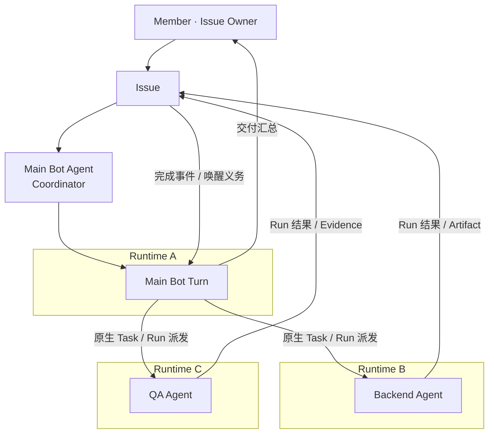

# Main Bot 的 Issue 工作组织模型

> 本阶段目标：在 AgentPlatform 整体产品方向下，明确 Main Bot 如何接手一个 Issue、组织 Agent / Runtime / SOP 工作，并持续向 Issue Owner 交付。本文先收敛产品职责和工作关系，不进入数据库表、API 或微服务设计。

## 1. 核心定位

Main Bot 是 **Issue 级智能协调者**。Member 将 Issue 的执行协调工作委托给 Main Bot 后，Main Bot 负责理解目标、制定和调整工作安排、选择执行者和工作方法、消费结果、处理异常并向 Issue Owner 汇总交付。

Main Bot 不是：
- Issue 的业务 Owner；
- 一个新的中央 Orchestrator 服务；
- Squad 下一级的 Leader；
- 独立于 Issue 的第二套任务系统；
- 必须把所有工作变成 SOP 的固定工作流引擎。

Main Bot 是由现有 Agent 承载的协调职责。首期以改造现有 Squad Leader Agent 的角色指令和运行约束实现，不新增一层 Agent 或调度服务。

## 2. Issue 的三种责任关系

必须区分三个问题：

| 关系 | 回答的问题 | 责任 |
|---|---|---|
| Issue Owner / Accountable Member | 谁对这项业务工作负责？ | 目标、范围、授权、重大业务决定、最终验收 |
| Main Bot / Coordinator | 谁负责组织和推进当前工作？ | 分析、规划、选择方法、委派、协调、结果消费、汇总 |
| Worker / Executor | 谁实际完成某一项工作？ | 在受托范围内执行、验证并交付 |

三者可以是不同主体。简单任务中，Coordinator 可以直接执行；复杂任务中，Main Bot 组织多个 Worker。Main Bot 的协调权来自 Owner 对本 Issue 的授权，不因 Agent 身份自动获得。

### 2.1 推荐的工作关系

当 Member 决定把 Issue 的持续执行交给 Main Bot：
- Member 继续作为 Accountable Member / Issue Owner；
- Main Bot Agent 成为当前执行协调者，接收该 Issue 的协调触发；
- Main Bot 可直接执行，也可委派多个 Worker Agent；
- Worker 的实际执行仍沿 Multica 原生 Task / Run / Runtime 链；
- 交付和待决事项回到原 Issue，由 Main Bot 汇总，Owner 作其保留的业务决定和验收。

若 Member 只需要一次性答疑、代码解释或局部协助，不必把整个 Issue 的持续协调权交给 Main Bot；可继续通过原 Issue 评论 / mention 请求 Agent 协助。**一次性协助与持续 Main Bot 委托是不同意图。**

## 3. Main Bot 是 Agent 的协调职责，不是新领域对象

建议复用 Multica 的 Agent 身份与执行能力：
- Main Bot 由现有 Agent 承载，继续使用 Agent 的配置、权限、Runtime 绑定和真实 Run。
- 原 Squad Leader Agent 是首选改造起点；其固定 Squad 成员边界和“必须委派、不得直接执行”的约束不再是 Main Bot 的默认约束。
- Main Bot 的逻辑身份在具体 Issue 上体现为当前受托协调角色；每个 Issue 的目标、授权、分工和结果仍归原 Issue。
- 不要求每个 Issue 创建一个新的 Agent 实体，也不把一个 Agent Session 当成 Main Bot 的持久身份。
- 首期一个 Main Bot Agent 绑定一个指定 Runtime；它可以派发多个绑定不同 Runtime 的 Worker Agent。

Squad 不再是 Main Bot 的必经层。团队如果需要固定成员组合或能力集合，可以作为资源配置继续存在；但 Main Bot 可以直接选择本次获准的 Agent，不必先经过 Squad Leader。

## 4. Main Bot 的工作职责

Main Bot 在每个 Issue 上承担一个完整闭环：

1. **理解工作**：读取 Issue 工作约定、项目上下文、已有决定、交付和历史执行。
2. **判断授权**：确认 Owner 授权范围、可调用 Agent、可用 Runtime、允许工具和预算。
3. **组织工作**：判断自己直接完成、委派一个 Agent、并行委派多个 Agent，或创建有独立责任和交付要求的子 Issue。
4. **选择方法**：按适用性选用 Skill、Rule、Playbook、局部 SOP 或完整 SOP；没有适用方法时动态探索。
5. **明确交接**：向每个 Worker 说明目标、边界、输入来源、预期产物、验证要求、交付位置和升级条件。
6. **消费结果**：核对实际 Run、制品、证据、候选版本和交付契约，不把 Agent 自述等同于合格交付。
7. **调整推进**：根据新结果决定继续、并行、返工、等待、改派、暂停或请求 Owner 决定。
8. **交付汇总**：向 Owner 汇总已完成内容、证据、未解决问题、风险、成本覆盖和待决定事项。

Main Bot 负责协调整个 Issue，但不因此拥有 Owner 的业务决定权。目标变更、超授权范围、预算提升、风险豁免和最终验收由相应有权成员决定。

## 5. Main Bot 如何组织工作

Main Bot 不要求用户先选择协作模式。它根据工作本身决定组织方式。

| 工作情况 | Main Bot 的处理 |
|---|---|
| 目标清楚、范围小、无需专业协作 | 自己直接执行或请求单个 Agent 协助 |
| 需要一个明确专业能力 | 直接委派一个获准 Worker Agent |
| 多专业工作且存在独立交付或并行依赖 | 选择多个 Worker Agent 并行或分阶段执行 |
| 一段工作需要独立负责人、单独状态和交付 | 创建子 Issue 并指派合适的 Member / Agent |
| 有成熟且适用的重复流程 | 调用完整 SOP 或局部 SOP |
| 方法未知、问题探索性强 | 动态分析与协作，不强行套用 SOP |
| 出现业务取舍、授权不足或超预算 | 向 Owner 提出明确决定请求，只暂停依赖该决定的工作 |

工作组织可以随执行结果变化。初始计划是当前安排，不是不可修改的流程；变化应记录在原 Issue 的工作上下文和协作时间线上。

### 5.1 Agent 委派与子 Issue 的区别

- 同一业务责任下的短步骤、调查、实现协助或独立检查，优先在原 Issue 委派，Worker Run 关联原 Issue。
- 当工作需要独立负责人、独立交付条件、等待 / 退回 / 取消生命周期时，才创建子 Issue。
- 不得为了让每个 Agent 都有一个“任务对象”而把所有委派拆成子 Issue。
- 同一项工作只能选择一种有效派发路径；不得既创建指派给 Agent 的子 Issue，又在父 Issue 评论中重复 mention 同一 Agent 执行同一工作。

## 6. Main Bot 与 SOP 的关系

SOP 是 Main Bot 可采用的工作方法，不是另一个协调者。

- Main Bot 决定当前工作是否适合 SOP、适合哪一个版本，以及使用完整流程还是局部流程。
- SOP 在明确委托范围内处理固定节点、依赖、输入输出契约、核验、返工和出口。
- Main Bot 仍然负责整个 Issue 的整体目标、跨 SOP 协调、未覆盖工作、异常升级和最终汇总。
- SOP 不得越权修改 Issue 目标、Owner、授权或验收决定。
- SOP 不适用或遇到未覆盖问题时，应暂停或交还受托范围，由 Main Bot 重新规划；不能强迫动态工作迁就流程。
- Main Bot 可在一次工作中交替使用自主协作与 SOP：未知部分自主探索，稳定部分调用 SOP，结果回到同一协调上下文。

## 7. 跨 Runtime 执行与 Main Bot 连续性

### 7.1 执行分布

Main Bot 自身运行在一个获准 Runtime；Worker Agent 可分别绑定成员本地的其他 Runtime。中心只负责授权、派发、领取路由、记录和回执，不远程接管成员宿主。

### 7.2 Main Bot 不需要常驻

一次 Main Bot 执行是一个 Coordinator Turn：
- 唤醒后读取 Issue 最新事实；
- 恢复当前分工和在途 Run；
- 做本轮需要的协调动作；
- 记录必要的协作进展；
- 在等待 Worker 或 Owner 时结束 Turn；
- 新结果或决定到达后，再次唤醒并从原 Issue 继续。

持续的是 Issue 协调过程，不是某个 Agent 进程或 Session。

### 7.3 恢复依据

优先使用已有权威事实恢复：
- Issue：目标、责任、工作约定、授权、评论和决定；
- Task / Run：实际派发、领取、运行、终态、执行者和 Runtime；
- Artifact / Candidate / Evidence：生产结果和可消费证据；
- 交付 / 消费记录：Main Bot 已采用哪些结果；
- 必要时使用简短结构化协调摘要，提示当前计划、未完成委派、待决事项和下一步。

不把聊天记录、Session 或某个本地工作目录作为唯一恢复来源。首期不新增独立 Planner 数据库；若 Issue 时间线与 Run 谱系已足以重建，则不再增加检查点对象。只有在实际恢复场景证明现有事实无法表达必要的协调进度时，才设计最小补充。

## 8. 必须补齐的底座协作能力

Main Bot 的多 Runtime 协作不需要第二套执行引擎，但需要把 Squad 特例中的可靠回唤能力推广为普通 Coordinator 可用的通用机制。

| 能力 | 目标行为 | 现有基础与缺口 |
|---|---|---|
| Main Bot 触发 | Owner 将 Issue 委托给 Main Bot 后，沿现有 Agent Task / Run 入口触发 | 复用 Issue 指派、Task 创建和 Daemon Claim；明确持续委托与一次性 mention 的差异 |
| Worker 派发 | Main Bot 直接选择本次获准 Agent，按其绑定 Runtime 派发 | 复用现有 Agent mention / 子 Issue 指派与 Runtime Claim；不依赖 Squad Roster |
| Worker 完成回唤 | Worker 成功、失败、取消或阻塞后，可靠通知原 Main Bot | 当前 Squad Leader 有特殊回唤路径；普通 Main Bot 需要通用 Coordinator Wakeup |
| 多结果合并 | 多 Worker 结果可合并为一次 Main Bot 恢复，但每个结果独立保留 | 复用 Task 终态、Issue 时间线和持久化恢复 / 去重模式 |
| 迟到结果隔离 | 结果回到原委派和原候选，不误推进后来变更的工作 | 复用 Run / Task lineage、Candidate 和现有代际隔离原则 |
| Main Bot 恢复 | Main Bot Runtime / Session 不可用时，工作事实仍可恢复 | 复用 Issue、Run、Artifact 和决定；Session 仅作上下文加速 |
| Owner 接管 | Owner 可停止 Main Bot 后续委派并处理在途工作 | 复用 Issue 权限、停止 / 取消和接管规则，明确旧执行副作用 |

Worker 成功回唤是本轮最关键的底座缺口。不能要求 Worker 依赖自然语言 @mention Main Bot 才完成核心回唤；平台应能从原始委派关系识别需要恢复的 Coordinator，并通过可恢复、幂等的方式投递。

## 9. 与现有 Multica 概念的映射

| Multica 原生概念 | Main Bot 方向的处理 |
|---|---|
| Issue | 保留为唯一业务工作和协作时间线 |
| Assignee | Main Bot 受托持续协调时，可指向承载 Main Bot 职责的 Agent |
| Accountable Member / Owner | 保留成员的业务责任和验收权，不随 Main Bot 委托转移 |
| Squad Leader Agent | 作为 Main Bot 的改造起点，放宽固定 Squad 委派约束 |
| Squad | 不作为 Main Bot 必需的调度层；固定成员集合可选保留为资源配置 |
| Agent | Main Bot 与 Worker 都由 Agent 身份承载，职责由本次授权和执行上下文决定 |
| Runtime / Daemon / Backend | 完整复用，实际执行仍在成员本地 |
| Task / Run / Session | 复用原生派发、执行和宿主连续性记录 |
| Issue Comment / Activity | 保留可审计委派、反馈、决定和结果时间线 |
| Project Workflow | 继续管理项目阶段和负责人交接，不替代 Main Bot 的动态协调 |

不要求立即删除 Multica 的 Squad 数据模型或功能。产品是否继续展示 Squad，应与 Main Bot 主线分开评估；本阶段明确的是：Main Bot 不依赖 Squad 才能协作，不再让 Squad Leader 成为它下面的第二层调度者。

## 10. 关键场景检查

### 场景 A：Member Owner 将 Issue 委托给 Main Bot

- Owner 保留 Accountable Member 身份。
- Main Bot 接收持续协调授权并被触发。
- Main Bot 自主规划，可能自己做，也可能委派 Worker。
- 结果持续回到原 Issue，Owner 随时可以查看、介入和接管。

### 场景 B：Main Bot 跨三个 Runtime 并行执行

- Main Bot 在 Runtime A 运行一个短 Turn。
- Backend Agent 在 Runtime B、QA Agent 在 Runtime C 分别执行。
- Main Bot Turn 结束，两个 Worker 独立运行。
- Worker 终态产生回唤义务；多个结果可合并触发 Main Bot 下一 Turn。
- Main Bot 核对候选和证据后决定下一步。

### 场景 C：Main Bot 发现只有一段适合 SOP

- Main Bot 先自主分析整个 Issue。
- 将稳定的后端交付范围委托给局部 SOP。
- 其他未稳定的集成和业务判断仍由 Main Bot 动态组织。
- SOP 结果回到 Main Bot，供后续工作消费。

### 场景 D：Main Bot Runtime 失联

- 已派发 Worker 不因 Main Bot 下线而自动失效。
- Owner 仍可查看 Issue、Run、结果和授权。
- Main Bot 原 Runtime 恢复后，或 Owner 显式改派 / 更换协调 Agent 后，基于 Issue 和已有执行事实接续。
- 不以超时推断旧进程已停止；涉及同一工作副本时先确认或隔离写入。

### 场景 E：Owner 修改目标或接管

- 新工作约定成为后续工作的依据。
- 旧委派结果仍归原 Run / 原候选。
- Main Bot 必须重新核对授权与受影响工作，不能沿旧计划继续扩大执行。
- Owner 可以撤销 Main Bot 的后续协调权，独立处理在途 Worker 的停止、继续或结果接收。

## 11. 本阶段推荐结论

1. Main Bot 是由现有 Agent 承载的 Issue 级智能协调者；优先将 Squad Leader Agent 改造成 Main Bot，而不是新增一个平台级 Agent 层。
2. Issue Owner 与 Main Bot 分离：Owner 保留业务责任、授权和验收，Main Bot 承担受托协调。
3. Main Bot 可以直接执行、直接委派任意获准 Agent、并行组织多个 Runtime、按需使用 SOP；不必经过 Squad Leader。
4. Squad 不作为核心协作主线的必需概念；可以保留为可选资源组织配置，不拥有独立的第二层调度权。
5. Main Bot 的持续性来自 Issue 上的工作事实和原生 Task / Run 关系，不来自常驻进程或单个 Session。
6. 首期 Main Bot 只需绑定一个 Runtime；跨 Runtime 的重点是 Worker 执行和结果回唤，不提前做 Main Bot 多活热迁移。
7. 最重要的底座扩展是通用 Coordinator Wakeup，其次是可靠的结果消费和 Main Bot 恢复；优先沿 Multica 原生机制扩展。
8. 不新增第二套 Task / Run / Planner 数据库；只有实际恢复证据证明 Issue 时间线与原生执行谱系不足时，才补充最小结构化摘要。

## 12. 尚未决策的问题

- Main Bot Agent 是工作区级共享配置，还是允许项目指定不同的协调 Agent？首期建议先从一个可授权的 Main Bot Agent 配置开始，不做复杂 Agent Pool。
- Main Bot 被指派为 Issue Assignee 时，Owner 如何通过独立 Accountable Member 关系保留？需按目标 Multica 版本核对具体字段与写入路径。
- Member 保留当前 Assignee、只在评论中委托 Main Bot 时，是否需要支持持续委托语义，还是统一要求将当前协调责任转给 Main Bot Agent？
- Main Bot 可以并行派发多个 Worker 时，如何限制每个 Issue 的协调并发和重复委派？
- 通用 Coordinator Wakeup 应沿现有评论 / Task 关系扩展，还是采用平台内部事件加持久化待办？需以 Multica 现有事务与回收能力为依据选择最小实现。
- Main Bot Runtime 长期失效时，首期采用 Owner 显式改绑 / 改派是否足够？

## 13. 本阶段依据

- [Multica Task Service](https://github.com/multica-ai/multica/blob/main/server/internal/service/task.go)
- [Multica Issue Trigger](https://github.com/multica-ai/multica/blob/main/server/internal/handler/issue_trigger.go)
- [Multica Comment Trigger / Routing](https://github.com/multica-ai/multica/blob/main/server/internal/handler/comment.go)
- [Multica Daemon Claim](https://github.com/multica-ai/multica/blob/main/server/internal/handler/daemon.go)
- [Multica Squad Leader Briefing](https://github.com/multica-ai/multica/blob/main/server/internal/handler/squad_briefing.go)
- [Multica Agent Task Queries](https://github.com/multica-ai/multica/blob/main/server/pkg/db/queries/agent.sql)
- [Main Bot 跨 Runtime 持续协调机制研究](mainbot-runtime-coordination.md)
- [整体系统架构与模块边界](../architecture/system-architecture.md)
- [研发工作生命周期](../architecture/01-unified-work-lifecycle.md)
