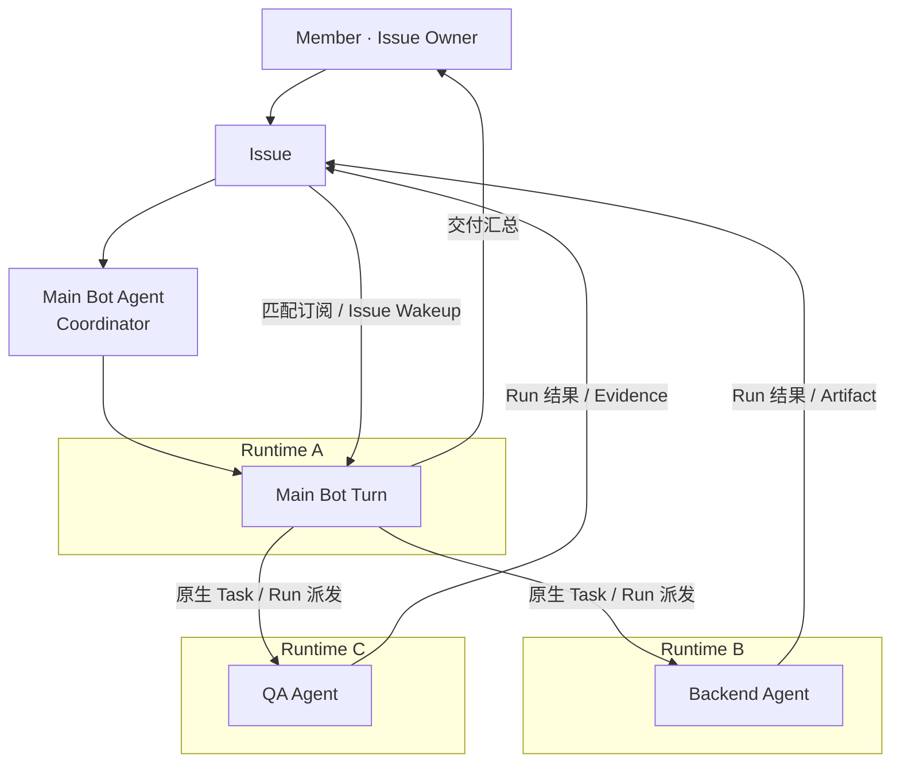

# Main Bot 的 Issue 工作组织模型

> 本阶段目标：在 AgentPlatform 整体产品方向下，明确 Main Bot 如何接手一个 Issue、组织 Agent / Runtime / SOP 工作，并持续向 Issue Owner 交付。本文先收敛产品职责和工作关系，不进入数据库表、API 或微服务设计。

## 1. 核心定位

Main Bot 是 **Issue 级智能协调者**。Member 将 Issue 的执行协调工作委托给 Main Bot 后，Main Bot 负责理解目标、制定和调整工作安排、选择执行者和工作方法、消费结果、处理异常并向 Issue Owner 汇总交付。

该职责由现有 Agent 在特定 Issue 上承担。成员将当前工作指派给该 Agent，并约定它可以自行处理、委派和交还决定的范围。

## 2. Issue 的三种责任关系

必须区分三个问题：

| 关系 | 回答的问题 | 责任 |
|---|---|---|
| Issue Owner / Accountable Member | 谁对这项业务工作负责？ | 目标、范围、授权、重大业务决定，并在工作约定中明确完成条件与验收人 |
| Main Bot / Coordinator | 谁负责组织和推进当前工作？ | 分析、规划、选择方法、委派、协调、结果消费、汇总 |
| Worker / Executor | 谁实际完成某一项工作？ | 在受托范围内执行、验证并交付 |

三者可以是不同主体。简单任务中，Coordinator 可以直接执行；复杂任务中，Main Bot 组织多个 Worker。Main Bot 的协调权来自 Owner 对本 Issue 的授权，不因 Agent 身份自动获得。

### 2.1 推荐的工作关系

当 Member 决定把 Issue 的持续执行交给 Main Bot：
- Member 继续作为 Accountable Member / Issue Owner；
- Issue 的单一 Assignee 指向受托 Agent，Issue 工作约定载明委托范围；
- Main Bot 可直接执行，也可委派多个 Worker Agent；
- Worker 的实际执行仍沿 Multica 原生 Task / Run / Runtime 链；
- 交付和待决事项回到原 Issue，由 Main Bot 汇总。业务决定按授权办理，验收依工作约定交由指定接收者。

若 Member 只需要一次性答疑、代码解释或局部协助，不必把整个 Issue 的持续协调权交给 Main Bot；可继续通过原 Issue 评论 / mention 请求 Agent 协助。**一次性协助与持续 Main Bot 委托是不同意图。**

## 3. Main Bot 是 Agent 的协调职责，不是新领域对象

建议复用 Multica 的 Agent 身份与执行能力：
- Main Bot 由现有 Agent 承载，继续使用 Agent 的配置、权限、Runtime 绑定和真实 Run。
- 普通 Agent 作为 Main Bot 时可直接执行或调用本次获准的其他 Agent。
- Main Bot 的逻辑身份在具体 Issue 上体现为当前受托协调角色；每个 Issue 的目标、授权、分工和结果仍归原 Issue。
- 不要求每个 Issue 创建一个新的 Agent 实体，也不把一个 Agent Session 当成 Main Bot 的持久身份。
- 首期一个 Main Bot Agent 绑定一个指定 Runtime；它可以派发多个绑定不同 Runtime 的 Worker Agent。

## 4. Main Bot 的工作职责

Main Bot 在每个 Issue 上承担一个完整闭环：

1. **理解工作**：读取 Issue 工作约定、项目上下文、已有决定、交付和历史执行。
2. **判断授权**：确认 Owner 授权范围、可调用 Agent、可用 Runtime、允许工具和预算。
3. **组织工作**：判断自己直接完成、委派一个 Agent、并行委派多个 Agent，或创建有独立责任和交付要求的子 Issue。
4. **选择方法**：按适用性选用 Skill、Rule、Playbook、局部 SOP 或完整 SOP；没有适用方法时动态探索。
5. **明确交接**：向每个 Worker 说明目标、边界、输入来源、预期产物、验证要求、交付位置和升级条件。
6. **消费结果**：核对实际 Run、制品、证据、候选版本和交付契约，不把 Agent 自述等同于合格交付。
7. **调整推进**：根据新结果决定继续、并行、返工、等待、改派、暂停或请求 Owner 决定。
8. **交付汇总**：向 Owner 汇总已完成内容、证据、未解决问题、风险、成本覆盖和待决定事项。

Main Bot 负责协调整个 Issue，但不因此拥有 Owner 的业务决定权。目标变更、超授权范围、预算提升、风险豁免和验收决定按工作约定交由有权主体办理。

## 5. Main Bot 如何组织工作

Main Bot 不要求用户先选择协作模式。它根据工作本身决定组织方式。

| 工作情况 | Main Bot 的处理 |
|---|---|
| 目标清楚、范围小、无需专业协作 | 自己直接执行或请求单个 Agent 协助 |
| 需要一个明确专业能力 | 直接委派一个获准 Worker Agent |
| 多专业工作且存在独立交付或并行依赖 | 选择多个 Worker Agent 并行或分阶段执行 |
| 一段工作需要独立负责人、单独状态和交付 | 创建子 Issue 并指派合适的 Member / Agent |
| 有成熟且适用的重复流程 | 调用完整 SOP 或局部 SOP |
| 方法未知、问题探索性强 | 动态分析与协作，不强行套用 SOP |
| 出现业务取舍、授权不足或超预算 | 向 Owner 提出明确决定请求，只暂停依赖该决定的工作 |

工作组织可以随执行结果变化。初始计划是当前安排，不是不可修改的流程；变化应记录在原 Issue 的工作上下文和协作时间线上。

### 5.1 Agent 委派与子 Issue 的区别

- 同一业务责任下的短步骤、调查、实现协助或独立检查，优先在原 Issue 委派，Worker Run 关联原 Issue。
- 当工作需要独立负责人、独立交付条件、等待 / 退回 / 取消生命周期时，才创建子 Issue。
- 不得为了让每个 Agent 都有一个“任务对象”而把所有委派拆成子 Issue。
- 同一项工作只能选择一种有效派发路径；不得既创建指派给 Agent 的子 Issue，又在父 Issue 评论中重复 mention 同一 Agent 执行同一工作。

## 6. Main Bot 与 SOP 的关系

SOP 是 Main Bot 可采用的工作方法，不是另一个协调者。

- Main Bot 决定当前工作是否适合 SOP、适合哪一个版本，以及使用完整流程还是局部流程。
- SOP 在明确委托范围内处理固定节点、依赖、输入输出契约、核验、返工和出口。
- Main Bot 仍然负责整个 Issue 的整体目标、跨 SOP 协调、未覆盖工作、异常升级和最终汇总。
- SOP 不得越权修改 Issue 目标、Owner、授权或验收决定。
- SOP 不适用或遇到未覆盖问题时，应暂停或交还受托范围，由 Main Bot 重新规划；不能强迫动态工作迁就流程。
- Main Bot 可在一次工作中交替使用自主协作与 SOP：未知部分自主探索，稳定部分调用 SOP，结果回到同一协调上下文。

## 7. 跨 Runtime 执行与 Main Bot 连续性

### 7.1 执行分布

Main Bot 自身运行在一个获准 Runtime；Worker Agent 可分别绑定成员本地的其他 Runtime。中心只负责授权、派发、领取路由、记录和回执，不远程接管成员宿主。

### 7.2 Main Bot 不需要常驻

一次 Main Bot 执行是一个 Coordinator Turn：
- 唤醒后读取 Issue 最新事实；
- 恢复当前分工和在途 Run；
- 做本轮需要的协调动作；
- 记录必要的协作进展；
- 在等待 Worker 或 Owner 时结束 Turn；
- 已登记的等待条件触发后，再从原 Issue 核实结果或决定并继续。

持续的是 Issue 协调过程，不是某个 Agent 进程或 Session。

### 7.3 恢复依据

优先使用已有权威事实恢复：
- Issue：目标、责任、工作约定、授权、评论和决定；
- Task / Run：实际派发、领取、运行、终态、执行者和 Runtime；
- Artifact / Candidate / Evidence：生产结果和可消费证据；
- 交付 / 消费记录：Main Bot 已采用哪些结果；
- 必要时使用简短结构化协调摘要，提示当前计划、未完成委派、待决事项和下一步。

不把聊天记录、Session 或某个本地工作目录作为唯一恢复来源。首期不新增独立 Planner 数据库；若 Issue 时间线与 Run 谱系已足以重建，则不再增加检查点对象。只有在实际恢复场景证明现有事实无法表达必要的协调进度时，才设计最小补充。

## 8. 委派与回唤的工作约定

| 环节 | Multica 原生行为 | Main Bot 的职责 |
|---|---|---|
| 委派 | 原 Issue 的结构化 Agent mention 可触发 Worker，已有待领 Run 可合并输入 | 保存原委派评论，确认逐目标受理结果和实际覆盖该评论的 Run |
| 等待 Worker | Issue Wakeup 可按同一 Issue 的实际 Run 订阅成功、失败、取消；注册时检查已有终态 | 在等待期间结束本轮。恢复后核对实际尝试及重试链，分别处理每项未结委派 |
| 等待成员或子工作 | 可按指定成员的评论变化唤回，也可观察子项收齐或另一个 Issue 的限定状态 | 回看评论中的实际决定，核对交付与当前候选；业务验收按工作约定办理 |
| 合并或迟到 | 回唤可保留摘要或并入符合条件的待领 Run；接管前已派发的执行仍可能回报 | 写入前复核当前委托、候选版本和此前的消费记录。迟到结果归原 Run |

运行时不可用、SOP 出口、Candidate 或 Evidence 变化应先确定对应的权威记录及可用的唤回条件。没有对应原生信号时，在明确的交还入口或有期限的条件复核中读取事实。详细行为和源码见[生命周期与持续推进研究](mainbot-lifecycle-and-progress.md)。

## 9. 与现有 Multica 概念的映射

| Multica 原生概念 | Main Bot 方向的处理 |
|---|---|
| Issue | 保留为唯一业务工作和协作时间线 |
| Assignee | 产品工作可指派给成员或 Agent，同一时点至多一个当前 Assignee。持续委托时指派给承担 Main Bot 职责的 Agent |
| Accountable Member / Owner | Issue 工作约定明确业务责任人和验收安排。原生 Run 的 `accountable_user_id` 记录执行归因 |
| Multica Squad / Leader | 上游支持将工作指派给固定小队，并为其 Leader 生成专用 Run。研究其短轮次分工和回报，用于理解受托协调 |
| Agent | Main Bot 与 Worker 都由 Agent 身份承载，职责由本次授权和执行上下文决定 |
| Runtime / Daemon / Backend | 完整复用，实际执行仍在成员本地 |
| Task / Run / Session | 复用原生派发、执行和宿主连续性记录 |
| Issue Comment / Activity | 保留可审计委派、反馈、决定和结果时间线 |
| Project Workflow | 继续管理项目阶段和负责人交接，不替代 Main Bot 的动态协调 |

## 10. 关键场景检查

### 场景 A：Member Owner 将 Issue 委托给 Main Bot

- Owner 保留 Accountable Member 身份。
- Main Bot 接收持续协调授权并被触发。
- Main Bot 自主规划，可能自己做，也可能委派 Worker。
- 结果持续回到原 Issue，Owner 随时可以查看、介入和接管。

### 场景 B：Main Bot 跨三个 Runtime 并行执行

- Main Bot 在 Runtime A 运行一个短 Turn。
- Backend Agent 在 Runtime B、QA Agent 在 Runtime C 分别执行。
- Main Bot Turn 结束，两个 Worker 独立运行。
- 对两个实际 Worker Run 分别登记终态等待。通知可合并，新的 Main Bot Turn 仍要逐项核对交付。
- Main Bot 核对候选和证据后决定下一步。

### 场景 C：Main Bot 发现只有一段适合 SOP

- Main Bot 先自主分析整个 Issue。
- 将稳定的后端交付范围委托给局部 SOP。
- 其他未稳定的集成和业务判断仍由 Main Bot 动态组织。
- SOP 结果回到 Main Bot，供后续工作消费。

### 场景 D：Main Bot Runtime 失联

- 已派发 Worker 不因 Main Bot 下线而自动失效。
- Owner 仍可查看 Issue、Run、结果和授权。
- Main Bot 原 Runtime 恢复后，或 Owner 显式改派 / 更换协调 Agent 后，基于 Issue 和已有执行事实接续。
- 不以超时推断旧进程已停止；涉及同一工作副本时先确认或隔离写入。

### 场景 E：Owner 修改目标或接管

- 新工作约定成为后续工作的依据。
- 旧委派结果仍归原 Run / 原候选。
- Main Bot 必须重新核对授权与受影响工作，不能沿旧计划继续扩大执行。
- Owner 可以撤销 Main Bot 的后续协调权，独立处理在途 Worker 的停止、继续或结果接收。

## 11. 设计结论

成员可亲自处理、邀请 Agent 协助，或明确委托现有 Agent 担任 Main Bot。Main Bot 按本次授权选择 Worker 或 SOP。每项结果带回原 Issue，按当期工作约定和交付版本处理。

## 12. 面向实现的核验事项

- 在实际项目中核验 Issue 工作约定或成员属性如何保留独立业务责任人，以及工作流交接后旧协调写入如何受限。
- 用同一 Issue 的两个 Worker 核对受理、实际 Run、迟到结果与重复唤醒，验证每项结果的消费记录可以重建。
- 在 Main Bot 的 Runtime 离线、原 Session 不可用或成员接管时，从原 Issue 复原分工和在途任务。这些是待执行的验证场景。

## 13. 本阶段依据

- [Multica Task Service](https://github.com/multica-ai/multica/blob/fdfbfcd5e5d30c135255e63ab9af4c52672b7bbc/server/internal/service/task.go)
- [Multica Issue Trigger](https://github.com/multica-ai/multica/blob/fdfbfcd5e5d30c135255e63ab9af4c52672b7bbc/server/internal/handler/issue_trigger.go)
- [Multica Comment Trigger / Routing](https://github.com/multica-ai/multica/blob/fdfbfcd5e5d30c135255e63ab9af4c52672b7bbc/server/internal/handler/comment.go)
- [Multica Daemon Claim](https://github.com/multica-ai/multica/blob/fdfbfcd5e5d30c135255e63ab9af4c52672b7bbc/server/internal/handler/daemon.go)
- [Multica Squad Leader Briefing](https://github.com/multica-ai/multica/blob/fdfbfcd5e5d30c135255e63ab9af4c52672b7bbc/server/internal/handler/squad_briefing.go)
- [Multica Agent Task Queries](https://github.com/multica-ai/multica/blob/fdfbfcd5e5d30c135255e63ab9af4c52672b7bbc/server/pkg/db/queries/agent.sql)
- [Multica Issue Wakeup 合并与处理](https://github.com/multica-ai/multica/blob/fdfbfcd5e5d30c135255e63ab9af4c52672b7bbc/docs/engineering/issue-wakeups.md#L201-L235)
- [Main Bot 跨 Runtime 持续协调机制研究](mainbot-runtime-coordination.md)
- [整体系统架构与模块边界](../architecture/system-architecture.md)
- [研发工作生命周期](../architecture/01-unified-work-lifecycle.md)
