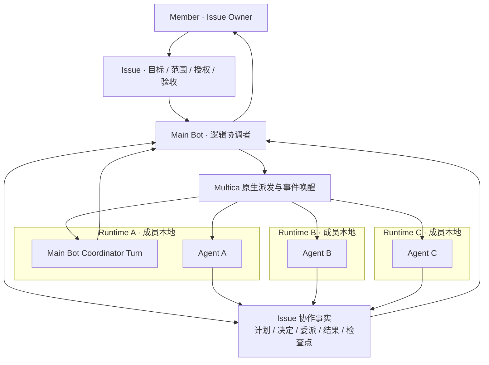
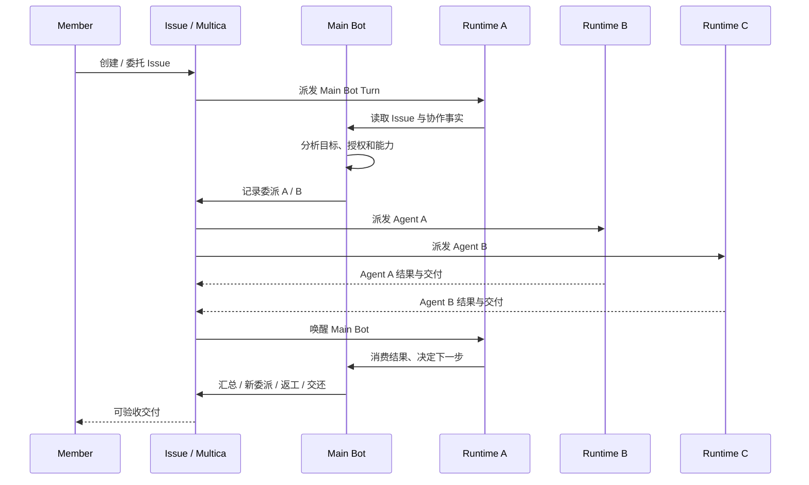

# Main Bot 跨 Runtime 持续协调机制研究

> 研究目标：沿用 Multica 的去中心化执行底座，将现有 Squad Leader Agent 简化改造成 Issue 级 Main Bot；研究其如何跨多个成员本地 Runtime 动态委派、持续推进、恢复状态并汇总交付。  
> 研究边界：本文是架构研究和演进建议，不是已经完成的工程实现，也不引入第二套 Issue、Run 或业务 Task 系统。

## 1. 核心结论

建议采用**一个逻辑 Main Bot、多个独立执行 Agent、多个成员本地 Runtime**的模型。

- Main Bot 是一个 Issue 的主要智能协调者，负责理解目标、规划、委派、选择 SOP、消费结果和交付汇总。
- Main Bot 的一次运行称为 Coordinator Turn。Turn 是短暂执行，不是常驻进程。
- Worker Agent 是实际执行主体，可以分别绑定不同成员的本地 Runtime。
- Issue 是唯一业务归属；Member 保留业务责任、授权和验收权。
- Multica 继续负责 Task / Run 派发、Runtime 领取、Backend 执行、Session 记录和真实回执。
- Main Bot 的长期连续性来自 Issue 上可恢复的协作事实，而不是依赖某一个 CLI Session 的聊天历史。

**持续的是 Issue 协调过程，不是某个 Agent 进程。**

## 2. 最简目标关系

Main Bot 可以委派不同 Agent，而这些 Agent 的 Runtime 可以分别位于不同成员机器。它们不需要加入一个固定 Squad，也不需要由第二个 Leader 转派。

## 3. Multica 现有能力与真实约束

### 3.1 可以直接复用的能力

| Multica 能力 | 当前机制 | Main Bot 的用法 |
|---|---|---|
| Issue 触发 | Issue 指派、评论、状态和工作流入口触发 Agent Task | 将 Main Bot Agent 作为该 Issue 的协调执行主体 |
| Agent 委派 | Issue 评论中的明确 Agent mention、子 Issue 指派 | Main Bot 直接选择获准 Agent，不必经过 Squad Leader |
| 多 Runtime 执行 | 不同 Agent 分别绑定 Runtime；Daemon 按 Runtime 领取任务 | 不同 Worker Agent 可以在不同成员本地 Runtime 并行执行 |
| Run / Task | Task 记录实际 Agent、Runtime、Issue、触发来源和结果 | 每次 Coordinator Turn 和 Worker 执行均有真实执行记录 |
| Session | Task 完成后保存宿主 Session / Workdir 等连续性信息 | 尽可能续接同一 Agent 的宿主会话，但不把 Session 当作协调状态 |
| 评论与时间线 | Issue 评论保留请求、委派、反馈和人工决定 | 作为可审计协作记录和唤醒入口 |
| 失败恢复 | 已有自动重试、委派失败恢复评论、待恢复 outbox | 复用失败恢复和幂等模式，扩展成功交付后的协调唤醒 |
| 权限与归因 | mention 触发检查 Agent 调用权限、项目访问、发起人和 accountable user | Main Bot 只能调用本次授权可用的 Agent 和 Runtime |

关键源码：
- `server/internal/service/task.go`：`EnqueueTaskForIssueWithHandoff`、`EnqueueTaskForSquadLeader`、`enqueueMentionTaskWithCommentPlan`、`recoverDelegatedTaskFailure`
- `server/internal/handler/issue_trigger.go`：`dispatchIssueRun`、`enqueueSquadLeaderTask`
- `server/internal/handler/comment.go`：`computeCommentAgentTriggers`、`resolveMentionedAgentCommentTriggers`、评论触发去重
- `server/internal/handler/daemon.go`：Daemon claim、Leader briefing 注入、Session 恢复
- `server/pkg/db/queries/agent.sql`：`CreateAgentTask`、`ClaimAgentTask`

### 3.2 需要改造的 Squad Leader 约束

现有 `squad_briefing.go` 的 Operating Protocol 强制 Leader：
- 只能从固定 Squad Roster 选择成员；
- 必须委派，不能亲自执行；
- 一次只发一条委派评论；
- 委派后必须结束当前 Turn；
- 必须记录 Squad Activity；
- 只能在 Squad 范围内行动。

Main Bot 应保留“先理解、再决定、持续推进、每轮留下可追溯结果”的纪律，但移除上述固定 Squad 限制：

- 可以直接执行简单工作；
- 可以直接调用任何本次 Issue 授权范围内的 Agent；
- 可以按需使用多个 Runtime；
- 可以建立多个并行委派；
- 可以创建独立子 Issue，但只在需要独立责任、交付或生命周期时；
- 可以选择完整 SOP、局部 SOP 或动态探索；
- 可以在 Worker 完成后被平台重新唤醒；
- 业务范围、权限和预算仍受 Issue Owner 授权约束。

不再把 `is_leader_task` 的语义等同于“必须按 Squad Protocol 委派”。应演进为通用 Main Bot / Coordinator 身份语义；Squad 相关 roster 注入可以作为可选上下文，而非执行前置条件。

## 4. 跨 Runtime 动态委派

### 4.1 目标流程

### 4.2 Agent 选择

Main Bot 根据以下条件选择执行主体：
1. 工作所需能力与 Agent 的 Role / Skills / Rules。
2. Agent 是否在当前 Team / Project / Issue 的调用授权范围内。
3. Agent 是否绑定可用 Runtime，Runtime 是否在线、健康且有剩余容量。
4. 宿主能力是否满足本次任务（文件、命令、工具、模型、共享上下文、取消和回报）。
5. 当前是否已有同一 Issue 的重复执行，或已有可复用的结果。
6. 成本与资源约束是否允许。

Agent 能力目录是候选发现来源，不是自动授权。Main Bot 不能因为能检索到 Agent 就推断有权调用它。

### 4.3 委派方式

- **短步骤 / 同一责任范围：** 在原 Issue 上通过原生 Agent mention 或等价派发入口委派，Worker Run 关联同一 Issue。
- **独立工作：** 只有当工作需要独立负责人、交付契约、状态生命周期或单独接收时，才创建子 Issue 并指派 Agent。
- **并行工作：** 为不同 Agent 创建不同 Run / Task；每个 Agent 使用自己的 Runtime，平台负责每个 Agent 自身的串行约束与 Runtime 容量。
- **避免重复触发：** 同一工作只能选一个派发路径。不要既创建已指派 Agent 的子 Issue，又在父 Issue 评论中再次 mention 同一 Agent 做同一工作。

Main Bot 不直接控制 Runtime 进程。它提交的是有 Issue 归属、执行主体、授权、输入和交付要求的派发请求，实际启动仍由 Multica Daemon / Backend 完成。

## 5. 多轮持续协调：Coordinator Turn 生命周期

Main Bot 不需要常驻循环。每次被唤醒只做一轮有限工作：

1. **Claim：** 取得当前 Issue 的协调执行资格，确认没有另一轮 Main Bot 正在修改同一协调状态。
2. **Reconstruct：** 读取 Issue 当前工作约定、授权、最近协调检查点、活跃与终态 Run、评论、子 Issue、候选和交付。
3. **Decide：** 判断当前状态属于继续规划、等待依赖、消费结果、返工、需要人工决定还是可以交付。
4. **Act：** 直接执行、派发 Agent、调用 SOP、创建必要子 Issue、提出人工决定或交付。
5. **Checkpoint：** 记录本轮采取的动作、派发对象、输入 / 输出契约、等待条件、结果引用和下一次唤醒条件。
6. **Yield：** 当前没有需要立即执行的动作时结束 Turn，等待新的 Issue / Run / 评论 / 交付事件。

Main Bot 不应在等待 Worker 时占用 Runtime，也不应依靠无限轮询维持协调。

### 5.1 同一 Issue 的协调并发

建议同一 Issue 同一时刻最多只有一个有写权限的 Main Bot Coordinator Turn。多个 Worker 可以并行；多个完成事件可以合并为一次唤醒。

Main Bot 每次恢复必须重新读取最新事实，不能把上一轮内存中的计划当作权威状态。若 Issue Owner 已改目标、撤销授权、改变验收要求或接管，旧 Main Bot Turn 只能停止或重新规划。

## 6. 状态持久化与恢复

### 6.1 不能把什么当作 Main Bot 的长期状态

以下内容都不能单独承担 Main Bot 连续性：
- 一个 CLI Session；
- 一台成员电脑；
- 一个 Daemon；
- Main Bot 上一次输出的自然语言总结；
- 某个 Worker 的本地工作目录；
- 仍在运行的进程内存。

### 6.2 应从哪些事实恢复

恢复时以 Issue 为入口，重建以下信息：

| 信息 | 权威来源 |
|---|---|
| 目标、范围、责任、授权、验收 | Issue 工作约定及有效 Decision |
| Main Bot 之前作过什么协调决定 | Issue 评论 / 协作时间线中的可追溯记录 |
| 当前委派了哪些 Agent | 原生 Task / Run 及其触发来源 |
| 哪些工作正在运行、等待或失败 | 原生 Run / Task 状态和回执 |
| Worker 实际交付了什么 | Artifact、Candidate、评论和原生结果 |
| 哪些结果已被 Main Bot 消费 | 有来源引用的消费记录 / Main Bot 检查点 |
| 下一步应该等什么 | 最新协调检查点与当前未完成依赖 |
| 是否需要人决定 | Issue 上明确的 Decision 请求及答复 |

建议首期不创建第二套业务 Task 或复杂 Planner 数据库。沿用 Issue、评论、Task / Run、Artifact、Decision；Main Bot 通过简短结构化检查点记录协调进度。检查点是可重建的协作摘要，不替代原生 Run、交付和决定事实。

检查点至少包含：
- 当前目标和工作约定版本；
- 已完成的阶段 / 结果引用；
- 仍在途的委派及对应 Run；
- 已确认的输入和交付；
- 未解决依赖和等待对象；
- 下一步候选动作；
- 本轮使用的 SOP / Skill / Rule 版本；
- 最近更新时间和协调 Turn 来源。

### 6.3 断连与接续

| 故障 | 应有行为 |
|---|---|
| Worker Runtime 离线 | 该 Worker 的 Run 按原生机制等待、失败或重试；其他 Worker 和 Issue 协作继续 |
| Main Bot Runtime 短暂离线 | 已派发 Worker 继续执行；Main Bot 不需要保持在线，恢复后从 Issue 检查点继续 |
| Main Bot Session 不可恢复 | 新 Session 根据检查点和原始事实重建上下文，不把 Session 恢复失败等同于 Issue 失败 |
| Main Bot 所在机器长期不可用 | Member 可以将 Main Bot Agent 重新绑定到获准 Runtime，或显式交接给替代 Main Bot；以 Issue 检查点恢复，不复制旧 Session |
| Worker 结果迟到 | 归属原 Run / 委派；Main Bot 恢复时判断该结果是否仍适用于当前工作约定和候选 |
| Main Bot 重复唤醒 | 通过 Issue 级协调租约 / 幂等检查点防止重复委派；读取已有任务并合并新事件 |
| Member 接管 | 撤销 Main Bot 后续派发权；在途 Worker 按授权决定继续、暂停或取消，结果仍回到 Issue |

## 7. 交付汇总与结果消费

Main Bot 不应只收集 Worker 的最终文字。每个委派在发出时就需要定义可消费的交付契约：

- 目标和范围；
- 输入资料与版本；
- 预期产物；
- 必须提供的验证证据；
- 结果接收者；
- 是否允许修改共享代码；
- 失败和升级条件。

Main Bot 收到结果后逐项判断：
1. 是否确实有对应 Run / 来源；
2. 必需 Artifact 是否存在、可读取、版本正确；
3. 报告是否对应当前 Issue 和本轮候选；
4. 声称的测试或检查是否有真实证据；
5. 结果之间是否冲突；
6. 是否满足下一步依赖；
7. 是否需要独立验证或 Owner 决定。

Main Bot 可以判断技术交付是否达到工作约定，并提出验收建议；超出授权的业务接受、风险豁免、范围变化和最终完成仍由 Issue 上的有权主体决定。

## 8. 关键架构约束与 Multica 真实缺口

### 8.1 Agent 与 Runtime 的绑定约束

当前 Multica 的 TaskService 在创建 Agent Task 时读取 Agent 的 `RuntimeID`，将其写入 Task；`ClaimAgentTask` 还要求 `agent.runtime_id = task.runtime_id`，并按该 Runtime 领取。

因此：
- 多个 Worker Agent 分别绑定不同 Runtime 并行执行，现有模型支持。
- 单个 Agent 身份不能直接把同一条 Task 任意迁移到多个 Runtime。
- Main Bot 自身当前也有一个绑定 Runtime。

**首期建议：Main Bot Agent 运行在一个指定 Runtime；它直接委派给绑定在其他成员 Runtime 的 Worker Agent。** 这已经实现一个 Main Bot 协调多个本地 Runtime 的工作，而无需先改造 Agent 的 Runtime 绑定模型。

若未来要求 Main Bot 自身也能在多个 Runtime 间透明热切换，再研究逻辑 Agent 身份与 Runtime 执行副本解耦；不应在首期提前引入复杂多活模型。

### 8.2 Worker 成功后唤醒 Main Bot 的缺口

当前 Multica 对 Squad 有专门的 Leader 回唤机制：
- Task 标记 `is_leader_task` 和 `squad_id`；
- Leader 发出的评论由 Worker 回复时，评论路由能依据原 Leader Task / Squad 身份找到 Leader；
- 失败的 delegated Task 还有持久化恢复评论与重放机制。

但普通 Agent 作为 Issue Coordinator 时，Agent-authored comment 不会简单地按 Issue 当前 Assignee fallback 重新触发该 Agent；当前特殊回唤路径依赖 Squad / Leader 事实。

所以 Main Bot 化不能只删 Squad 提示词。必须把“委派结果如何可靠回到原协调者”从 Squad 特例提升为通用委派回执 / Coordinator Wakeup 机制。

建议基于已有 Task lineage 和评论来源：
- 每个委派明确记录来源 Coordinator Turn；
- Worker 成功、失败、取消、阻塞都产生可追溯终态事件；
- 平台为对应 Main Bot 建立一次可幂等合并的唤醒义务；
- 唤醒内容引用原 Run、交付物和状态，不复制整个 Worker 对话；
- 事件丢失时由持久化 outbox / reconciliation 重放；
- Main Bot 只消费属于当前 Issue、当前授权和有效工作轮次的结果。

不要依赖 Worker 自觉 @MainBot 才能完成核心回唤；显式 @mention 可以是协作补充，不应是可靠性基础。

### 8.3 Main Bot Runtime 失效后的接续缺口

Main Bot 的 Agent 身份目前绑定一个 Runtime。把同一个 Agent 的任务投到任意其他 Runtime 并不符合现有 Claim 约束。

首期采取单 Runtime Main Bot + 多 Runtime Workers，恢复时同 Runtime 新 Session 续接；长期失效由 Member 显式重绑或更换协调 Agent，检查点重建上下文。

跨 Runtime 透明故障转移作为后续增强，不把它伪装成现有 Multica 已支持的能力。

### 8.4 Main Bot 的协调权与 Worker 的执行权

- Main Bot 对 Issue 的规划和委派权来自 Issue Owner 的明确授权。
- Worker 只获得委派范围内的执行权，不能自行扩大工作范围。
- Worker 的报告不会自动改变 Issue Owner、验收标准或 Issue 完成状态。
- Main Bot 的 Coordinator Turn 结束不代表 Issue 完成。
- Member 可以随时暂停、撤销授权或接管；在途 Run 的停止和副作用仍需按真实回执处理。

## 9. 推荐演进顺序

### 阶段 A：Squad Leader 轻量 Main Bot 化

- 保留现有 Leader Agent、Issue 触发、Task / Run、Daemon、Backend 和 Session 机制。
- 将系统提示从“必须委派 Squad 成员”改为“先判断工作，再自主选择直接执行、Agent 委派或 SOP”。
- 移除只能选择固定 Squad Roster 的限制；改为查询本次授权范围内可调用 Agent。
- 保留 Issue Owner、accountable user、权限和资源检查。
- 暂时仍使用一个指定 Runtime 承载 Main Bot。

### 阶段 B：通用委派回唤

- 将 Squad Worker → Leader 的成功 / 失败回唤抽象为通用 Coordinator Wakeup。
- 以委派来源和 Task lineage 关联 Worker 结果。
- 增加幂等合并、持久化待唤醒义务和补偿重放。
- 让 Main Bot 在同一 Issue 上接收多 Agent、多 Runtime 的结果。

### 阶段 C：协调状态恢复与交付汇总

- 将协调检查点与 Issue、Run、Artifact、Decision 关联。
- Main Bot 每次唤醒先重建状态，不依赖完整 Session transcript。
- 处理 Main Bot Session 失效、Worker 迟到结果、Issue 改目标、成员接管和重复唤醒。
- 汇总交付契约和证据，交回 Issue Owner。

### 阶段 D：跨 Runtime 的 Main Bot 自身迁移（按需）

- 仅当单一 Main Bot Runtime 的可用性成为实际瓶颈时，再将逻辑 Main Bot 身份与 Agent Runtime 绑定解耦。
- 通过获准的替代 Runtime 运行新的 Coordinator Turn。
- 不迁移或复制旧宿主 Session；通过 Issue 检查点恢复。
- 确保同一 Issue 只有一个 Coordinator Turn 取得有效协调租约。

## 10. 必须验证的场景

| 场景 | 验证目标 |
|---|---|
| Main Bot 在 Runtime A，Worker A / B 分别在 Runtime B / C | 同一 Issue 多 Runtime 并行派发与结果回收 |
| Main Bot 一轮委派两个 Agent 后退出 | 不占用 Main Bot Runtime，Worker 独立执行 |
| 两个 Worker 先后 / 同时完成 | 回唤合并，不丢结果、不重复启动 Main Bot |
| Worker 失败并自动重试 | 中间重试不提前唤醒；最终失败可靠回唤 |
| Worker 成功但回唤投递失败 | outbox / reconciliation 能补发 |
| Main Bot Runtime 中断，Worker 继续 | Issue 与 Worker 进度不丢失 |
| Main Bot Session 不可恢复 | 新 Session 仅凭 Issue 事实和检查点恢复 |
| Main Bot 在旧结果回报前已改变计划 | 迟到结果归属旧委派，不推进新计划 |
| Member 修改目标、撤权或接管 | Main Bot 停止旧授权下的新派发 |
| Agent 无 Runtime、Runtime 离线或无权限 | 明确阻塞原因，不伪装为已派发或成功 |
| 两种派发路径同时误触发 | 幂等与唯一约束避免重复执行 |
| Worker 交付缺少必需制品或证据 | Main Bot 不把文本回复当成合格交付 |

## 11. 本阶段结论

1. Main Bot 是 Issue 级逻辑协调者，不是中心常驻服务。
2. Coordinator Turn 是短生命周期执行；Main Bot 连续性由 Issue 上可恢复的协作事实提供。
3. 一个 Main Bot 可以直接委派多个绑定不同本地 Runtime 的 Worker Agent；不需要 Squad Leader 再次调度。
4. 首期不要求同一个 Main Bot Agent 身份在多个 Runtime 同时运行；Main Bot 可先绑定一个 Runtime，Worker 跨多个 Runtime。
5. Squad Leader 的核心价值是 Issue 触发、持续唤醒、委派和结果回收。将其行为约束改造成 Main Bot 的开放式协调协议即可，不必先建设新调度层。
6. 当前最重要的 Multica 扩展缺口不是 Agent 执行，而是**非 Squad 场景下 Worker 终态如何可靠唤醒原 Main Bot**。
7. 其次是 Main Bot 检查点、幂等协调 Turn 和结果消费。它们应沿 Issue、Task / Run、Comment、Artifact 和 Decision 建立，不复制第二套业务任务系统。
8. Main Bot 自身跨 Runtime 热切换不是首期前提；需要时通过重新绑定 / 替代协调 Agent 和检查点恢复演进。

## 12. 源码依据

### Multica
- [Task Service](https://github.com/multica-ai/multica/blob/main/server/internal/service/task.go)
- [Issue Trigger](https://github.com/multica-ai/multica/blob/main/server/internal/handler/issue_trigger.go)
- [Comment Trigger / Routing](https://github.com/multica-ai/multica/blob/main/server/internal/handler/comment.go)
- [Daemon Claim](https://github.com/multica-ai/multica/blob/main/server/internal/handler/daemon.go)
- [Squad Leader Briefing](https://github.com/multica-ai/multica/blob/main/server/internal/handler/squad_briefing.go)
- [Agent Task Queries](https://github.com/multica-ai/multica/blob/main/server/pkg/db/queries/agent.sql)
- [Agent Types](https://github.com/multica-ai/multica/blob/main/packages/core/types/agent.ts)
- [Squad Types](https://github.com/multica-ai/multica/blob/main/packages/core/types/squad.ts)
