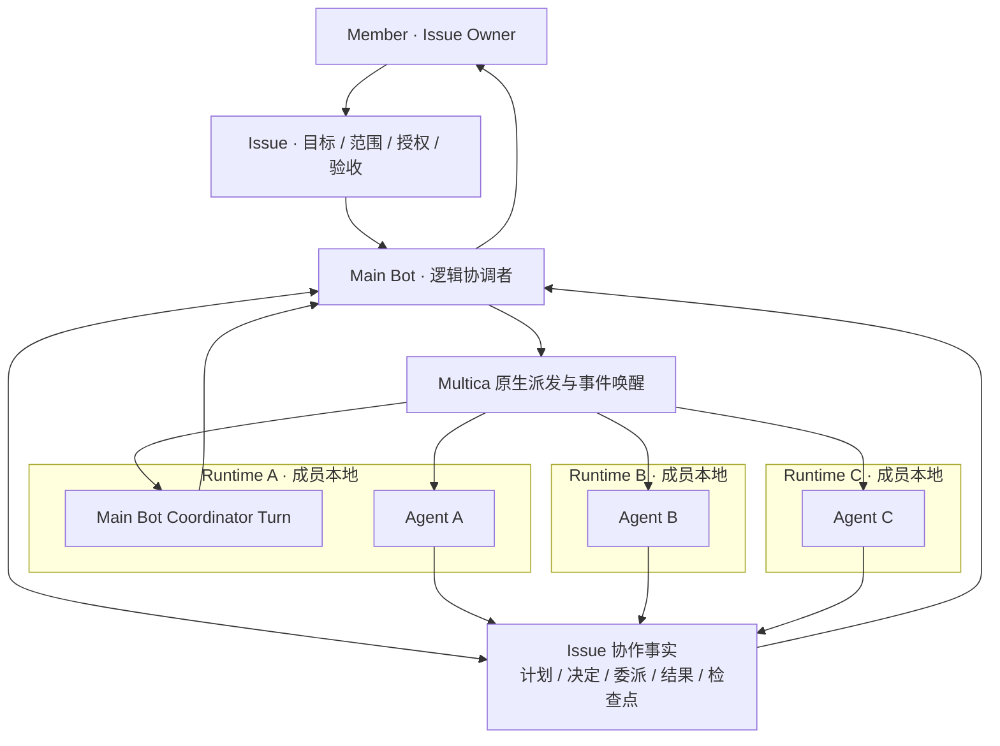
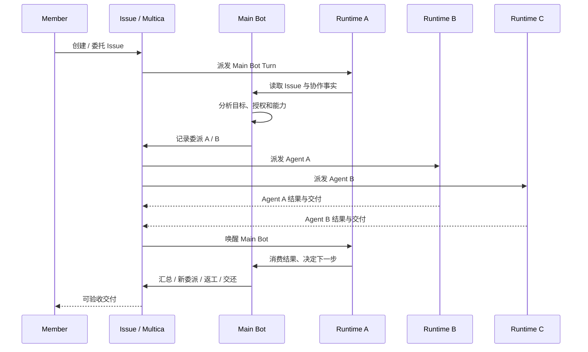

# Main Bot 跨 Runtime 持续协调机制研究

> 本文研究普通 Agent 如何受托协调 Issue、组织分布在不同成员本地 Runtime 的 Worker，并通过 Multica 原生 Issue Wakeup 恢复工作。
> 研究边界：本文是架构研究和演进建议，不是已经完成的工程实现，也不引入第二套 Issue、Run 或业务 Task 系统。

## 1. 核心结论

建议采用**一个逻辑 Main Bot、多个独立执行 Agent、多个成员本地 Runtime**的模型。

- Main Bot 是一个 Issue 的主要智能协调者，负责理解目标、规划、委派、选择 SOP、消费结果和交付汇总。
- Main Bot 的一次运行称为 Coordinator Turn。Turn 是短暂执行，不是常驻进程。
- Worker Agent 是实际执行主体，可以分别绑定不同成员的本地 Runtime。
- Issue 是业务工作的归属。Accountable Member 保留业务责任，验收按工作约定办理。
- Multica 继续负责 Task / Run 派发、Runtime 领取、Backend 执行、Session 记录和真实回执。
- Main Bot 的长期连续性来自 Issue 上可恢复的协作事实，而不是依赖某一个 CLI Session 的聊天历史。

**持续的是 Issue 协调过程，不是某个 Agent 进程。**

## 2. 最简目标关系

Main Bot 可以委派不同 Agent，而这些 Agent 的 Runtime 可以分别位于不同成员机器。它们不需要加入一个固定 Squad，也不需要由第二个 Leader 转派。

## 3. Multica 现有能力与真实约束

### 3.1 可以直接复用的能力

| Multica 能力 | 当前机制 | Main Bot 的用法 |
|---|---|---|
| Issue 触发 | Issue 指派、评论、状态和工作流入口触发 Agent Task | 将 Main Bot Agent 作为该 Issue 的协调执行主体 |
| Agent 委派 | Issue 评论中的明确 Agent mention、子 Issue 指派 | Main Bot 直接选择获准 Agent，不必经过 Squad Leader |
| 多 Runtime 执行 | 不同 Agent 分别绑定 Runtime；Daemon 按 Runtime 领取任务 | 不同 Worker Agent 可以在不同成员本地 Runtime 并行执行 |
| Run / Task | Task 记录实际 Agent、Runtime、Issue、触发来源和结果 | 每次 Coordinator Turn 和 Worker 执行均有真实执行记录 |
| Session | Task 完成后保存宿主 Session / Workdir 等连续性信息 | 尽可能续接同一 Agent 的宿主会话，但不把 Session 当作协调状态 |
| 评论与时间线 | Issue 评论保留请求、委派、反馈和人工决定 | 作为可审计协作记录和唤醒入口 |
| Issue Wakeup | 显式订阅同一 Issue 的 Run 事件，可按实际 Run ID 过滤 | 等待 Worker 的成功、失败或取消，回唤后读取实际结果和后续尝试 |
| 权限与归因 | mention 触发检查 Agent 调用权限、项目访问、发起人和 accountable user | Main Bot 只能调用本次授权可用的 Agent 和 Runtime |

关键源码：
- `server/internal/service/task.go`：`EnqueueTaskForIssueWithHandoff`、`EnqueueTaskForSquadLeader`、`enqueueMentionTaskWithCommentPlan`、`recoverDelegatedTaskFailure`
- `server/internal/handler/issue_trigger.go`：`dispatchIssueRun`、`enqueueSquadLeaderTask`
- `server/internal/handler/comment.go`：`computeCommentAgentTriggers`、`resolveMentionedAgentCommentTriggers`、评论触发去重
- `server/internal/handler/daemon.go`：Daemon claim、Leader briefing 注入、Session 恢复
- `server/pkg/db/queries/agent.sql`：`CreateAgentTask`、`ClaimAgentTask`

### 3.2 两种协调入口

团队将普通 Agent 指派为 Issue 的 Main Bot，并在工作约定中明确协调范围。它可直接执行、委派获准的 Worker，或选择局部 SOP。若团队明确把 Issue 指派给 Squad，则由原生 Leader 在该范围按 Squad 协议协调。两条入口共用 Issue 与 Task / Run。

原生 Leader 通常按 roster 分工，在一条委派评论中可明确提及多个成员，并记录当轮 Squad Activity。普通 Main Bot 使用普通 Agent Run 的权限与指令，`is_leader_task` 保留给实际 Leader Run。

## 4. 跨 Runtime 动态委派

### 4.1 目标流程

### 4.2 Agent 选择

Main Bot 根据以下条件选择执行主体：
1. 工作所需能力与 Agent 的 Role / Skills / Rules。
2. Agent 是否在当前 Team / Project / Issue 的调用授权范围内。
3. Agent 是否绑定可运行的 Runtime。暂时离线或满载会影响何时领取，无绑定或宿主不可用会影响派发。
4. 宿主能力是否满足本次任务（文件、命令、工具、模型、共享上下文、取消和回报）。
5. 当前是否已有同一 Issue 的重复执行，或已有可复用的结果。
6. 成本与资源约束是否允许。

Agent 能力目录是候选发现来源，不是自动授权。Main Bot 不能因为能检索到 Agent 就推断有权调用它。

### 4.3 委派方式

- **短步骤 / 同一责任范围：** 在原 Issue 上通过原生 Agent mention 或等价派发入口委派，Worker Run 关联同一 Issue。
- **独立工作：** 只有当工作需要独立负责人、交付契约、状态生命周期或单独接收时，才创建子 Issue 并指派 Agent。
- **并行工作：** 为不同 Agent 创建不同 Run / Task；每个 Agent 使用自己的 Runtime，平台负责每个 Agent 自身的串行约束与 Runtime 容量。
- **避免重复触发：** 同一工作只能选一个派发路径。不要既创建已指派 Agent 的子 Issue，又在父 Issue 评论中再次 mention 同一 Agent 做同一工作。

Main Bot 不直接控制 Runtime 进程。它提交的是有 Issue 归属、执行主体、授权、输入和交付要求的派发请求，实际启动仍由 Multica Daemon / Backend 完成。

## 5. 多轮持续协调：Coordinator Turn 生命周期

Main Bot 不需要常驻循环。每次被唤醒只做一轮有限工作：

1. **Claim：** 由 Agent 绑定的 Runtime 领取 Task，再核对本轮是否仍处于当前 Issue 的协调委托内。
2. **Reconstruct：** 读取 Issue 当前工作约定、授权、最近协调检查点、活跃与终态 Run、评论、子 Issue、候选和交付。
3. **Decide：** 判断当前状态属于继续规划、等待依赖、消费结果、返工、需要人工决定还是可以交付。
4. **Act：** 直接执行、派发 Agent、调用 SOP、创建必要子 Issue、提出人工决定或交付。
5. **Checkpoint：** 记录本轮采取的动作、派发对象、输入 / 输出契约、等待条件、结果引用和下一次唤醒条件。
6. **Yield：** 当前没有需要立即执行的动作时结束 Turn，等待新的 Issue / Run / 评论 / 交付事件。

Main Bot 不应在等待 Worker 时占用 Runtime，也不应依靠无限轮询维持协调。

### 5.1 同一 Issue 的协调并发

建议同一 Issue 同一时刻最多只有一个有写权限的 Main Bot Coordinator Turn。多个 Worker 可以并行；多个完成事件可以合并为一次唤醒。

Main Bot 每次恢复必须重新读取最新事实，不能把上一轮内存中的计划当作权威状态。若 Issue Owner 已改目标、撤销授权、改变验收要求或接管，旧委托失效后，旧 Turn 停止新增协调写入。在仍有效的委托内，Main Bot 依据新约定调整工作。

## 6. 状态持久化与恢复

### 6.1 不能把什么当作 Main Bot 的长期状态

以下内容都不能单独承担 Main Bot 连续性：
- 一个 CLI Session；
- 一台成员电脑；
- 一个 Daemon；
- Main Bot 上一次输出的自然语言总结；
- 某个 Worker 的本地工作目录；
- 仍在运行的进程内存。

### 6.2 应从哪些事实恢复

恢复时以 Issue 为入口，重建以下信息：

| 信息 | 权威来源 |
|---|---|
| 目标、范围、责任、授权、验收 | Issue 工作约定及有效 Decision |
| Main Bot 之前作过什么协调决定 | Issue 评论 / 协作时间线中的可追溯记录 |
| 当前委派了哪些 Agent | 原委派评论或子 Issue 指派、各目标受理结果、实际覆盖该委派的 Task / Run |
| 哪些工作正在运行、等待或失败 | 原生 Run / Task 状态和回执 |
| Worker 实际交付了什么 | Artifact、Candidate、评论和原生结果 |
| 哪些结果已被 Main Bot 消费 | 有来源引用的消费记录 / Main Bot 检查点 |
| 下一步应该等什么 | 最新协调检查点与当前未完成依赖 |
| 是否需要人决定 | Issue 上明确的 Decision 请求及答复 |

建议首期不创建第二套业务 Task 或复杂 Planner 数据库。沿用 Issue、评论、Task / Run、Artifact、Decision；原始引用足以重建进度时直接读取；需要为接手者整理时，在原 Issue 留下简短摘要。

如需整理检查点，按当前交接需要引用以下信息：
- 当前目标和工作约定版本；
- 已完成的阶段 / 结果引用；
- 仍在途的委派及对应 Run；
- 已确认的输入和交付；
- 未解决依赖和等待对象；
- 下一步候选动作；
- 本轮使用的 SOP / Skill / Rule 版本；
- 最近更新时间和协调 Turn 来源。

### 6.3 断连与接续

| 故障 | 应有行为 |
|---|---|
| Worker Runtime 离线 | 该 Worker 的 Run 按原生机制等待、失败或重试；其他 Worker 和 Issue 协作继续 |
| Main Bot Runtime 短暂离线 | 已派发 Worker 继续执行；Main Bot 不需要保持在线，恢复后从 Issue 检查点继续 |
| Main Bot Session 不可恢复 | 新 Session 根据检查点和原始事实重建上下文，不把 Session 恢复失败等同于 Issue 失败 |
| Main Bot 所在机器长期不可用 | Member 可以将 Main Bot Agent 重新绑定到获准 Runtime，或显式交接给替代 Main Bot；以 Issue 检查点恢复，不复制旧 Session |
| Worker 结果迟到 | 归属原 Run / 委派；Main Bot 恢复时判断该结果是否仍适用于当前工作约定和候选 |
| Main Bot 重复唤醒 | 按原委派、Run 和交付版本核对已处理记录，只对当前仍有效且未处理的结果采取动作 |
| Member 接管 | 撤销 Main Bot 后续派发权；在途 Worker 按授权决定继续、暂停或取消，结果仍回到 Issue |

## 7. 交付汇总与结果消费

Main Bot 不应只收集 Worker 的最终文字。每个委派在发出时就需要定义可消费的交付契约：

- 目标和范围；
- 输入资料与版本；
- 预期产物；
- 必须提供的验证证据；
- 结果接收者；
- 是否允许修改共享代码；
- 失败和升级条件。

Main Bot 收到结果后逐项判断：
1. 是否确实有对应 Run / 来源；
2. 必需 Artifact 是否存在、可读取、版本正确；
3. 报告是否对应当前 Issue 和本轮候选；
4. 声称的测试或检查是否有真实证据；
5. 结果之间是否冲突；
6. 是否满足下一步依赖；
7. 是否需要独立验证或 Owner 决定。

Main Bot 可以判断技术交付是否达到工作约定，并提出验收建议；超出授权的业务接受、风险豁免、范围变化和最终完成仍由 Issue 上的有权主体决定。

## 8. 跨 Runtime 的协调边界

### 8.1 Agent 与 Runtime 的绑定约束

当前 Multica 的 TaskService 在创建 Agent Task 时读取 Agent 的 `RuntimeID`，将其写入 Task；`ClaimAgentTask` 还要求 `agent.runtime_id = task.runtime_id`，并按该 Runtime 领取。

因此：
- 多个 Worker Agent 分别绑定不同 Runtime 并行执行，现有模型支持。
- 单个 Agent 身份不能直接把同一条 Task 任意迁移到多个 Runtime。
- Main Bot 自身当前也有一个绑定 Runtime。

**首期建议：Main Bot Agent 运行在一个指定 Runtime；它直接委派给绑定在其他成员 Runtime 的 Worker Agent。** 这已经实现一个 Main Bot 协调多个本地 Runtime 的工作，而无需先改造 Agent 的 Runtime 绑定模型。

若未来要求 Main Bot 自身也能在多个 Runtime 间透明热切换，再研究逻辑 Agent 身份与 Runtime 执行副本解耦；不应在首期提前引入复杂多活模型。

### 8.2 Worker 结果回到原 Issue

普通 Main Bot 可以在原 Issue 用结构化 mention 委派获准 Worker。逐目标检查受理结果。评论可能并入已有任务或延后处理，因此要从 Issue 的 Run 列表核对谁实际覆盖了该评论。获得 Run ID 后，在该 Issue 上显式订阅 `task.completed`、`task.failed`、`task.cancelled`。注册会同时检查该 Run 的当前终态。普通 Agent 的无提及回复不走成员 Assignee 的隐式路由。Squad 的 Leader 回复路径单独适用。

回唤可能合并多条输入，也可能并入符合条件的待领 Run。Main Bot 从未结委派、原 Run 及其后继、候选和交付记录恢复，逐项核实结果。具体的注册竞态、回执保留、子 Issue 条件和授权边界见[生命周期与持续推进研究](mainbot-lifecycle-and-progress.md)。

### 8.3 Main Bot Runtime 长期失效后的接续

Main Bot 的 Agent 身份目前绑定一个 Runtime。把同一个 Agent 的任务投到任意其他 Runtime 并不符合现有 Claim 约束。

首期采取单 Runtime Main Bot + 多 Runtime Workers，恢复时同 Runtime 新 Session 续接；长期失效由 Member 显式重绑或更换协调 Agent，检查点重建上下文。

跨 Runtime 透明故障转移作为后续增强，不把它伪装成现有 Multica 已支持的能力。

### 8.4 Main Bot 的协调权与 Worker 的执行权

- Main Bot 对 Issue 的规划和委派权来自 Issue Owner 的明确授权。
- Worker 只获得委派范围内的执行权，不能自行扩大工作范围。
- Worker 的报告不会自动改变 Issue Owner、验收标准或 Issue 完成状态。
- Main Bot 的 Coordinator Turn 结束不代表 Issue 完成。
- Member 可以随时暂停、撤销授权或接管；在途 Run 的停止和副作用仍需按真实回执处理。

## 9. 与整体设计的衔接

普通 Agent 的持续委托、可选 Squad Leader、Worker Run 和交付消费接入同一套对象关系。Issue 上记录当前授权及其范围，派发交给原生 Task / Run 与 Runtime。会改变后续工作的动作按当前授权与交付版本复核。具体次序见[生命周期与持续推进研究](mainbot-lifecycle-and-progress.md)。

## 10. 必须验证的场景

| 场景 | 验证目标 |
|---|---|
| Main Bot 在 Runtime A，Worker A / B 分别在 Runtime B / C | 同一 Issue 多 Runtime 并行派发与结果回收 |
| Main Bot 一轮委派两个 Agent 后退出 | 不占用 Main Bot Runtime，Worker 独立执行 |
| 两个 Worker 先后 / 同时完成 | 无论产生一轮或多轮回唤，均按两项未结委派独立核对，重复通知不重复采用结果 |
| Worker 失败并自动重试 | 原 Run 的失败可以先唤回。核对后继尝试，并对仍待处理的新 Run 重新建立等待 |
| Worker 先于订阅完成，或分发暂时失败 | 指定 Run 的终态检查覆盖注册竞态，待派发回执可重试；再次恢复从原 Issue 的未结委派核对 |
| Main Bot Runtime 中断，Worker 继续 | Issue 与 Worker 进度不丢失 |
| Main Bot Session 不可恢复 | 新 Session 仅凭 Issue 事实和检查点恢复 |
| Main Bot 在旧结果回报前已改变计划 | 迟到结果归属旧委派，不推进新计划 |
| Member 修改目标、撤权或接管 | Main Bot 停止旧授权下的新派发 |
| Agent 无 Runtime、Runtime 离线或无权限 | 明确阻塞原因，不伪装为已派发或成功 |
| 两种派发路径同时误触发 | 确认哪些 Run 已受理或执行，按原委派处理重复交付，防止再次派发 |
| Worker 交付缺少必需制品或证据 | Main Bot 不把文本回复当成合格交付 |

## 11. 设计结论

跨 Runtime 协作由一个受托协调 Agent 和若干各自绑定 Runtime 的 Worker 完成。Coordinator Turn 结束释放 Runtime，后续由原生 Issue Wakeup 带回相关事实。Issue 的委托与交付记录支持协调者在新 Session 恢复、在交接后隔离旧结果，并向约定的接收者交付。

## 12. 源码依据

### Multica
- [Task Service](https://github.com/multica-ai/multica/blob/fdfbfcd5e5d30c135255e63ab9af4c52672b7bbc/server/internal/service/task.go)
- [Issue Trigger](https://github.com/multica-ai/multica/blob/fdfbfcd5e5d30c135255e63ab9af4c52672b7bbc/server/internal/handler/issue_trigger.go)
- [Comment Trigger / Routing](https://github.com/multica-ai/multica/blob/fdfbfcd5e5d30c135255e63ab9af4c52672b7bbc/server/internal/handler/comment.go)
- [Daemon Claim](https://github.com/multica-ai/multica/blob/fdfbfcd5e5d30c135255e63ab9af4c52672b7bbc/server/internal/handler/daemon.go)
- [Squad Leader Briefing](https://github.com/multica-ai/multica/blob/fdfbfcd5e5d30c135255e63ab9af4c52672b7bbc/server/internal/handler/squad_briefing.go)
- [Agent Task Queries](https://github.com/multica-ai/multica/blob/fdfbfcd5e5d30c135255e63ab9af4c52672b7bbc/server/pkg/db/queries/agent.sql)
- [Agent Types](https://github.com/multica-ai/multica/blob/fdfbfcd5e5d30c135255e63ab9af4c52672b7bbc/packages/core/types/agent.ts)
- [Squad Types](https://github.com/multica-ai/multica/blob/fdfbfcd5e5d30c135255e63ab9af4c52672b7bbc/packages/core/types/squad.ts)
- [Issue Wakeup 工程说明](https://github.com/multica-ai/multica/blob/fdfbfcd5e5d30c135255e63ab9af4c52672b7bbc/docs/engineering/issue-wakeups.md#L99-L134)
- [同 Issue Run 的注册终态检查](https://github.com/multica-ai/multica/blob/fdfbfcd5e5d30c135255e63ab9af4c52672b7bbc/server/internal/service/issue_wakeup.go#L600-L625)
